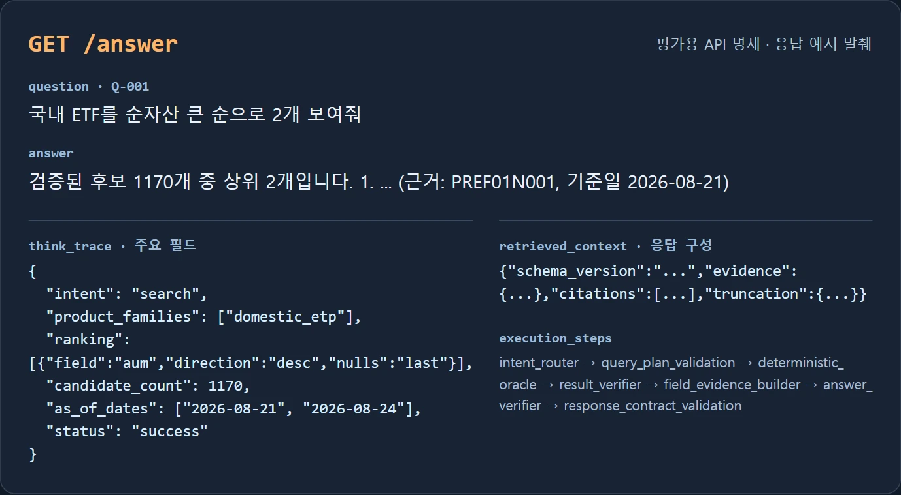
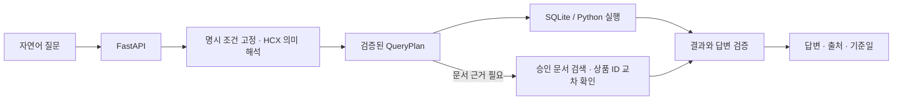

<h1> 금융상품 AI Agent · gaeng3</h1>

**자연어로 금융상품을 조회·비교하고, 결과에 공식 데이터의 기준일과 근거를 붙이는 검색 Agent**

## Overview

미래에셋증권 AI Festival 제출 프로젝트입니다. 국내채권, 국내·해외 ETF·ETN, 공모펀드를 대상으로 조건 검색, 상품 비교, 집계를 제공합니다. HyperCLOVA X는 질문의 의미를 해석하고, 서버는 실행할 조건과 결과 상품·수치·출처를 확정합니다.

## Features & Demo

| 사용자 흐름 | 구현 |
| --- | --- |
| 상품 찾기 | 상품군·코드·수치·기간 조건을 반영해 검색하고, 결과를 지정한 기준으로 정렬합니다. |
| 비교·집계 | 상품별 지표를 비교하고 개수·평균·최솟값·최댓값 등을 계산합니다. |
| 근거 확인 | 공식 상품 데이터의 기준일을 제공합니다. 구성종목·테마 이력 등의 질의에는 승인 문서에서 관련 구간을 찾아 출처와 함께 반환합니다. |
| 모호한 질문 처리 | 해석에 필요한 조건을 되묻고, 근거 부족과 조건에 맞는 상품 없음은 서로 다른 결과로 처리합니다. |

### Demo



**국내 ETF 순자산 순위 검색** — 제출 당시 [평가용 API 명세의 응답 예시](docs/평가용_API_서버_정보.md#34-응답-예시)를 발췌했습니다. 질의, 답변, 데이터 기준일과 실행 단계가 응답에 어떻게 담기는지 보여줍니다.

### 핵심 구현

1. **명시 조건을 고정한 뒤 질문의 나머지 표현을 해석합니다.** 상품 코드·수치·기간·정렬 방향을 먼저 고정합니다. 모델이 제안한 의도와 의미를 원문 및 지원 필드에 대조해 타입이 정해진 `QueryPlan`을 구성합니다. KURE-v1의 스키마 검색은 조건을 충족한 미해결 표현에 적용합니다. [의미 검증](src/finance_agent/packages/finance_agent_core/src/finance_agent_core/agent/semantic_gate.py) · [QueryPlan](src/finance_agent/packages/finance_agent_core/src/finance_agent_core/contracts/queryplan.py)
2. **검색과 답변이 동일한 상품·수치·근거를 유지하도록 검증합니다.** SQLite 실행 결과를 독립 검증기가 점검합니다. 문서 검색 결과도 공식 DB의 상품 ID와 교차 확인합니다. 서버가 확정한 답변 본문을 해시로 고정하고, LLM은 검증된 도입 문구나 역질문만 덧붙일 수 있습니다. [실행기](src/finance_agent/packages/finance_agent_core/src/finance_agent_core/execution/oracle.py) · [결과 검증기](src/finance_agent/packages/finance_agent_core/src/finance_agent_core/execution/verifier.py) · [최종 답변](src/finance_agent/packages/finance_agent_core/src/finance_agent_core/answering/final_generation.py)
3. **평가 환경을 재현할 수 있게 입력과 실행물을 묶습니다.** 코드, 데이터, 모델, 색인, 문서를 SHA-256 매니페스트로 결속하고 검증에 실패하면 릴리스 실행을 차단합니다. [릴리스 검증](src/fastapi_backend/scripts/release_trust.py) · [데이터·재현 부록](docs/기술_제안서_부록.md)

## Tech Stack

| 영역 | 기술과 코드 위치 |
| --- | --- |
| HTTP API·배포 | FastAPI, Pydantic, Docker Compose · [src/fastapi_backend](src/fastapi_backend/) |
| Agent·실행 | Python 3.12, HyperCLOVA X HCX-007, SQLite · [src/finance_agent](src/finance_agent/) |
| 검색·데이터 | KURE-v1, BM25, SQLite FTS, RDF/Turtle · [승인 문서 묶음](src/finance_agent/artifacts/approved-corpus/) · [ontology](ontology/) |

### 아키텍처



## How to Run

Ubuntu 22.04/24.04 x86_64, Docker Engine 24 이상, Docker Compose v2와 주최 측 원천 XLSX 8개가 필요합니다. 원천 XLSX와 생성 DB는 별도로 준비합니다. 기본 개발 구성은 SQLite/Python 검색을 사용합니다.

```bash
git clone https://github.com/Hyunhoim/gaeng3.git
cd gaeng3
cp src/fastapi_backend/.env.example src/fastapi_backend/.env
# .env의 FINANCE_RAW_DATA_DIR에 원천 XLSX 디렉터리를 지정합니다.
./compose.sh up --detach --wait
curl --fail http://127.0.0.1:18001/health
curl --get http://127.0.0.1:18001/answer \
  --data-urlencode 'question_id=Q-001' \
  --data-urlencode 'question=판매 가능한 원화채권 중 AA- 이상 종목 알려줘'
```

`GET /answer`는 `question_id`와 `question`을 받고 `retrieved_context`, `think_trace`, `answer`와 함께 돌려줍니다. 평가 구성은 별도의 CLOVA Studio 키 파일과 지정 리비전의 KURE-v1 모델 캐시가 필요합니다. [API 명세](docs/평가용_API_서버_정보.md) · [평가 구성 재현](src/fastapi_backend/README.md#62-평가-구성-실행)

## Appendix

### 미래에셋증권 AI Festival 제출 · 팀 내부 검증

기술제안서 3.6절의 팀 내부 QA 기록입니다. Outcome Exact는 처리 상태와 결과 상품 집합의 일치율이고, 상품 micro F1은 전체 문항의 상품 단위 정밀도·재현율을 합산한 지표입니다.

| 검증 구간 | 문항 수 | Outcome Exact | 상품 micro F1 |
| --- | ---: | ---: | ---: |
| Phase 3 최초 블라인드 | 600 | 59.17% | 72.84% |
| Phase 3 동일 세트 회귀 | 600 | 87.17% | 90.23% |
| Phase 4 최초 블라인드 | 1,000 | 14.80% | 11.44% |
| Phase 4 동일 세트 회귀 | 1,000 | 89.38% | 86.20% |
| Phase 5 최초 블라인드 | 105 | 78.29% | 77.14% |
| Phase 6 최초 블라인드 | 150 | 95.33% | 90.78% |

Phase마다 문항 구성과 난도가 다릅니다. 동일 세트 회귀는 정답을 공개한 뒤 수정 사항을 점검한 기록입니다. 인용한 수치는 팀 내부 검증 결과이며 대회 공식 성적은 별도입니다.

### 데이터 범위

공식 상품 데이터는 **2026-08-24 배포본**이며, 외부 근거는 12개 발행 주체의 승인 문서 258건으로 한정됩니다. 검색·비교·집계 범위는 배포 데이터와 승인 문서가 뒷받침하는 항목까지입니다.

[제출 원본 커밋](https://github.com/Hyunhoim/gaeng3/tree/065f179e3d2f54e5f991b6ed5dabd47262b36b96) · [Agent 개발 문서](src/finance_agent/README.md) · [기술제안서 PDF](docs/기술_제안서.pdf) · [데이터·재현 부록](docs/기술_제안서_부록.md) · [외부 구성요소 고지](THIRD_PARTY_NOTICES.md)
