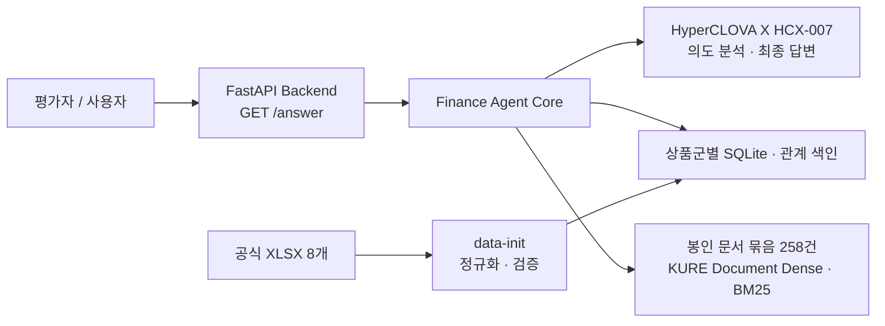

# 금융상품 Agent (팀 갱갱갱)

제10회 2026 미래에셋증권 AI Festival — 금융상품 Agent 과제 제출물

자연어 질문을 받아 주최 측 제공 데이터(국내채권, 국내·해외 ETF·ETN, 공모펀드)에서 상품을
조회·비교·집계하고 근거와 기준일을 함께 답한다. 상품명·수치·순위·출처는 SQLite와 Python 검증기가
확정하고, HyperCLOVA X(HCX-007)는 질문 의도 해석과 검증된 결과의 문장화만 담당한다. 구성종목·
자회사·테마·위험요인 같은 외부 근거는 검토·승인해 봉인한 공식 문서 258건(12개 발행기관)에서만
찾는다. 데이터로 확인할 수 없는 질문에는 추측하지 않고 확인 불가를 안내하거나 되묻는다.

## 제출물

| 항목 | 위치 |
| --- | --- |
| 소스코드 | `src/`, `requirements.txt`, 이 README |
| Ontology | [`ontology/`](ontology/) — `common.ttl` `bond_kr.ttl` `etf_kr.ttl` `etf_gl.ttl` `fund_pub.ttl` |
| 기술 제안서 | [`docs/기술_제안서.pdf`](docs/기술_제안서.pdf) · [부록: 수집·적재 Flow, 활용 로직, 재현 절차](docs/기술_제안서_부록.md) |
| 평가용 API | `GET http://101.79.25.57/answer` · [API 명세서](docs/평가용_API_서버_정보.md) |

## 평가용 API

```bash
curl --get "http://101.79.25.57/answer" \
  --data-urlencode "question_id=Q-001" \
  --data-urlencode "question=현재 판매 가능한 원화채권 중 AA- 이상 종목 알려줘"
```

인증 없음, 순차 1건 호출. 응답은 `question_id` · `question` · `retrieved_context` · `think_trace` ·
`answer` 다섯 문자열 필드이며, 답할 수 없는 질문도 같은 스키마와 HTTP 200으로 돌아온다.
상태 확인은 `GET http://101.79.25.57/health`.

## 동작 구조



질문 → 안전 검사 → HCX-007 의도 분석(Semantic Frame) + 어휘 규칙으로 조건 잠금 → 남은 표현만
KURE-v1 Schema Dense로 필드 연결 → 서버가 Typed QueryPlan 확정 → SQLite 실행과 Python 재검산 →
(필요 시) 봉인 문서 묶음에서 근거 검색 후 제공 DB 상품과 교집합 → HCX-007 문장 생성 → Answer
Verifier 재검사. 각 단계의 계약과 파일 위치는 [Agent README](src/finance_agent/README.md)와
[Backend README](src/fastapi_backend/README.md)에 있다.

## 실행

Docker Engine 24 이상, Docker Compose v2, 주최 측 XLSX 디렉터리(`2.금융상품_20260824`)가 필요하다.

```bash
cp src/fastapi_backend/.env.example src/fastapi_backend/.env   # FINANCE_RAW_DATA_DIR 를 XLSX 경로로
./compose.sh up --detach --wait
curl --fail http://127.0.0.1:18001/health
```

한 명령으로 이미지 빌드 → XLSX 정규화·검증 → 상품군별 SQLite·관계 색인 생성 → Backend 시작까지
수행한다. 이 기본 실행은 HCLX 자격증명 없이 결정론적 경로만으로 동작한다. 종료는
`./compose.sh down`. Docker 없이 실행하려면 Python 3.12에서 `pip install -r requirements.txt`
뒤 [Agent README](src/finance_agent/README.md)를 따른다.

평가 구성(HCX-007 + 승인 문서 묶음)으로 실행하려면 `src/fastapi_backend/scripts/manual-release.sh`를 쓴다. 이미지 빌드 → 데이터 준비 →
릴리스 봉인(코드·DB·색인·문서 묶음의 SHA-256 결속) → 컨테이너 기동 → 확인 순서이며, 봉인 값과
실제 파일이 다르면 시작하지 않는다. 절차와 환경변수는 [Backend README](src/fastapi_backend/README.md).

## 재현용 외부 자료

평가 구성의 외부 근거 검색을 재현하기 위한 자료다. 원천 XLSX 8개는 주최 측 배포본을 그대로 쓴다.

| 자료 | 내용 | 위치 |
| --- | --- | --- |
| 승인 문서 묶음 | 12개 발행기관 공식 문서 258건의 정규화 텍스트(`corpus-root/snapshots/`), 문서 매니페스트(문서별 출처 URL·발행일·SHA-256), KURE Document Dense 색인, 활성화 영수증, 관계 파일 | `src/finance_agent/artifacts/approved-corpus/` (97 MB, 저장소 포함) |
| KURE-v1 임베딩 모델 | `nlpai-lab/KURE-v1` revision `d14c8a9423946e268a0c9952fecf3a7aabd73bd9` (Hugging Face 공개 모델, 약 2.2 GB) | `huggingface-cli download nlpai-lab/KURE-v1 --revision d14c8a9423946e268a0c9952fecf3a7aabd73bd9 --cache-dir /path/to/kure-cache` |

문서 원문(HTML·PDF)은 저장하지 않으며, 매니페스트 `approved-corpus-manifest.json`의 `source_uri`·`published_at`·`content_sha256`로
출처와 무결성을 확인한다. `manual-release.sh`에는 다음 경로를 넘긴다(`C`는 `src/finance_agent/artifacts/approved-corpus`).

```bash
APPROVED_CORPUS_MANIFEST=$C/runtime/approved-corpus-manifest.json
APPROVED_CORPUS_ROOT=$C/corpus-root
APPROVED_DOCUMENT_DENSE=$C/runtime/release-bundle/document-dense.json
DOCUMENT_CACHE_ACTIVATION=$C/runtime/release-bundle/document-cache-activation.json
APPROVED_TEMPORAL_RELATIONS=$C/runtime/release-bundle/temporal-relations.json
KURE_CACHE_DIR=/path/to/kure-cache
```

모든 파일은 SHA-256으로 릴리스에 결속되므로 내용이 다르면 서버가 시작하지 않는다.

## 저장소 구조

```text
.
├── README.md
├── requirements.txt
├── ontology/              # 도메인별 Ontology (.ttl)
├── docs/                  # 기술 제안서 · 부록 · API 명세서
├── src/finance_agent/     # Agent Core
├── src/fastapi_backend/   # API 서버 · 배포
├── docker-compose.yml · compose.sh · compose-release.sh
└── THIRD_PARTY_NOTICES.md
```

## Ontology

`ontology/`의 Turtle 5개(`common.ttl`, `bond_kr.ttl`, `etf_kr.ttl`, `etf_gl.ttl`, `fund_pub.ttl`)는
Agent가 질문 해석에 쓰는 field registry에서 생성한다. `common.ttl`이 공통 상위 클래스와 공통 속성을,
상품군별 파일이 하위 클래스와 전용 속성을 정의한다.
