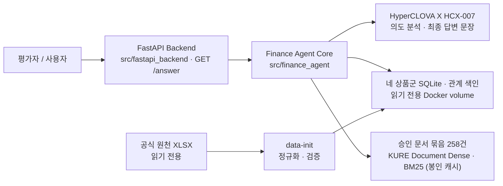

# 금융상품 Agent (팀 갱갱갱)

제10회 2026 미래에셋증권 AI Festival — 금융상품 Agent 과제 제출물

자연어 질문을 받아 주최 측 제공 데이터(국내채권, 국내·해외 ETF·ETN, 공모펀드)에서 상품을
조회·비교·집계하고, 근거와 기준일을 함께 제시하는 Agent다. 상품명·수치·순위·출처는 SQLite와
Python 검증기가 확정하고, HyperCLOVA X(HCX-007)는 질문 의도 해석과 검증된 결과의 문장화만
담당한다. 데이터로 확인할 수 없는 질문에는 추측하지 않고 확인 불가를 안내하거나 되묻는다.

## 1. 제출물

| 제출 항목 | 위치 |
| --- | --- |
| 소스코드 | `src/`, `requirements.txt`, 이 README |
| 도메인별 Ontology | [`ontology/`](ontology/) — `common.ttl` `bond_kr.ttl` `etf_kr.ttl` `etf_gl.ttl` `fund_pub.ttl` |
| 기술 제안서 | [`docs/technical-proposal.pdf`](docs/technical-proposal.pdf) · 부록 [데이터 수집·적재 Flow·활용 로직·검증·재현 절차](docs/technical-proposal-appendix.md) |
| 평가용 API 서버 정보 | 아래 §2 · [API 명세서](docs/api-specification.md) |

## 2. 평가용 API

| 항목 | 값 |
| --- | --- |
| End-point | `GET http://101.79.25.57/answer?question_id={문항 ID}&question={질문}` |
| 상태 확인 | `GET http://101.79.25.57/health` |
| 인증 | 없음. 순차 1건 호출, 요청당 270초 내부 timeout |
| 응답 | `question_id` · `question` · `retrieved_context` · `think_trace` · `answer` 다섯 문자열 필드. 답할 수 없는 질문도 같은 스키마와 HTTP 200 |
| LLM | 질문 의도 분석과 최종 답변 생성 모두 NCP HyperCLOVA X `HCX-007` |
| 외부 근거 | 2026-08-24 이전 발행 공식 문서 258건(12개 발행기관)을 검토·승인해 봉인한 문서 묶음만 조회. 실시간 웹 검색은 사용하지 않는다 |

```bash
curl --get "http://101.79.25.57/answer" \
  --data-urlencode "question_id=Q-001" \
  --data-urlencode "question=현재 판매 가능한 원화채권 중 AA- 이상 종목 알려줘"
```

## 3. 동작 개요



1. **안전 검사** — 비금융·주문·예측·개인정보·데이터 범위 밖 요청은 HCLX 호출 전에 거부한다
2. **의도 분석** — HCX-007이 질문 종류(검색·상세·비교·집계·관계)와 상품군, 의미 구조(Semantic Frame)를 제안한다. 명시적 조건(등급·기간·정렬·개수)은 어휘 규칙이 먼저 잠근다
3. **필드 의미 연결** — 남은 표현만 KURE-v1 Schema Dense(필드 155개 벡터)로 field registry의 필드에 연결한다
4. **Typed QueryPlan** — 서버가 필드·조건·정렬·개수를 registry에 대해 검증한다. LLM은 이 값을 바꿀 수 없다
5. **SQLite 실행 + 검증** — 검색·정렬·비교·집계를 SQL로 실행하고 Python 검증기가 같은 규칙으로 재계산해 대조한다
6. **외부 근거** — 구성종목·자회사·테마·펀드 전략·위험요인은 봉인된 문서 묶음에서 KURE Document Dense + BM25로 찾아 제공 DB 상품과 교집합을 확인한다
7. **최종 답변** — HCX-007이 검증된 근거만 입력받아 문장을 만들고, Answer Verifier가 상품명·수치를 재검사한다

## 4. 저장소 구조

```text
.
├── README.md
├── requirements.txt              # 실행 의존성 (고정 버전)
├── requirements-dev.txt          # 테스트 · 온톨로지 검사 의존성
├── ontology/                     # 제출용 Turtle 5개 (field registry에서 생성)
├── docs/
│   ├── technical-proposal.pdf    # 기술 제안서
│   ├── technical-proposal-appendix.md
│   └── api-specification.md      # 평가용 API 명세서
├── src/
│   ├── finance_agent/            # Agent Core — 질의 해석 · 검색 · 검증 · 근거 · 답변
│   │   ├── packages/finance_agent_core/   # Python 패키지 + 테스트
│   │   ├── requirements/                  # 고정 버전 constraints
│   │   ├── scripts/sync-ontology.py       # registry → Turtle 생성 · 검사
│   │   └── artifacts/runtime/schema-dense/ # KURE 필드 의미 색인 v9
│   └── fastapi_backend/          # FastAPI 서버 · Dockerfile · 배포 스크립트 + 테스트
├── docker-compose.yml            # data-init + backend
├── compose.sh                    # 한 명령 실행 진입점
├── compose-release.sh            # 봉인 릴리스를 Compose로 기동하는 대안 경로
└── THIRD_PARTY_NOTICES.md
```

## 5. 실행 (Docker)

요구 사항: Docker Engine 24 이상, Docker Compose v2, 주최 측 제공 XLSX 디렉터리(`2.금융상품_20260824`).

```bash
cp src/fastapi_backend/.env.example src/fastapi_backend/.env
# .env 의 FINANCE_RAW_DATA_DIR 를 XLSX 디렉터리 경로로 바꾼다
./compose.sh up --detach --wait
```

이미지 빌드 → XLSX 정규화·검증 → 상품군별 SQLite·관계 색인 생성(전용 volume) → Backend 시작까지
한 명령으로 수행한다. 원본 XLSX는 읽기 전용으로 연결되며 수정하지 않는다.

```bash
curl --fail http://127.0.0.1:18001/health
curl --get --fail-with-body \
  --data-urlencode 'question_id=Q-001' \
  --data-urlencode 'question=현재 판매 가능한 원화채권 중 AA- 이상 종목 알려줘' \
  http://127.0.0.1:18001/answer
```

`/health`에 `ready_product_families`가 네 상품군, `relation_retrieval_status=ready`이면 정상이다.
OpenAPI 화면은 `http://127.0.0.1:18001/docs`. 종료는 `./compose.sh down`(생성 DB 보존) 또는
`./compose.sh down --volumes`. 포트 충돌 시 `.env`의 `BACKEND_PORT`를 바꾼다.

이 기본 실행(`APP_ENV=development`)은 HCLX 자격증명 없이 결정론적 경로만으로 동작하므로
데이터·검색·검증 로직을 credential 없이 재현할 수 있다.

## 6. 평가 서버 배포

평가 서버(`101.79.25.57`)는 `src/fastapi_backend/scripts/manual-release.sh`로 서버 한 대에서 배포한다.
이미지 빌드(`adaptive-runtime`) → XLSX 정규화·검증 → 릴리스 봉인(코드·DB·색인·문서 묶음·활성화
영수증의 SHA-256을 AgentReleaseManifest와 DeploymentBinding에 결속) → 컨테이너 기동 → `/health`·
`/answer` 확인 순서다. 봉인 값과 실제 파일이 하나라도 다르면 컨테이너는 시작하지 않는다.

```bash
RAW_DATA_DIR=/path/to/2.금융상품_20260824 SECRETS_DIR=~/.secrets/finance-agent \
BIND_ADDRESS=0.0.0.0 PORT=80 EXTERNAL_MODE=approved_corpus_cache_only ADAPTIVE=true \
KURE_CACHE_DIR=/path/to/kure-cache \
APPROVED_CORPUS_MANIFEST=... APPROVED_CORPUS_ROOT=... APPROVED_DOCUMENT_DENSE=... \
DOCUMENT_CACHE_ACTIVATION=... APPROVED_TEMPORAL_RELATIONS=... \
  src/fastapi_backend/scripts/manual-release.sh all
```

CLOVA Studio API 키는 환경변수가 아니라 읽기 전용 host 파일(`SECRETS_DIR/clovastudio-api-key`)로
전달한다. 승인 문서 묶음(원문·매니페스트·KURE Document Dense 색인·활성화 영수증)과 KURE-v1 모델
캐시는 Git에 포함하지 않고 배포 시 읽기 전용으로 마운트한다. 설정 항목은
[`.env.release.example`](src/fastapi_backend/.env.release.example)과
[Backend README](src/fastapi_backend/README.md)에 있다.

## 7. 실행 (Docker 없이)

Python 3.12 기준.

```bash
python -m venv .venv && source .venv/bin/activate
python -m pip install -r requirements.txt
```

KURE 의미 검색까지 켜려면 `src/fastapi_backend/requirements.embedding.txt`(torch CPU·sentence-transformers)를
추가 설치한다. 네 상품군 SQLite 생성과 Backend 단독 실행은 [Agent README](src/finance_agent/README.md)와
[Backend README](src/fastapi_backend/README.md)를 따른다.

## 8. 검증

```bash
python -m pip install -r requirements-dev.txt

# Agent Core
( cd src/finance_agent/packages/finance_agent_core && python -m pytest -q )

# Backend (테스트가 파일 권한을 검사하므로 umask 022로 실행)
umask 022
PYTHONPATH=src/fastapi_backend:src python -m pytest -q src/fastapi_backend/tests

# Ontology가 field registry와 일치하는지
python src/finance_agent/scripts/sync-ontology.py --check
```

| 검증 | 결과 (2026-09-06, 제출 트리) |
| --- | --- |
| Agent Core pytest | 4,039 passed · 12 skipped |
| Backend pytest | 408 passed |
| `sync-ontology.py --check` | Turtle 5개가 `field_registry.yaml`과 일치 |
| Docker 빌드 · 릴리스 봉인 · `GET /health` · 공식 예시 8문항 | 예시 1·2·3·5 근거 포함 답변, 답변 불가 3문항 거부, 예시 4는 문서 묶음 범위 밖으로 확인 불가 |

테스트는 원천 데이터·네트워크·LLM 자격증명 없이 실행된다. skip은 선택적 로컬 키나 승인 DB 경로를
요구하는 opt-in 테스트다.

## 9. Ontology

`ontology/`의 Turtle 5개는 손으로 쓰지 않고
[`field_registry.yaml`](src/finance_agent/packages/finance_agent_core/src/finance_agent_core/config/field_registry.yaml)에서
`sync-ontology.py`가 생성한다. `common.ttl`이 공통 상위 클래스(`Product`)와 공통 속성을, 상품군별
파일이 하위 클래스와 전용 속성을 정의한다. 런타임이 같은 registry로 질문을 해석하므로 온톨로지와
실제 동작이 어긋나지 않으며 `--check`가 이를 자동 검증한다.

## 10. 데이터·LLM 원칙

- 평가·운영 경로의 LLM은 HyperCLOVA X만 사용한다. `evaluation`·`production` 모드에서 다른 provider가 설정되면 프로세스가 시작되지 않는다
- 외부 근거는 승인·봉인된 문서 묶음만 사용하며, 공식 데이터와 외부 문서가 충돌하면 공식 데이터를 우선한다
- 0·빈 값은 원천값 그대로 보존하고, 해당 컬럼을 기준으로 하는 검색·정렬·집계에서만 제외한다
- 답변의 상품명·수치·순위·출처는 제공 데이터와 결정론적 코드로 검증한다
- 원천 XLSX, 생성 DB, 로그, 자격증명은 Git에 포함하지 않는다

## 11. 팀

| 역할 | 담당 |
| --- | --- |
| AI Agent | 조해영 |
| Backend · 배포 | 임현호 |
| 금융 도메인 | 박재모 |
