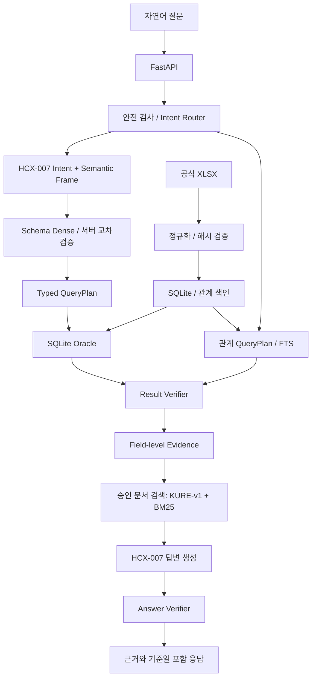

<div align="center">

# 금융상품 AI Agent

**미래에셋증권 AI Festival · 근거 기반 금융상품 검색 및 분석 서비스**

      

[Overview](#overview) · [Features](#features) · [Architecture](#architecture) · [Tech Stack](#tech-stack) · [How to Run](#how-to-run)

</div>

---

## Overview

자연어 질문을 받아 공식 금융상품 데이터에서 국내채권, 국내·해외 ETF·ETN, 공모펀드를 조회·비교·집계하고, 상품별 근거와 기준일을 함께 제공하는 AI Agent입니다. HyperCLOVA X(HCX-007)는 의도 해석과 검증된 결과의 자연어 설명을 담당하며, 검색 조건·수치·순위·출처는 서버의 결정론적 처리와 독립 검증을 통해 확정합니다.

공식 상품 데이터와 별도로 12개 발행기관의 승인 문서 258건을 활용해 구성종목, 자회사, 테마 이력, 위험요인 등에 관한 외부 근거를 검색합니다. 확인할 수 없는 정보는 추정하지 않습니다.

## Features

| 기능 | 설명 |
| --- | --- |
| 금융상품 검색 | 네 상품군의 조건 검색, 정확한 식별자 조회, 정렬 |
| 비교 및 집계 | 상품 비교, 개수·평균·최솟값·최댓값 등 결정론적 연산 |
| 의미 기반 질의 해석 | HCX-007 Intent 및 Semantic Frame, KURE-v1 Schema Dense 필드 연결, 서버 교차검증 |
| 관계 검색 | 발행사·운용사·기초지수·자산유형·투자지역 관계 색인과 정확한 엔터티 일치 |
| 문서 검색 | 승인 문서 258건의 KURE-v1 Document Dense 및 BM25 검색, 근거 구간과 출처 제공 |
| 검증 | Typed QueryPlan, SQLite Oracle, 독립 Result Verifier, Answer Verifier |
| 안전 처리 | 결측·기준일·통화 호환성 확인, 확인 불가 및 역질문 처리 |
| 릴리스 무결성 | 코드·데이터·모델·색인·문서 묶음 SHA-256 결속, 불일치 시 실행 차단 |

외부 근거는 승인된 문서 묶음으로 제한하며 실시간 웹 검색을 사용하지 않습니다. 공식 데이터와 외부 근거가 충돌할 경우 공식 데이터를 우선합니다.

## Architecture



기본 개발 실행은 LLM 및 외부 문서 검색 없이 결정론적 검색 경로를 사용합니다. 평가 구성에서는 HCX-007과 봉인된 승인 문서 색인을 활성화합니다. Agent Core는 FastAPI Backend 프로세스에 설치되어 동작합니다.

| Path | Responsibility |
| --- | --- |
| `src/finance_agent/` | Agent Core, 질의 해석, 검색, 검증, 근거 생성 |
| `src/finance_agent/artifacts/approved-corpus/` | 승인 문서 텍스트, 매니페스트, 색인 및 관계 파일 |
| `src/fastapi_backend/` | HTTP API, 실행 제어, 배포 및 릴리스 검증 |
| `ontology/` | 공통 및 상품군별 RDF/Turtle 정의 5개 |
| `docs/` | 기술 제안서, 부록 및 API 명세 |
| `compose.sh`, `docker-compose.yml` | 기본 컨테이너 실행 |

## Tech Stack

| Layer | Technology |
| --- | --- |
| Agent & LLM | Python 3.12, HyperCLOVA X HCX-007 |
| Retrieval | KURE-v1, Schema Dense, Document Dense, BM25, SQLite FTS |
| Data & Knowledge | SQLite, XLSX 정규화, Field Registry, RDF/Turtle Ontology |
| Backend | FastAPI, Pydantic, JSON Schema |
| Infrastructure | Docker Engine, Docker Compose, SHA-256 Release Manifest |
| Verification | pytest, SQLite Oracle, 독립 Python Verifier |

## How to Run

### 1. Prerequisites

Ubuntu 22.04/24.04 x86_64, Docker Engine 24 이상, Docker Compose v2, 공식 XLSX 디렉터리(파일 8개)가 필요합니다. 원천 XLSX 및 생성 DB는 저장소에 포함되지 않습니다.

```bash
git clone https://github.com/Hyunhoim/gaeng3.git
cd gaeng3
cp src/fastapi_backend/.env.example src/fastapi_backend/.env
```

환경 파일의 `FINANCE_RAW_DATA_DIR`에 실제 XLSX 디렉터리를 지정합니다.

### 2. Basic Mode

```bash
./compose.sh up --detach --wait
curl --fail http://127.0.0.1:18001/health
```

이미지 빌드, XLSX 정규화 및 검증, SQLite·관계 색인 생성, Backend 기동을 수행합니다.

```bash
curl --get http://127.0.0.1:18001/answer \
  --data-urlencode 'question_id=Q-001' \
  --data-urlencode 'question=현재 판매 가능한 원화채권 중 AA- 이상 종목 알려줘'
```

종료: `./compose.sh down`

### 3. Evaluation Mode

CLOVA Studio API 키를 별도의 읽기 전용 파일로 준비합니다. 키는 Git이나 환경변수에 저장하지 않습니다.

```bash
mkdir -p ~/.secrets/finance-agent
chmod 700 ~/.secrets/finance-agent
# clovastudio-api-key 파일에 발급받은 API 키를 저장
chmod 600 ~/.secrets/finance-agent/clovastudio-api-key
pip install -U huggingface_hub
huggingface-cli download nlpai-lab/KURE-v1 \
  --revision d14c8a9423946e268a0c9952fecf3a7aabd73bd9 --cache-dir ~/kure-cache
```

승인 문서 묶음은 저장소의 기본 경로를 사용합니다. 깨끗한 Git 작업 트리에서 다음을 실행합니다.

```bash
RAW_DATA_DIR=/path/to/2.금융상품_20260824 \
SECRETS_DIR=$HOME/.secrets/finance-agent \
KURE_CACHE_DIR=$HOME/kure-cache \
  src/fastapi_backend/scripts/manual-release.sh all
```

```bash
curl --get http://127.0.0.1:8080/answer \
  --data-urlencode 'question_id=Q-001' \
  --data-urlencode 'question=캠브리콘이 편입된 중국 반도체 ETF를 알려줘'
```

종료: `src/fastapi_backend/scripts/manual-release.sh stop`

### 4. Development & Verification

```bash
python -m pip install -r requirements.txt
python src/finance_agent/scripts/sync-ontology.py --check
cd src/finance_agent/packages/finance_agent_core
python -m pytest -q
```

[Agent 개발 문서](src/finance_agent/README.md) · [Backend 실행 가이드](src/fastapi_backend/README.md) · [기술 제안서 부록](docs/기술_제안서_부록.md) · [외부 구성요소 고지](THIRD_PARTY_NOTICES.md)
