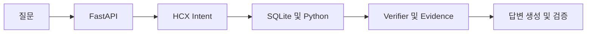

# 금융상품 AI Agent

**미래에셋증권 AI Festival · 근거 기반 금융 서비스**

     

[Overview](#overview) · [Features](#features) · [Architecture](#architecture) · [Documentation](#documentation)

---

## Overview

자연어 금융상품 검색·비교·계산을 지원하는 AI Agent 프로젝트입니다. AI Agent는 임현호가 단독 개발했습니다. LLM의 언어 이해와 결정론적 데이터 처리 및 검증을 분리합니다.

## Features

- 국내채권 및 국내·해외 ETF/ETN 검색과 비교
- SQLite 기반 필터링, 정렬, 집계
- 수치·상품명·출처 검증 및 안전한 fallback
- 관계 검색, Ontology, 릴리스 무결성 검사

## Architecture

## Tech Stack

Python · FastAPI · SQLite · HyperCLOVA X · Docker · Ontology

## Project Status

개인 담당: AI Agent 단독 개발 (질문 해석, 검색·계산, 근거 검증 및 답변 생성). 기존 개발 문서의 팀 역할 표기와 달리 실제 Agent 구현 범위를 기준으로 기재했습니다. 2026-09-01 기록 기준 Agent Core 2,232개 및 Backend 466개 테스트 통과. 공모펀드 공식 실행은 비활성, 프론트엔드 합류와 NCP 서명 배포는 예정 단계입니다.

## Documentation

[Agent 문서](src/finance_agent/README.md) · [Backend 문서](src/fastapi_backend/README.md) · [팀 문서](docs/README.md)

- [상세 개발·실행 안내 및 기존 README](README_DEVELOPMENT.md)
