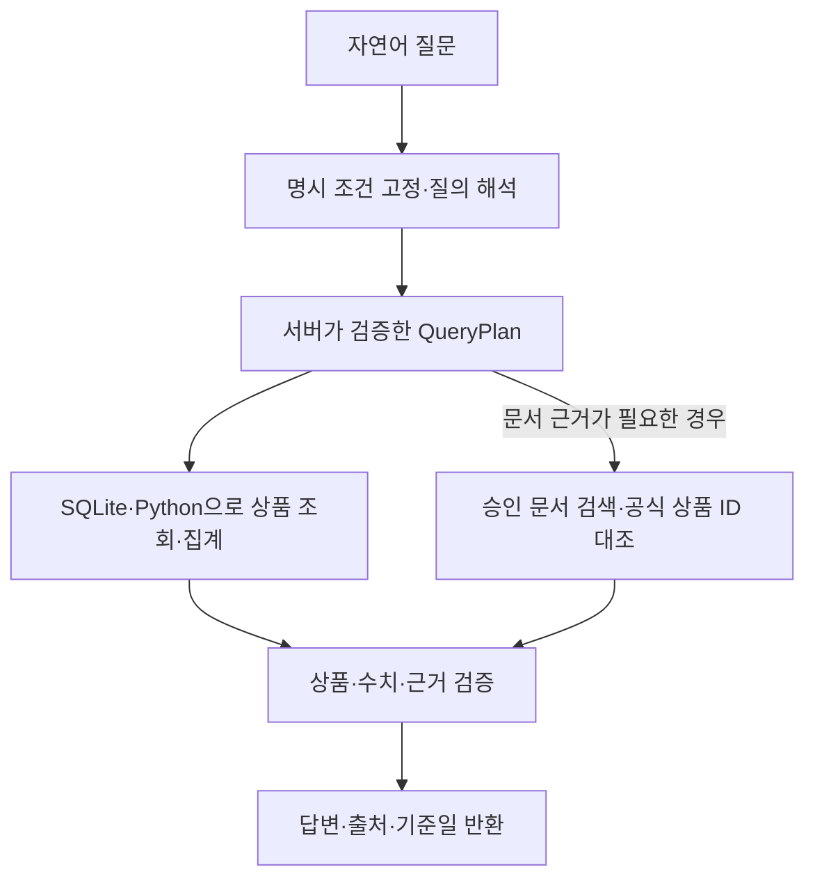

<h1> 금융상품 AI Agent · gaeng3</h1>

## Overview

미래에셋증권 AI Festival에 제출한 **자연어 금융상품 검색 Agent**입니다. 국내채권, 국내·해외 ETF·ETN, 공모펀드를 검색·비교·집계하고, 답변에 사용한 데이터의 기준일과 근거를 함께 제공합니다.

## Features & Demo

### 자연어로 순위 검색과 비교

“국내 ETF를 순자산 큰 순으로 2개 보여줘”처럼 입력하면 상품군, 정렬 기준, 결과 개수를 확정해 조회합니다. 같은 방식으로 조건에 맞는 상품을 찾고 지표를 비교하거나 집계할 수 있습니다.


*제출용 API 명세의 응답 예시. `GET /answer`가 반환하는 답변·근거·실행 기록 중 주요 내용을 발췌했습니다.*

### 출처가 확인되는 답변

정형 상품 데이터로 확인할 수 있는 수치는 SQLite와 Python에서 계산하고 독립 검증기로 대조합니다. 구성종목이나 테마처럼 문서 근거가 필요한 경우 승인 문서를 검색하고 상품 ID를 공식 DB와 교차 확인합니다. 질문의 조건이 부족하면 필요한 내용을 되묻습니다. [API 명세](docs/평가용_API_서버_정보.md)

## Architecture



## Tech Stack

| 영역 | 기술 |
| --- | --- |
| API·실행 | Python 3.12, FastAPI, Pydantic, SQLite |
| 질의 해석 | HyperCLOVA X HCX-007, 타입이 정의된 QueryPlan |
| 근거 검색 | KURE-v1, BM25, SQLite FTS, RDF/Turtle |
| 배포·검증 | Docker Compose, pytest, SHA-256 릴리스 매니페스트 |

## How to Run

Ubuntu 22.04/24.04 x86_64, Docker Engine 24 이상, Docker Compose v2, 주최 측 원천 XLSX 8개가 필요합니다. 원천 데이터는 별도로 준비합니다.

```bash
git clone https://github.com/Hyunhoim/gaeng3.git
cd gaeng3
cp src/fastapi_backend/.env.example src/fastapi_backend/.env
# .env의 FINANCE_RAW_DATA_DIR에 원천 XLSX 디렉터리를 지정합니다.
./compose.sh up --detach --wait
curl --fail http://127.0.0.1:18001/health
```

```bash
curl --get http://127.0.0.1:18001/answer \
  --data-urlencode 'question_id=Q-001' \
  --data-urlencode 'question=국내 ETF를 순자산 큰 순으로 2개 보여줘'
```

LLM과 승인 문서 색인을 활성화하는 제출 구성은 [평가 환경 재현 가이드](src/fastapi_backend/README.md#62-평가-구성-실행)를 따릅니다.

## Appendix

### 제출용 내부 검증

기술제안서 3.6절에 기록한 팀 내부 QA입니다. **Outcome Exact**는 처리 상태와 결과 상품 집합이 맞은 비율입니다. **상품 micro F1**은 전체 문항의 상품 단위 판정을 합산해 계산합니다.

| 검증 구간 | 문항 | Outcome Exact | 상품 micro F1 |
| --- | ---: | ---: | ---: |
| Phase 3 최초 블라인드 | 600 | 59.17% | 72.84% |
| Phase 3 동일 세트 회귀 | 600 | 87.17% | 90.23% |
| Phase 4 최초 블라인드 | 1,000 | 14.80% | 11.44% |
| Phase 4 동일 세트 회귀 | 1,000 | 89.38% | 86.20% |
| Phase 5 최초 블라인드 | 105 | 78.29% | 77.14% |
| Phase 6 최초 블라인드 | 150 | 95.33% | 90.78% |

Phase마다 문항 구성과 난도가 달랐습니다. 동일 세트 회귀는 정답 공개 후 수정한 기능을 확인한 기록입니다. 평가에 사용한 공식 상품 데이터는 2026-08-24 배포본이고, 외부 근거는 12개 발행 주체의 승인 문서 258건입니다.

[기술제안서 PDF](docs/기술_제안서.pdf) · [데이터·재현 부록](docs/기술_제안서_부록.md) · [Agent 개발 문서](src/finance_agent/README.md) · [제출 원본 커밋](https://github.com/Hyunhoim/gaeng3/tree/065f179e3d2f54e5f991b6ed5dabd47262b36b96)
