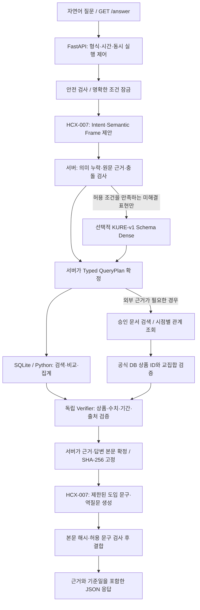

<div align="center">

# 금융상품 AI Agent

**미래에셋증권 AI Festival · 근거 기반 금융상품 검색 및 분석 서비스**

      

[기술제안서 PDF](docs/기술_제안서.pdf) · [데이터·재현 부록](docs/기술_제안서_부록.md) · [API 명세](docs/평가용_API_서버_정보.md)

</div>

---

## 프로젝트 소개

자연어 질문을 받아 공식 금융상품 데이터에서 국내채권, 국내·해외 ETF·ETN, 공모펀드를 조회·비교·집계하고, 상품별 근거와 기준일을 함께 제공하는 AI Agent입니다. **명확한 조건을 먼저 잠그고, 남은 의미를 단계적으로 해석한 뒤 서버가 실행과 근거를 확정**합니다. HyperCLOVA X(HCX-007)는 질문의 의도·의미 구조와 제한된 답변 문구를 제안하고, 상품·수치·순위·출처는 SQL/Python 실행기와 독립 검증기가 확정합니다.

공식 상품 데이터와 별도로 12개 발행기관의 승인 문서 258건을 활용해 구성종목, 자회사, 테마 이력, 위험요인 등에 관한 외부 근거를 검색합니다. 확인할 수 없는 정보는 추정하지 않습니다.

설명 기준은 저장소에 포함된 제출 기술제안서와 2026-09-06 배포 부록입니다. 공식 상품 데이터는 **2026-08-24 배포본**이며, 값마다 원천 데이터의 기준일을 함께 표시합니다. 실시간 시세 서비스나 실제 매매·주문 시스템은 아닙니다.

제출 원본 커밋은 [`065f179`](https://github.com/Hyunhoim/gaeng3/tree/065f179e3d2f54e5f991b6ed5dabd47262b36b96)입니다. 2026-11-25 정리 기준으로 `main`은 이 원본과 **README.md만 다르며, 실행 코드·데이터 명세·기술제안서는 동일**합니다. 제출 당시 README까지 확인하려면 원본 커밋을 참고하세요.

## 주요 기능

| 기능 | 설명 |
| --- | --- |
| 금융상품 검색 | 네 상품군의 조건 검색, 정확한 식별자 조회, 정렬 |
| 비교 및 집계 | 상품 비교, 개수·평균·최솟값·최댓값 등 결정론적 연산 |
| 의미 기반 질의 해석 | HCX-007 Intent 및 Semantic Frame, KURE-v1 Schema Dense 필드 연결, 서버 교차검증 |
| 관계 검색 | 발행사·운용사·기초지수·자산유형·투자지역 관계 색인과 정확한 엔터티 일치 |
| 문서 검색 | 승인 문서 258건의 KURE-v1 Document Dense 및 BM25 검색, 근거 구간과 출처 제공 |
| 검증 | Typed QueryPlan, SQLite Oracle, 독립 Result Verifier, Answer Verifier |
| 안전 처리 | 결측·기준일·통화 호환성 확인, 확인 불가 및 역질문 처리 |
| 릴리스 무결성 | 코드·데이터·모델·색인·문서 묶음 SHA-256 결속, 불일치 시 실행 차단 |

외부 근거는 승인된 문서 묶음으로 제한하며 실시간 웹 검색을 사용하지 않습니다. 공식 데이터와 외부 근거가 충돌할 경우 공식 데이터를 우선합니다.

## 처리 구조



기본 개발 실행은 LLM 및 외부 문서 검색 없이 결정론적 검색 경로를 사용합니다. 평가 구성에서는 HCX-007과 봉인된 승인 문서 색인을 활성화합니다. Agent Core는 FastAPI Backend 프로세스에 설치되어 동작합니다.

- **조건 잠금:** 상품군·상품코드·숫자·기간·정렬 방향·결과 개수처럼 명확한 조건을 먼저 확정합니다. 모델의 의미 해석이 이를 임의로 바꾸지 못합니다.
- **두 가지 Dense 검색:** Schema Dense는 미해결 표현을 허용된 DB 필드에 연결하는 보완 수단입니다. Document Dense는 BM25와 함께 승인 문서의 근거 구간을 찾습니다. 모든 질문에 두 검색을 일괄 적용하지 않습니다.
- **상품 범위 제한:** 외부 문서에서 발견한 상품도 제공 DB의 상품 ID와 교차 검증합니다. 공식 DB에 없는 상품을 외부 검색만으로 결과에 추가하지 않습니다.
- **답변 불변성:** 서버가 수치와 근거를 담은 본문을 고정하고, HCX-007이 생성한 도입 문구·역질문을 검증해 결합합니다. LLM이 본문 전체를 자유롭게 다시 작성하는 구조가 아닙니다.
- **데이터 정책:** 결측·0은 필드별 규칙으로 판단하고 임의 보간하지 않습니다. 기간·통화·단위가 호환되지 않는 값은 임의 환산하지 않습니다.

근거 부족과 검색 결과 없음은 구분합니다. 아래는 처리 상태 설명이며, 공식 API에 별도 `status` 필드를 추가한다는 뜻은 아닙니다.

| 상태 | 의미 |
| --- | --- |
| `SUCCESS` | 조건과 근거를 검증한 결과 |
| `CLARIFY` | 조건이 부족하거나 해석이 여러 가지여서 역질문 필요 |
| `NOT_FOUND` | 필요한 검증을 마쳤지만 제공 DB에 조건과 맞는 상품 없음 |
| `CANNOT_VERIFY` | 문서·기간·출처 등 근거가 부족해 확인 불가 |
| `UNSUPPORTED` | 지원 범위 밖 요청 또는 안전 정책상 실행 불가 |

## 저장소 구성

| 경로 | 역할 |
| --- | --- |
| `src/finance_agent/` | Agent Core, 질의 해석, 검색, 검증, 근거 생성 |
| `src/finance_agent/artifacts/approved-corpus/` | 승인 문서 텍스트, 매니페스트, 색인 및 관계 파일 |
| `src/fastapi_backend/` | HTTP API, 실행 제어, 배포 및 릴리스 검증 |
| `ontology/` | 공통 및 상품군별 RDF/Turtle 정의 5개 |
| `docs/` | 기술 제안서, 부록 및 API 명세 |
| `compose.sh`, `docker-compose.yml` | 기본 컨테이너 실행 |

## 기술 구성

| 영역 | 기술 |
| --- | --- |
| Agent & LLM | Python 3.12, HyperCLOVA X HCX-007 |
| Retrieval | KURE-v1, Schema Dense, Document Dense, BM25, SQLite FTS |
| Data & Knowledge | SQLite, XLSX 정규화, Field Registry, RDF/Turtle Ontology |
| Backend | FastAPI, Pydantic, JSON Schema |
| Infrastructure | Docker Engine, Docker Compose, SHA-256 Release Manifest |
| Verification | pytest, SQLite Oracle, 독립 Python Verifier |

## 내부 평가 기록

다음은 [기술제안서](docs/기술_제안서.pdf) 3.6절에 보고된 **팀 내부 QA 결과**입니다. 대회 공식 심사 점수나 이번 README 수정 과정에서 재측정한 결과가 아닙니다.

| 평가 | 문항 수 | Outcome Exact | 상품 micro F1 |
| --- | ---: | ---: | ---: |
| Phase 3 최초 Blind | 600 | 59.17% | 72.84% |
| Phase 3 동일 세트 회귀 | 600 | 87.17% | 90.23% |
| Phase 4 최초 Blind | 1,000 | 14.80% | 11.44% |
| Phase 4 동일 세트 회귀 | 1,000 | 89.38% | 86.20% |
| Phase 5 최초 Blind | 105 | 78.29% | 77.14% |
| Phase 6 최초 Blind | 150 | 95.33% | 90.78% |

Outcome Exact는 처리 상태와 결과 상품 집합의 일치 여부, 상품 micro F1은 전체 질문의 상품 집합을 합산한 정밀도·재현율의 조화평균입니다. Phase마다 질문 구성과 난도가 달라 수치를 동일 조건의 성능 향상으로 해석하지 않습니다. Gold 공개 후 수정한 동일 세트 회귀 결과는 일반화 성능과 구분합니다.

## 실행 방법

### 1. 준비

Ubuntu 22.04/24.04 x86_64, Docker Engine 24 이상, Docker Compose v2, 공식 XLSX 디렉터리(파일 8개)가 필요합니다. 원천 XLSX 및 생성 DB는 저장소에 포함되지 않습니다.

```bash
git clone https://github.com/Hyunhoim/gaeng3.git
cd gaeng3
cp src/fastapi_backend/.env.example src/fastapi_backend/.env
```

환경 파일의 `FINANCE_RAW_DATA_DIR`에 실제 XLSX 디렉터리를 지정합니다.

### 2. 기본 개발 실행

```bash
./compose.sh up --detach --wait
curl --fail http://127.0.0.1:18001/health
```

이미지 빌드, XLSX 정규화 및 검증, SQLite·관계 색인 생성, Backend 기동을 수행합니다.

```bash
curl --get http://127.0.0.1:18001/answer \
  --data-urlencode 'question_id=Q-001' \
  --data-urlencode 'question=현재 판매 가능한 원화채권 중 AA- 이상 종목 알려줘'
```

종료: `./compose.sh down`

### 3. 평가 구성 재현

CLOVA Studio API 키를 별도의 읽기 전용 파일로 준비합니다. 키는 Git이나 환경변수에 저장하지 않습니다.

```bash
mkdir -p ~/.secrets/finance-agent
chmod 700 ~/.secrets/finance-agent
# clovastudio-api-key 파일에 발급받은 API 키를 저장
chmod 600 ~/.secrets/finance-agent/clovastudio-api-key
pip install -U huggingface_hub
huggingface-cli download nlpai-lab/KURE-v1 \
  --revision d14c8a9423946e268a0c9952fecf3a7aabd73bd9 --cache-dir ~/kure-cache
```

승인 문서 묶음은 저장소의 기본 경로를 사용합니다. 깨끗한 Git 작업 트리에서 다음을 실행합니다.

```bash
RAW_DATA_DIR=/path/to/2.금융상품_20260824 \
SECRETS_DIR=$HOME/.secrets/finance-agent \
KURE_CACHE_DIR=$HOME/kure-cache \
  src/fastapi_backend/scripts/manual-release.sh all
```

```bash
curl --get http://127.0.0.1:8080/answer \
  --data-urlencode 'question_id=Q-001' \
  --data-urlencode 'question=캠브리콘이 편입된 중국 반도체 ETF를 알려줘'
```

종료: `src/fastapi_backend/scripts/manual-release.sh stop`

### 4. 개발 및 검증

```bash
python -m pip install -r requirements.txt
python src/finance_agent/scripts/sync-ontology.py --check
cd src/finance_agent/packages/finance_agent_core
python -m pytest -q
```

## API 응답

단일 질문·단일 답변 방식입니다. `GET /answer`는 `question_id`, `question`을 URL query parameter로 받으며, 응답은 아래 다섯 문자열 필드로 구성됩니다.

| 필드 | 내용 |
| --- | --- |
| `question_id` | 요청 문항 ID |
| `question` | 요청 질문 원문 |
| `retrieved_context` | 검증된 데이터·문서 근거를 담은 JSON 문자열 |
| `think_trace` | 의도·실행 단계·검증 상태를 요약한 JSON 문자열 |
| `answer` | 검증된 최종 답변 |

확인 불가·역질문 같은 정상적인 처리 결과는 같은 응답 형식과 HTTP 200으로 반환합니다. 릴리스 무결성이나 준비 상태에 문제가 있으면 HTTP 503 등 오류 응답을 사용할 수 있으므로, **HTTP 200 자체가 답변의 정답 여부를 뜻하지는 않습니다.** 상세 규격은 [API 명세](docs/평가용_API_서버_정보.md)를 참고하세요. 문서에 기재된 평가 서버 주소는 제출 당시 기록이며 현재 운영 여부는 보장하지 않습니다.

## 확장 방향

제안서는 승인 문서의 정기 갱신, 새 상품군의 Field Registry·검증 규칙 추가, 상품 상세 화면 연결을 확장 방향으로 제시합니다. 공식 출처 한정 실시간 검색은 제출 실행 환경에서 비활성화되어 있으며, 개인화 추천·적합성 판단·실제 주문은 별도 권한과 검토가 필요한 후속 범위입니다.

[Agent 개발 문서](src/finance_agent/README.md) · [Backend 실행 가이드](src/fastapi_backend/README.md) · [기술제안서 PDF](docs/기술_제안서.pdf) · [데이터·재현 부록](docs/기술_제안서_부록.md) · [외부 구성요소 고지](THIRD_PARTY_NOTICES.md)
