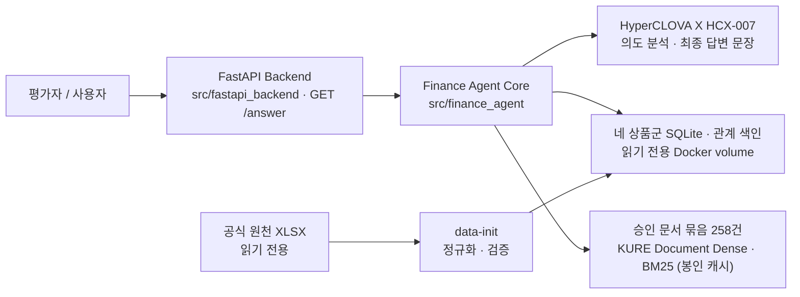

# 금융상품 Agent (팀 갱갱갱)

제10회 2026 미래에셋증권 AI Festival — 금융상품 Agent 과제 제출물

자연어 질문을 이해하고 주최 측 제공 데이터에서 국내채권, 국내·해외 ETF·ETN, 공모펀드를
조회·비교·계산한 뒤 **근거와 기준일을 함께 제시**하는 Agent다. 상품명·수치·순위·출처는
LLM이 아니라 SQLite와 Python 검증기가 확정하고, LLM(HyperCLOVA X)은 질문 의도 해석과
검증된 결과의 설명만 담당한다.

## 1. 제출물 안내

| 제출 항목 | 위치 |
| --- | --- |
| 소스코드 | `src/` (구현체), `requirements.txt`, 이 README |
| 도메인별 Ontology | [`ontology/`](ontology/) — `common.ttl` `bond_kr.ttl` `etf_kr.ttl` `etf_gl.ttl` `fund_pub.ttl` |
| 기술 제안서 | [`docs/technical-proposal.pdf`](docs/technical-proposal.pdf) · 부록 [데이터 수집·적재 Flow·활용 로직·검증·재현 절차](docs/technical-proposal-appendix.md) |
| 평가용 API 서버 정보 | [`docs/api-specification.md`](docs/api-specification.md) |

## 2. 평가용 API

| 항목 | 값 |
| --- | --- |
| End-point | `GET http://101.79.25.57/answer?question_id={문항 ID}&question={질문}` |
| 상태 확인 | `GET http://101.79.25.57/health` |
| 인증 | 없음. 순차 1건 호출, 요청당 270초 외곽 timeout |
| 응답 | `question_id` · `question` · `retrieved_context` · `think_trace` · `answer` 다섯 문자열 필드. 답할 수 없는 질문도 같은 스키마와 HTTP 200 |
| 생성 모델 | 질문 의도 분석(의도 + Semantic Frame)과 최종 답변 생성 모두 NCP HyperCLOVA X `HCX-007`. 평가·운영 설정에서는 다른 LLM provider가 시작 단계에서 거부된다 |
| 외부 근거 | 2026-08-24 이전 발행 공식 문서 258건(12개 발행기관)을 검토·승인해 봉인한 문서 묶음만 조회한다(`approved_corpus_cache_only`). 실시간 웹·NAVER 검색은 평가 환경에서 사용하지 않는다 |
| 의미 검색 | 필드 의미 연결(KURE-v1 Schema Dense v9)과 문서 검색(KURE-v1 Document Dense + BM25)은 CPU에서 동작하며 색인은 릴리스에 해시로 결속된다 |

```bash
curl --get "http://101.79.25.57/answer" \
  --data-urlencode "question_id=Q-001" \
  --data-urlencode "question=현재 판매 가능한 원화채권 중 AA- 이상 종목 알려줘"
```

요청·응답 JSON 스키마와 오류 처리 규칙은 [API 명세서](docs/api-specification.md)에 있다.

## 3. 시스템 개요



답변 한 건은 다음 순서로 만들어진다.

1. **의도 분석** — HCX-007이 질문 종류(검색·상세·비교·집계·관계)와 상품군을 해석한다
2. **Typed QueryPlan** — 서버가 필드·조건·정렬·개수를 registry에 대해 검증한다. LLM은 이 값을 바꿀 수 없다
3. **SQLite Oracle** — 검색·정렬·비교·집계를 SQL로 실행한다
4. **Verifier** — Python이 같은 규칙으로 다시 계산해 결과를 대조한다. 어긋나면 답하지 않는다
5. **근거 생성** — 필드별 값·출처·기준일을 보존한다
6. **최종 답변** — HCX-007이 검증된 근거만 입력받아 문장을 만들고, Answer Verifier가 상품명·수치를 재검사한다

데이터로 확인할 수 없는 질문은 추측하지 않고 한계를 안내하거나 되묻는다.

## 4. 저장소 구조

```text
.
├── README.md                     # 이 문서: 환경 구성 · 실행 · 검증
├── requirements.txt              # 실행 의존성 (고정 버전)
├── requirements-dev.txt          # 테스트 · 온톨로지 검사 의존성
├── ontology/                     # 제출용 Turtle 5개
├── docs/
│   ├── technical-proposal.pdf    # 기술 제안서
│   ├── technical-proposal-appendix.md  # 부록: 수집·적재 Flow · 활용 로직 · 검증 · 재현 절차
│   ├── user-scenarios.md
│   ├── diagrams/                 # 시스템 구성도 · 답변 흐름도 (Mermaid)
│   └── api-specification.md      # 평가용 API 명세서
├── src/
│   ├── finance_agent/            # Agent Core — 질의 해석 · 검색 · 검증 · 근거 · 답변
│   │   ├── packages/finance_agent_core/   # 설치 가능한 Python 패키지 + 테스트
│   │   ├── requirements/                  # 고정 버전 constraints
│   │   ├── scripts/sync-ontology.py       # registry → Turtle 생성 · 검사
│   │   └── artifacts/runtime/schema-dense/ # KURE 필드 의미 색인 v9 (런타임 입력)
│   └── fastapi_backend/          # FastAPI 서버 · Dockerfile · 릴리스 봉인·배포 스크립트(manual-release.sh) + 테스트
├── docker-compose.yml            # data-init + backend
├── compose.sh                    # 한 명령 실행 진입점
├── compose-release.sh            # 봉인 릴리스를 Compose로 기동하는 대안 경로 (평가 서버는 manual-release.sh 사용)
└── THIRD_PARTY_NOTICES.md
```

## 5. 실행 방법 (Docker)

### 5.1 요구 사항

- Docker Engine 24 이상, Docker Compose v2
- 주최 측 제공 금융상품 XLSX 디렉터리(`2.금융상품_20260824`)

### 5.2 준비

```bash
cp src/fastapi_backend/.env.example src/fastapi_backend/.env
```

`src/fastapi_backend/.env`의 `FINANCE_RAW_DATA_DIR`를 XLSX 디렉터리 경로로 바꾼다.
Compose가 이 디렉터리를 읽기 전용으로 연결해 네 상품군 SQLite와 관계 색인을 전용
volume에 생성한다. 원본 XLSX는 수정하지 않는다.

### 5.3 실행

```bash
./compose.sh up --detach --wait
```

한 명령으로 Backend 이미지 빌드 → XLSX 정규화·검증 → Backend 시작 → 정상 상태 대기까지 수행한다.

### 5.4 확인

```bash
curl --fail http://127.0.0.1:18001/health

curl --get --fail-with-body \
  --data-urlencode 'question_id=Q-001' \
  --data-urlencode 'question=현재 판매 가능한 원화채권 중 AA- 이상 종목 알려줘' \
  http://127.0.0.1:18001/answer
```

`/health`에 `ready_product_families`가 네 상품군, `relation_retrieval_status=ready`이면 정상이다.
OpenAPI 화면은 `http://127.0.0.1:18001/docs`.

### 5.5 종료

```bash
./compose.sh down            # 컨테이너 종료, 생성 DB volume 보존
./compose.sh down --volumes  # 생성 DB까지 삭제 (원본 XLSX는 영향 없음)
```

포트 충돌 시 `.env`의 `BACKEND_PORT`를 바꾼다. 상세 진단은 [Backend README](src/fastapi_backend/README.md).

### 5.6 평가 서버 배포 (HyperCLOVA X · 승인 문서 묶음)

기본 Compose(`APP_ENV=development`)는 HCLX 자격증명 없이 결정론적 경로만으로 동작하므로
데이터·검색·검증 로직을 credential 없이 재현할 수 있다. 평가 서버(`101.79.25.57`)는
`src/fastapi_backend/scripts/manual-release.sh`로 서버 한 대에서 배포한다. 이 스크립트는
이미지 빌드(`adaptive-runtime` 타깃) → XLSX 정규화·검증 → 릴리스 봉인(코드·DB·색인·문서 묶음·
활성화 영수증의 SHA-256을 AgentReleaseManifest와 DeploymentBinding에 결속) → 컨테이너 기동 →
`/health`·`/answer` 확인을 순서대로 수행한다. 봉인 값과 실제 파일이 하나라도 다르면 컨테이너는
시작하지 않는다.

```bash
RAW_DATA_DIR=/path/to/2.금융상품_20260824 SECRETS_DIR=~/.secrets/finance-agent \
BIND_ADDRESS=0.0.0.0 PORT=80 EXTERNAL_MODE=approved_corpus_cache_only ADAPTIVE=true \
KURE_CACHE_DIR=/path/to/kure-cache \
APPROVED_CORPUS_MANIFEST=... APPROVED_CORPUS_ROOT=... APPROVED_DOCUMENT_DENSE=... \
DOCUMENT_CACHE_ACTIVATION=... APPROVED_TEMPORAL_RELATIONS=... \
  src/fastapi_backend/scripts/manual-release.sh all
```

CLOVA Studio API 키는 환경변수가 아니라 **읽기 전용 host 파일**(`SECRETS_DIR/clovastudio-api-key`)로
전달한다. 승인 문서 묶음(원문 258건·매니페스트·KURE Document Dense 색인·활성화 영수증)과
KURE-v1 모델 캐시는 Git에 포함하지 않고 배포 시 읽기 전용으로 마운트한다. 설정 항목은
[`.env.release.example`](src/fastapi_backend/.env.release.example)과
[Backend README](src/fastapi_backend/README.md)에 있다.

## 6. 실행 방법 (Docker 없이)

Python 3.12 기준.

```bash
python -m venv .venv && source .venv/bin/activate
python -m pip install -r requirements.txt
```

KURE 의미 검색까지 켜려면 `src/fastapi_backend/requirements.embedding.txt`(torch CPU·sentence-transformers)를 추가 설치한다.
네 상품군 SQLite 생성과 Backend 단독 실행은 [Agent README](src/finance_agent/README.md)와
[Backend README](src/fastapi_backend/README.md)를 따른다.

## 7. 검증

```bash
python -m pip install -r requirements-dev.txt

# Agent Core
( cd src/finance_agent/packages/finance_agent_core && python -m pytest -q )

# Backend (릴리스 보안 검사가 파일 권한을 확인하므로 umask 022 필요)
umask 022
PYTHONPATH=src/fastapi_backend:src python -m pytest -q src/fastapi_backend/tests

# Ontology가 field registry와 일치하는지
python src/finance_agent/scripts/sync-ontology.py --check
```

| 검증 | 결과 (2026-09-06, 제출 트리) |
| --- | --- |
| Agent Core pytest | 4,039 passed · 12 skipped |
| Backend pytest | 408 passed |
| `sync-ontology.py --check` | Turtle 5개가 `field_registry.yaml`과 일치 |
| Docker 빌드(`adaptive-runtime`) · 릴리스 봉인 · `GET /health` · 공식 예시 8문항 | 정상 (예시 1·2·3·5 근거 포함 답변, 답변 불가 3문항 거부, 예시 4는 문서 묶음 범위 밖으로 확인 불가) |

테스트는 원천 데이터·네트워크·LLM 자격증명 없이 실행된다. skip으로 표시되는 소수는
선택적 로컬 키나 승인 DB 경로를 요구하는 opt-in 테스트다.

## 8. Ontology

`ontology/`의 Turtle 5개는 손으로 쓰지 않고
[`field_registry.yaml`](src/finance_agent/packages/finance_agent_core/src/finance_agent_core/config/field_registry.yaml)에서
`sync-ontology.py`가 생성한다. `common.ttl`이 공통 상위 클래스(`Product`)와 공통 속성을,
상품군별 파일이 하위 클래스와 전용 속성을 정의한다. 런타임이 같은 registry로 질문을
해석하므로 온톨로지와 실제 동작이 어긋나지 않으며 `--check`가 이를 자동 검증한다.

## 9. LLM과 데이터 원칙

- 외부 근거는 승인·봉인된 문서 묶음(캐시)만 사용한다. 실시간 웹 검색 코드는 저장소에 남아 있으나 평가 환경에서는 자격증명을 두지 않아 동작하지 않는다
- 평가·운영 경로의 LLM은 공식 규칙에 따라 **HyperCLOVA X만** 사용한다. `evaluation`·`production`
  모드에서 다른 provider가 설정되면 프로세스가 시작되지 않는다
- `finance_agent_core/agent/providers/`에는 개발 단계 단위 테스트용 mock·로컬 provider 코드가
  남아 있으나, 평가 설정·릴리스 이미지·의존성에서는 선택될 수 없다
- 답변의 상품명·수치·순위·출처는 제공 데이터와 결정론적 코드로 검증한다
- 공식 데이터와 외부 데이터가 충돌하면 공식 데이터를 우선한다
- 원천 XLSX, 생성 DB, 로그, 자격증명은 Git에 포함하지 않는다

## 10. 팀

| 역할 | 담당 |
| --- | --- |
| AI Agent | 조해영 |
| Backend · 배포 | 임현호 |
| 금융 도메인 | 박재모 |
