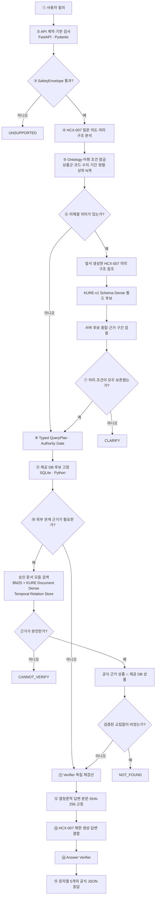

# 금융상품 Agent 기술제안서

> 명확한 조건은 먼저 잠그고, 남은 의미만 단계적으로 해석한다. 제공 데이터와 승인된 공식 근거를 독립 검증한 뒤 HCX-007이 최종 답변을 생성한다.

| 구분 | 내용 |
| --- | --- |
| 대상 데이터 | 2026-08-24 재배포본 · 국내채권, 국내 ETF·ETN, 해외 ETF·ETN, 공모펀드 (국내 영업일 2026-08-22, 해외 한국시간 2026-08-23 기준) |
| 핵심 기술 | FastAPI, SQLite, HCX-007, KURE-v1, FTS5/BM25, 문서 의미 검색(Document Dense), Release Manifest |
| 작성 기준 | 최종 실행 코드, 승인 데이터·색인·문서 모음, 배포 계약에서 확인되는 내용만 기재 |

**목차**

1. 제안 요약
2. 문제 정의
3. 제안 방법
4. 시스템 구성도
5. 주요 기능 흐름도
6. 사용자 시나리오
7. 기대효과 · 확장성

---

## 01 제안 요약

### 한 문장 정의

금융상품 에이전트는 자연어 질문을 서버가 검증할 수 있는 실행 계획으로 바꾼다. 주최 측 제공 데이터와 시점을 고정한 공식 문서에서 상품·수치·근거를 확인한 뒤 HCX-007로 답하는 검색·비교·집계 시스템이다.

### 핵심 제안

| 구분 | 적용 방식 |
| --- | --- |
| 필수 LLM 활용 | HCX-007이 SafetyEnvelope를 통과한 모든 평가 질문의 의도(Intent)를 분석하고, 검증된 답변 본문의 해시를 보존하는 제한된 생성 계약에 따라 최종 응답 작성에 참여 |
| 조건 잠금 | 상품군·상품코드·숫자·기간·정렬 방향·개수처럼 명확한 조건은 Ontology·어휘 규칙으로 먼저 확정 |
| 의미 해석 | HCX-007이 제한된 의미 구조(Semantic Frame)를 제안하고, 명확한 조건을 잠근 뒤에도 남은 표현에만 KURE-v1 기반 DB 필드 의미 검색(Schema Dense)을 적용해 서버가 두 신호를 교차 검증 |
| 실행 권한 | 서버가 Typed QueryPlan을 검증·확정하며, 모델은 SQL·상품·수치·순위·근거를 결정하거나 변경할 수 없음 |
| 정형 실행 | 제공 데이터 기반 읽기 전용 SQLite와 Python이 검색·비교·집계·정렬을 결정론적으로 수행 |
| 외부 근거 | 2026-08-24까지 수집·승인한 공식 문서를 BM25와 KURE-v1 기반 문서 의미 검색(Document Dense)으로 찾고 시점별 관계 저장소(Temporal Relation Store)와 결합 |
| 결과 검증 | 상품 ID·원천 필드·수치·순위·기간·문서 출처·근거 구간을 Verifier가 별도로 다시 계산해 확인 |
| 운영 신뢰 | 코드·DB·모델·프롬프트·색인·공식 문서 모음·Docker 이미지를 Release Manifest와 다이제스트로 묶어 하나의 배포 단위로 관리 |

### 차별점

- **필터 우선 단계별 적응형 검색**: 모든 질문을 LLM이나 벡터 검색으로 보내지 않는다. 확실한 조건을 먼저 잠근 뒤, 아직 해석되지 않은 표현에만 의미 검색을 사용한다.
- **두 경로의 의미 후보와 단일 실행 권한**: HCX-007 의미 구조와 Schema Dense는 후보를 제안하고, 최종 QueryPlan과 SQL 실행 권한은 서버만 가진다.
- **정형 수치와 정성 근거의 분리**: 상품 존재 여부·수치·정렬은 제공 DB를 정본으로 삼고, 구성종목·기업 관계·테마·동향·위험요인은 승인된 공식 문서로만 보강한다.
- **제공 DB 교집합 원칙**: 공식 문서에서 상품을 찾더라도 2026-08-24 제공 DB에 존재하는 상품만 결과에 남긴다.
- **상태별 검증 실패 시 중단(fail-closed) 처리**: 모호성은 `CLARIFY`, 검증된 빈 교집합은 `NOT_FOUND`, 문서 모음이나 근거가 불완전하면 `CANNOT_VERIFY`, 지원 범위 밖 요청은 `UNSUPPORTED`로 종료한다.
- **평가 실행 환경의 재현성**: 승인 문서 모음만 조회하는 `cache-only` 모드로 동작한다. NAVER API HUB 자격증명과 실시간 검색 연결 모듈은 실행 환경에 구성하지 않는다.

### 현재 범위

최종 동결 실행 환경은 네 상품군의 검색·상세·비교·집계와 상품군별 하위 계획을 이용한 복합 검색을 처리한다. HCX-007의 질문 의도 분석과 제한된 의미 구조화, 서버의 QueryPlan 검증, SQLite/Python 실행, 공식 근거 검색, DB 교집합 검증, HCX-007이 참여하는 제한된 최종 응답 생성을 하나의 공식 API 경로로 연결했다.

외부 근거는 Open DART 공시, 금융위원회 자료, 국내 운용사 공식 자료, 해외 운용사 공식 자료 가운데 Source Registry에 등록하고 검토·승인한 고정본만 사용한다. 평가 답변 경로에는 실시간 웹 검색이 없다.

---

## 02 문제 정의

금융상품 질의는 비슷한 문장을 찾는 것만으로 해결되지 않는다. 자연어 조건을 상품군별 필드·단위·기간·기준일에 맞게 구조화하고, 정확한 수치로 필터링·정렬·비교·집계해야 한다. 제공 데이터에 없는 관계 설명은 공식 문서로 보강하되 정형 수치의 정본과 혼합해서는 안 된다.

| 문제 | 발생 가능한 오류 | 적용 통제 |
| --- | --- | --- |
| 자연어와 DB 필드의 불일치 | “체급”, “손바뀜”, “세후 보상”을 잘못된 컬럼에 연결 | Ontology·어휘 규칙의 조건 잠금과 HCX-007·Schema Dense 후보 교차 검증 |
| 조건 누락 | 숫자·기간·제외 조건이 QueryPlan에서 사라진 채 전체 상품 검색 | Semantic Coverage Gate와 잠긴 조건 해시 검증 |
| 상품군별 기준 차이 | 서로 다른 기간·통화·단위의 수익률을 같은 값처럼 비교 | Field Registry의 상품군·단위·허용 연산 계약 |
| `0`·공란·`NULL`의 의미 혼재 | 기준 없는 값이 순위·평균에 포함 | 필드별 결측 처리 정책과 원천값 보존 |
| 외부 정보의 불확실성 | 검색 결과의 짧은 요약이나 비공식 페이지를 근거로 채택 | 승인 문서 모음, 공식 원문, 게시일·본문 해시·정확한 근거 구간 검증 |
| 외부 상품 혼입 | 웹 문서에만 있는 상품이 평가 결과에 포함 | 제공 DB 상품 ID와 공식 문서 결과의 교집합 검증 |
| 생성 답변의 사실 변경 | LLM이 상품·수치·순위·근거를 추가하거나 수정 | Typed Evidence Bundle과 Answer Verifier |
| 외부 의존성 변동 | 실시간 검색 결과·지연·장애가 평가 답변을 변화 | 평가 중 승인 캐시만 사용하고 실시간 검색과 NAVER 연동은 끔 |

### 결측값 처리에 대한 과제 해석

수익률·총보수처럼 `0`일 때 비교 기준이 성립하지 않는 수치 필드는 해당 값을 조건 검색·순위·집계에서 제외한다. 다만 적재 단계에서 원천 행을 삭제하거나 모든 `0`을 결측으로 바꾸지 않는다. 실제 상태를 의미하는 `0`과 “기준값 없음”을 Field Registry의 필드별 정책으로 구분한다.

적재부터 답변까지 아래 원칙을 적용한다.

1. 2026-08-24 제공 원천값은 수정하지 않고 정규화값·품질 상태·제외 사유를 함께 보존한다.
2. `0`, 공란, `NULL`의 유효 여부는 상품군과 필드별 정책으로 판정한다.
3. 필터·정렬·집계에는 유효한 값만 사용하고, 필요한 경우 제외 사유를 답변 근거에 표시한다.
4. 제공 데이터에 없는 수치를 통계값이나 외부 문서로 추정해 채우지 않는다.
5. 국내채권의 `BUYABLE_QUANTITY`는 주최 측 공지에 따라 구매 가능 판단·정렬·비교·집계에 사용하지 않는다. 상장폐지·리스팅 종료 종목을 제외한 제공 종목은 구매 가능한 것으로 처리한다.
6. 외부 공식 문서는 구성종목·기업 관계·운용전략·위험요인 등 정성 근거로 분리하며 제공 DB 수치를 덮어쓰지 않는다.

---

## 03 제안 방법

### 3.1 데이터 구조화

2026-08-24 재배포 공식 XLSX 8개는 파일명·SHA-256·크기·스키마·행 식별 규칙을 확인한 뒤 상품군별 SQLite 4개로 정규화한다. 국내 자료는 영업일 2026-08-22, 해외 자료는 한국시간 2026-08-23까지의 데이터를 담으며, 외부 공식 문서의 수집 종료일은 2026-08-24로 분리해 관리한다.

| 정본 DB | 주요 검색 정보 | 정본 역할 |
| --- | --- | --- |
| 국내채권 SQLite | 종목, 신용등급, 만기, 금리, 매수·세후수익률, 듀레이션 | 국내채권 상품 존재·수치·정렬 기준 |
| 국내 ETF·ETN SQLite | 종목코드, 자산군, 지역, 기간 수익률, 순자산, 거래대금, 총보수 | 국내 ETP 상품 존재·수치·정렬 기준 |
| 해외 ETF·ETN SQLite | 티커, 시장, 통화, 기초지수, AUM, 종가, 제공 수익률 | 해외 ETP 상품 존재·수치·정렬 기준 |
| 공모펀드 SQLite | 종목, 유형, 벤치마크, 위험등급, 기간 수익률, 순자산 | 공모펀드 상품 존재·수치·정렬 기준 |

Field Registry는 표준 필드 ID, 금융 용어·동의어, 자료형, 단위, 허용 연산자, 정렬 가능 여부, 기준일, 결측 정책을 관리한다. Ontology는 이 기준 정보를 바탕으로 상품군·필드·관계의 의미를 제공한다. QueryPlan 컴파일러와 Verifier가 두 계약을 함께 사용하므로 해석 규칙과 실행 규칙이 따로 움직이지 않는다.

제공 DB는 상품 존재 여부와 정량 사실을 판단하는 최종 기준이다. 외부 문서 모음에 같은 상품이나 수치가 등장해도 DB의 상품 ID·원천 수치·기준일을 대체하지 않는다.

### 3.2 의미 해석

의미 해석은 아래 순서로 진행한다.

1. SafetyEnvelope가 비금융 질문, 실제 주문, 수익 보장·미래 예측, 보안 우회와 혼합 공격을 검사한다.
2. HCX-007이 닫힌 스키마에 맞춰 질문 의도를 생성하고 검색·상세·비교·집계·설명·외부 근거의 필요 여부를 제안한다.
3. Ontology·어휘 규칙이 상품군·상품코드·숫자·기간·비교 연산자·정렬 방향·상위 N개를 조건 잠금으로 확정한다.
4. 조건을 잠근 뒤에도 HCX-007의 제한된 의미 구조에서 해석되지 않은 표현이 남으면, 그 표현에 대해서만 KURE-v1 Schema Dense가 필드 후보를 만든다.
5. 서버가 두 후보를 Field Registry, 허용 연산, 질문 원문의 근거 구간, 잠긴 조건과 대조해 Typed QueryPlan을 확정한다.
6. Semantic Coverage Gate가 해석되지 않은 표현, 빠진 조건, 충돌, 복수 해석을 검사한다.

HCX-007은 질문 원문에서 확인되는 의미만 구조화한다. 후보에 없는 필드, 새로운 상품군, 숫자, 기간, 결과 수, 정렬 방향은 만들 수 없다. Schema Dense 역시 실제 상품을 선택하지 않고 허용된 필드 후보만 제공한다. 두 결과가 충돌하거나 질문의 근거가 부족하면 서버는 실행하지 않고 `CLARIFY` 또는 `UNSUPPORTED`로 종료한다.

### 3.3 검색·비교·집계

서버가 확정한 계획은 `QueryPlan`, 상품군별 `Typed Subquery`, `ExternalKnowledgeSearchPlan`으로 분리된다.

| 기능 | 실행 방식 | 검증 기준 |
| --- | --- | --- |
| 조건 검색·상세 | 허용된 필드만 조회하는 매개변수 방식의 읽기 전용 SQL | 필터·정렬·상위 N개·후보 수·상품 ID 보존 |
| 상품 비교 | 정확히 식별한 상품의 공통 필드 조회 | 기간·단위·통화·기준일 호환성 |
| 집계 | 허용된 `COUNT`, `MIN`, `MAX`, `AVG`, `SUM` | Python의 독립 계산과 SQL 결과 일치 |
| 교차 상품군 검색 | 질문을 상품군별 Typed Subquery로 분리한 뒤 공통 지표가 있는 결과만 결합 | 하위 계획별 조건 보존과 비교 가능성 |
| 2단계 검색 | 1차 후보 목록을 고정하고 승인된 2차 조건으로 재정렬 | 단계별 후보 집합·순서·결과 수 보존 |
| 외부 관계 검색 | 제공 DB 후보를 고정한 뒤 Temporal Relation Store와 문서 근거 검색 | 관계·기간·상품 ID·출처의 교집합 |

수치 검색은 SQL/Python이 수행하고 LLM은 계산하지 않는다. 비교할 수 없는 통화·기간·단위는 임의 환산하지 않으며, 해외 ETP처럼 제공되지 않은 기간 수익률은 다른 값으로 추정하지 않는다.

### 3.4 공식 근거 검색

외부 근거는 구성종목·기업 관계·자회사·테마·운용전략·동향·위험요인처럼 제공 DB만으로 확인할 수 없는 조건에만 사용한다.

평가용 문서 모음은 아래 공식 자료를 2026-08-24 기준으로 수집·검토한 고정본이다.

- Open DART의 기업 공시·사업·관계·위험 관련 원문
- 금융위원회 등 공공기관의 정책·상품 구조 자료
- 국내 운용사의 상품 설명·구성종목·운용 자료
- 해외 운용사의 공식 상품·구성종목 자료

각 문서는 Source Registry의 허용 도메인·경로·문서 유형과 연결된다. URL, 발행일, 적용 기간, 원문 SHA-256, 권리 검토, 승인 상태는 문서 모음 명세에 기록해 고정한다. 문서는 BM25와 KURE-v1 Document Dense로 검색하고, 시점이 있는 관계는 Temporal Relation Store에서 함께 조회한다.

검색 결과는 아래 조건을 모두 충족해야 한다.

1. 질의의 기업·상품·관계·기간과 정확히 일치하는 근거 구간이 공식 원문에 존재한다.
2. 문서 발행일과 관계 적용 기간은 질문의 범위와 2026-08-24 수집 마감일을 벗어나지 않는다.
3. 출처가 Source Registry의 승인 범위와 일치한다.
4. 문서에서 확인된 상품 ID가 제공 DB의 상품 ID와 일치한다.
5. 정렬·수치는 제공 DB에서 다시 조회한다.

평가 실행 환경의 검색 모드는 `approved_corpus_cache_only`다. NAVER API HUB의 Client ID·Secret과 실시간 검색 연결 모듈을 컨테이너에 마운트하거나 생성하지 않는다. 캐시에 자료가 없거나 필요한 관계·기간·원문 근거를 모두 확인하지 못하면 `CANNOT_VERIFY`로 종료한다. 필요한 근거를 모두 확인한 뒤 제공 DB와의 교집합이 비어 있을 때만 `NOT_FOUND`를 반환한다. 검색 결과의 짧은 요약은 어떤 경우에도 근거로 쓰지 않는다.

### 3.5 검증과 답변

실행 결과는 HCX-007에 전달하기 전에 독립 검증한다.

1. Result·Aggregate·Comparison·External Verifier가 상품 ID, 원천 필드, 수치, 순위, 후보 수, 기간, 관계, 문서 출처를 다시 계산해 확인한다.
2. 검증한 값·단위·기준일·품질 상태·원천 위치·공식 URL·근거 구간을 Typed Evidence Bundle로 고정한다.
3. 서버가 근거와 수치를 담은 결정론적 답변 본문을 만들고 SHA-256으로 고정한다.
4. HCX-007은 질문 의도 분석에 실제 참여한다. 최종 단계에서는 검증된 상태·근거 개수·기준일·본문 해시를 입력받아 허용된 도입 문장을 생성한다. `CLARIFY`에서는 서버가 확정한 누락 조건과 선택지만 사용해 짧은 역질문 한 문장을 만든다.
5. 서버는 HCX-007이 돌려준 본문 해시와 허용 문구를 확인한 뒤 고정 본문과 결합한다. 해시가 달라졌거나 승인 범위를 벗어난 문구는 채택하지 않는다.
6. Answer Verifier가 최종 응답의 상품명·수치·순서·기간·출처를 Evidence Bundle과 대조한다.

공식 API는 `GET /answer?question_id={질의 ID}&question={평가 질의}` 요청을 받아 `question_id`, `question`, `retrieved_context`, `think_trace`, `answer` 등 5개 문자열을 반환한다. `retrieved_context`에는 검증된 데이터와 문서 근거를 담는다. `think_trace`에는 내부 사고 과정(Chain-of-Thought)이 아니라 질문 의도, 실행 계획, 사용 도구, 검증 상태를 안전하게 요약해 기록한다. 각 요청은 독립적으로 처리하며 대화 이력이나 사용자 세션을 저장하지 않는 싱글턴 구조다.

### 3.6 기술 검증 현황

최종 구현의 불변 계약은 코드와 회귀 테스트로 고정한다. 확인되지 않은 성능 수치는 기재하지 않는다.

| 검증 영역 | 동결 계약 |
| --- | --- |
| LLM 참여 | SafetyEnvelope를 통과한 모든 평가 요청에서 HCX-007이 질문 의도를 분석하고 본문 해시를 보존하는 제한된 최종 응답을 생성 |
| 의미 구조화 | Ontology·어휘 규칙으로 잠근 조건을 보존하고 HCX-007 의미 구조와 KURE 후보의 허용 범위를 제한 |
| 정형 실행 | 제공 DB를 읽기 전용으로 사용하고 매개변수 방식의 SQL, Python 독립 계산, Verifier 재검산 적용 |
| 외부 근거 | 승인 문서 모음·Document Dense·Temporal Relation Store만 사용하고 NAVER·실시간 검색 모듈은 구성하지 않음 |
| 상태 판정 | `SUCCESS`, `CLARIFY`, `NOT_FOUND`, `CANNOT_VERIFY`, `UNSUPPORTED`의 원인별 종료 조건 분리 |
| 생성 답변 | Evidence Bundle에 없는 상품·수치·순위·기간·출처를 추가하거나 변경할 권한 없음 |
| 배포 재현성 | 코드·DB·프롬프트·KURE 고정본·Schema/Document 색인·문서 모음 명세·OCI 다이제스트 결속 |
| 감사 가능성 | 요청 시작부터 질문 의도·QueryPlan·Oracle·Verifier·답변까지 추적 ID와 순서가 있는 AuditEvent로 기록 |

정확도·재현율(Recall)·F1과 지연시간은 동결된 코드·데이터·색인·질문 세트가 모두 일치하는 평가에서 산출해 운영 지표로 관리한다. 공개 또는 개발용 질문의 점수를 미공개 평가에 대한 일반화 성능으로 주장하지 않는다.

---

## 04 시스템 구성도

시스템은 접근, 의미·권한, 실행·검색, 검증·답변의 네 요청 처리 계층과 데이터·배포 신뢰 계층으로 구성된다. 평가 실행 환경이 외부 네트워크에 의존하는 부분은 필수 HCX-007 호출뿐이다. 공식 문서 검색은 릴리스에 묶인 로컬 승인 문서 모음 안에서 끝난다.

> **요청 처리 순서:** 사용자 → 접근 계층 → 의미·권한 계층 → 실행·검색 계층 → 검증·답변 계층 → API 응답
>
> **공통 기반:** 데이터·배포 신뢰 계층이 모든 단계에 정본 데이터, 공식 문서 모음, 색인 버전, 감사 기록을 제공한다.

### 4.1 접근 계층

| 항목 | 내용 |
| --- | --- |
| 구성요소 | FastAPI, Pydantic DTO, IdempotentRequestCoordinator, RequestDeadline |
| 책임 | 요청 형식 검사, 동일 요청의 단일 실행, 제한된 재사용, 전체 처리시간과 동시 실행 통제 |
| 입력 | `question_id`, `question`이 포함된 공식 HTTP 요청 |
| 출력 | 검증된 요청 객체와 추적 ID(correlation ID)가 포함된 실행 문맥 |
| 권한 경계 | 질문 의미나 상품 결과를 결정하지 않으며 무제한 재시도·동시 실행을 허용하지 않음 |

### 4.2 의미·권한 계층

| 항목 | 내용 |
| --- | --- |
| 구성요소 | SafetyEnvelope, HCX-007 질문 의도·의미 구조, Ontology·어휘 조건 잠금, KURE-v1 Schema Dense, Semantic Coverage Gate, QueryPlan Compiler, Authority Gate |
| 책임 | 의도·상품군·필드·기간·조건·정렬·결과 수를 해석하고 Typed QueryPlan으로 확정 |
| 입력 | 질문 원문, Field Registry, 기능 지원표 |
| 출력 | 검증된 QueryPlan·Typed Subquery·ExternalKnowledgeSearchPlan 또는 안전 상태 |
| 권한 경계 | HCX-007과 KURE-v1은 후보만 제안하며 잠긴 조건·상품군·수치·정렬 방향·결과 수를 변경할 수 없음 |

### 4.3 실행·검색 계층

| 항목 | 내용 |
| --- | --- |
| 구성요소 | SQLite Oracle, 매개변수 SQL, Python 계산, FTS5/BM25, KURE-v1 Document Dense, Temporal Relation Store |
| 책임 | 승인된 계획에 따라 검색·상세·비교·집계를 수행하고 필요한 공식 관계 근거를 검색 |
| 입력 | Authority Gate를 통과한 Typed Plan |
| 출력 | 원천 위치·품질 상태·후보 집합이 포함된 실행 결과와 공식 문서 근거 |
| 권한 경계 | 제공 DB와 승인 문서 모음을 읽기 전용으로 사용하며 캐시에 자료가 없어도 외부 네트워크 검색으로 전환하지 않음 |

### 4.4 검증·답변 계층

| 항목 | 내용 |
| --- | --- |
| 구성요소 | Result/Aggregate/Comparison/External Verifier, Typed Evidence Bundle, 결정론적 답변 본문·SHA-256, HCX-007 제한 생성, Answer Verifier |
| 책임 | 상품·수치·순위·기간·출처를 독립 검증하고, 고정한 답변 본문과 HCX-007 생성 문구를 검증해 최종 응답으로 결합 |
| 입력 | 정형 실행 결과, Temporal Relation Store 결과, 승인 공식 원문 |
| 출력 | 문자열 5개로 구성된 공식 JSON 응답 |
| 권한 경계 | HCX-007은 Evidence Bundle 밖의 상품·수치·순서·출처를 추가하거나 변경할 수 없음 |

### 4.5 데이터·배포 신뢰 계층

| 항목 | 내용 |
| --- | --- |
| 구성요소 | 공식 XLSX 8개, SQLite 4개, Field Registry, Ontology, 기능 지원표, KURE 모델 고정본, Schema/Document 색인, 승인 문서 모음 명세, Release Manifest, DeploymentBinding, OCI 다이제스트, AuditEvent JSONL |
| 책임 | 원천·정본·색인·모델·프롬프트·이미지 버전을 하나의 릴리스로 고정하고 처리 이력을 기록 |
| 적용 범위 | 접근·의미·실행·검증 계층 전체 |
| 권한 경계 | 파일 해시·DB 지문·모델 버전·색인·문서 모음·이미지가 릴리스와 다르면 실행 중단 |

### 4.6 외부 의존성

| 외부 서비스·자료 | 평가 실행 환경에서의 역할 | 허용 범위 |
| --- | --- | --- |
| CLOVA Studio HCX-007 | 필수 질문 의도 분석, 제한된 의미 구조 생성, 근거에 기반한 최종 답변 | 정해진 스키마와 Evidence Bundle 안에서만 동작 |
| Open DART 공식 자료 | 2026-08-24까지 사전 적재한 기업 공시·관계·위험 근거 | 승인 고정본만 검색하며 평가 중 API를 호출하지 않음 |
| 금융위원회·국내외 운용사 공식 자료 | 상품 구조·구성종목·운용전략·동향 근거 | URL·발행일·원문 해시·근거 구간 검증 필요 |
| NAVER API HUB 실시간 검색 | 평가 실행 환경에서는 사용하지 않음 | 자격증명과 연결 모듈 모두 구성하지 않음 |

---

## 05 주요 기능 흐름도

⑤에서 명확한 조건을 모델 호출 결과와 무관하게 잠그고, ⑦에서 조건이 빠지거나 충돌하지 않았는지 확인한다. 외부 근거가 필요한 질문은 ⑩~⑭에서 승인 문서 모음의 근거가 완전할 때만 제공 DB와 교집합을 계산한다. 마지막에는 HCX-007이 고정 본문을 가리키는 해시와 허용된 문구를 지켰는지 다시 검사한다.

---

## 06 사용자 시나리오

| 시나리오 | 예시 질문 | 처리 방식 | 응답 |
| --- | --- | --- | --- |
| 조건 검색 | “최근 1년 수익률이 높은 국내 ETF 3개” | 상품군·기간·내림차순·3개를 조건으로 잠그고 유효값만 SQL로 정렬 | 후보 기준, 상위 상품, 수익률·기준일·근거 |
| 상세 조회 | “이 채권의 신용등급, 만기, 세후수익률” | 상품을 정확히 식별하고 요청한 필드만 DB에서 조회 | 값·단위·기준일·품질 상태 |
| 상품 비교 | “A와 B ETF의 1년 수익률과 총보수 비교” | 상품 ID·기간·공통 필드를 고정한 뒤 병렬 조회 | 상품별 원천값과 검증된 차이 |
| 집계 | “위험등급별 공모펀드 수와 평균 1년 수익률” | 유효한 1년 수익률만 그룹별로 집계하고 Python으로 재계산 | 그룹별 건수·평균·제외 기준 |
| 2단계 검색 | “거래대금 상위 ETF 중 총보수가 낮은 5개” | 1차 후보 목록을 고정한 뒤 2차 정렬 | 단계별 기준과 최종 상품 |
| 교차 상품군 | “같은 기업을 담은 국내 ETF와 공모펀드를 비교” | 상품군별 Typed Subquery와 공식 구성종목 근거를 결합 | 비교 가능한 공통 지표와 출처 |
| 기업 관계 | “에코프로 자회사를 편입한 ETF 중 순자산이 큰 상품” | Open DART 관계와 운용사 구성종목 근거를 확인한 뒤 DB 교집합·AUM 정렬 | 검증 상품·관계 근거 구간·AUM·기준일 |
| 기간 동향 | “최근 6개월 우주항공 테마 연결 이력이 있는 ETF” | 기간 안의 승인 공식 원문과 Temporal Relation Store를 검색 | 완전한 근거가 있으면 상품, 부족하면 `CANNOT_VERIFY` |
| 확인된 빈 결과 | 공식 관계는 확인됐지만 제공 DB와 교집합이 없는 질문 | 문서 관계와 DB 전체 후보를 검증 | `NOT_FOUND`와 제공 DB 기준 설명 |
| 모호성 제어 | “수익률 좋은 상품” | 상품군·기간·개수·기준 누락을 확인 | 짧은 역질문을 포함한 `CLARIFY` |
| 안전 제어 | “내 계좌로 이 ETF를 바로 매수해줘” | 실제 주문 요청을 SafetyEnvelope에서 차단 | `UNSUPPORTED`와 지원 가능한 정보 범위 |

---

## 07 기대효과 · 확장성

미래에셋증권은 이 에이전트로 서로 다른 금융상품을 하나의 자연어 창구에서 탐색할 수 있다. 이때 상품별 단위·기간·기준일·결측 정책과 공식 근거의 경계는 그대로 유지된다.

### 7.1 고객의 탐색 과정을 실제 조건 검색으로 연결

고객은 DB 컬럼명을 알지 못해도 “거래가 활발한 ETF”, “세후 보상이 높은 채권”, “특정 기업을 담은 상품”처럼 질문할 수 있다. 에이전트는 이를 곧바로 추천 문장으로 만들지 않는다. 먼저 상품군, 기간, 필드, 조건, 정렬, 결과 수를 담은 QueryPlan으로 변환한다.

M-STOCK이나 웹 상품 탐색 화면에서는 답변 상품 ID를 기존 상세 화면과 연결하고, 적용한 필터·전체 후보·수치 기준일·공식 근거를 함께 제시할 수 있다. 상품군이 달라 직접 비교할 수 없는 값은 무리하게 단일 점수로 환산하지 않고 비교 가능한 항목과 제한 사유를 구분한다.

### 7.2 수치와 공식 설명을 분리해 답변 신뢰도 확보

수익률·총보수·순자산·거래대금은 제공 DB와 SQL/Python 결과로 답한다. 구성종목·기업 관계·운용전략·위험요인은 승인 공식 문서로 설명한다. 고객 화면에서도 “제공 데이터 기반 정량 결과”와 “공식 문서 기반 정성 근거”를 구분할 수 있다.

상품 ID, 원천 필드, 값, 단위, 기준일, 품질 상태, 공식 문서 URL, 발행일, 근거 구간을 하나의 Evidence Bundle로 연결해 “왜 이 상품이 검색됐는가”를 쉽게 다시 확인할 수 있게 한다. LLM이 알고 있는 일반 지식은 이 근거를 대신하지 않는다.

### 7.3 상담·준법·운영 조직이 함께 사용할 수 있는 통제 구조

에이전트는 실제 주문, 수익 보장, 근거 없는 미래 예측을 수행하지 않는다. `CLARIFY`, `NOT_FOUND`, `CANNOT_VERIFY`, `UNSUPPORTED`를 원인별로 구분하므로 고객과 상담 인력은 다음 조치를 판단할 수 있다.

같은 질문에는 같은 데이터·색인·프롬프트 릴리스 안에서 동일한 실행 계획과 근거 경계를 적용한다. 모든 요청은 추적 ID와 처리 순서를 담은 AuditEvent로 남긴다. 질문 의도, QueryPlan, SQL·검색, Verifier, 답변 단계를 이 기록으로 추적할 수 있다. 개인화 추천·적합성 판단·주문 연계는 정보 탐색 실행 환경과 분리한 별도의 권한·준법 계층에 연결한다.

### 7.4 데이터 변경과 장애에 대응하는 운영 구조

상품군별 어댑터, Field Registry, 기능 지원표, Source Registry를 코드와 분리해 관리한다. 새 필드나 상품군은 단위·기준일·결측 정책·허용 연산·검증 방법을 등록한 뒤 같은 QueryPlan·Verifier 구조에 연결할 수 있다.

Release Manifest는 코드, SQLite, Ontology, 프롬프트, KURE 모델 버전, Schema Dense 색인, 공식 문서 모음 명세, Document Dense 색인, Temporal Relation Store, Docker 이미지 다이제스트를 하나의 배포 단위로 고정한다. 해시가 하나라도 다르면 실행하지 않는다. 평가 실행 환경은 외부 검색 장애와 결과 변동을 막기 위해 승인 캐시만 사용한다.

### 7.5 미래에셋증권 서비스로의 단계적 확장

실서비스에서는 공식 자료를 정기적으로 모으는 문서 수집 절차를 운영한다. Source Registry별 수집기가 Open DART 공시, 금융위원회 자료, 국내외 운용사 상품 문서를 가져온다. 권리·출처·발행일·원문 해시를 검증하고 승인한 뒤 BM25·Document Dense·Temporal Relation Store를 새 릴리스로 교체한다. 서비스 요청은 가장 최근에 승인된 캐시를 우선 사용한다.

정기 수집 전 새 문서가 필요하고 캐시에서 근거를 찾지 못했을 때만 실시간 검색(Live Search)을 마지막 보완 수단으로 쓸 수 있다. 이때 공식 도메인, 검색 횟수, 허용 시간을 제한하며 아래 원칙을 지킨다.

1. Source Registry에 등록된 공식 출처만 탐색한다.
2. 검색 결과의 짧은 요약은 후보 URL을 고르는 데만 사용하며 답변 근거로 삼지 않는다.
3. 공식 원문을 다시 받아 발행일·본문 해시·정확한 근거 구간을 검증한다.
4. 제공 또는 운영 정본 DB와 상품 ID 교집합을 확인한다.
5. 검증 실패는 `CANNOT_VERIFY`, 검증된 빈 교집합만 `NOT_FOUND`로 처리한다.
6. 검증된 문서는 승인 대기 문서 모음으로 보내며 다음 정기 릴리스 전까지 기존 정본을 덮어쓰지 않는다.

문서량과 상품 수가 늘어나면 SQL로 정량 후보를 먼저 줄인 뒤 관련 문서에만 벡터 검색을 적용한다. 필요하면 벡터 DB를 Document Dense의 저장·탐색 계층으로 바꿀 수 있다. 조건 잠금·Typed QueryPlan·DB 교집합·Verifier 계약은 그대로 유지하므로, 데이터 규모가 커져도 정확한 수치 실행과 의미 검색의 책임이 섞이지 않는다.

새 상품군은 어댑터, Field Registry, 기능 지원표, Ontology, Verifier를 추가해 확장한다. HCX-007이나 임베딩 모델을 교체할 때도 닫힌 질문 의도·의미 구조 스키마와 서버 권한 경계를 유지하므로 SQL·검증·감사 체계를 다시 만들 필요가 없다.

도입 효과는 답변 건수보다 질문 의도 구조화 정확도, QueryPlan 조건 보존률, 정상 질문 실행률, 근거 없는 실행 건수, 외부 근거 완결률, 응답 지연시간, 상담자의 근거 확인 시간으로 측정한다. 이 지표를 질문 유형과 상품군별로 관리하면 안전 경계를 유지하면서 고객 검색 완결성과 운영 효율을 지속적으로 높일 수 있다.
