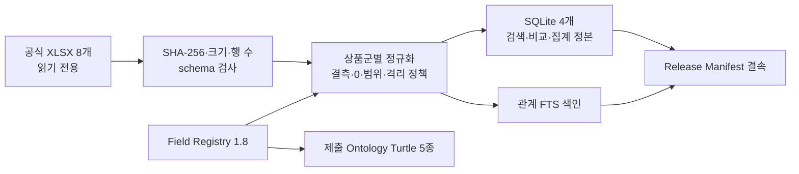
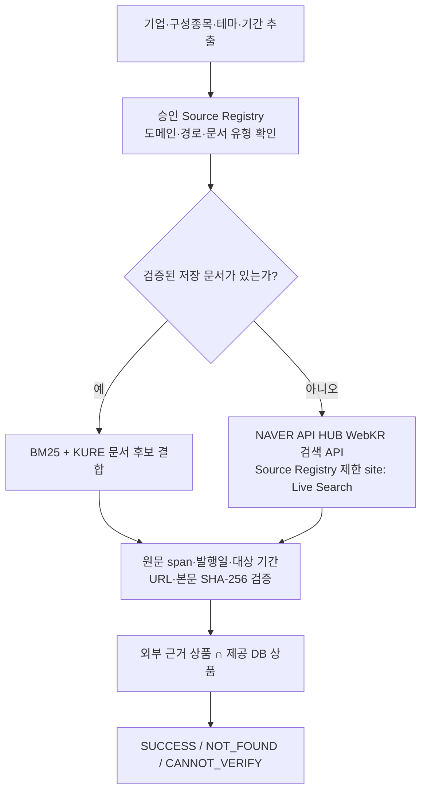
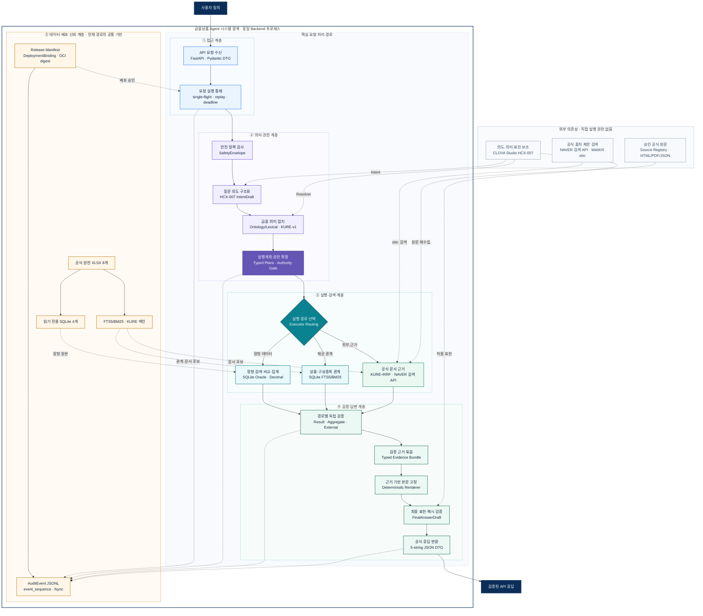
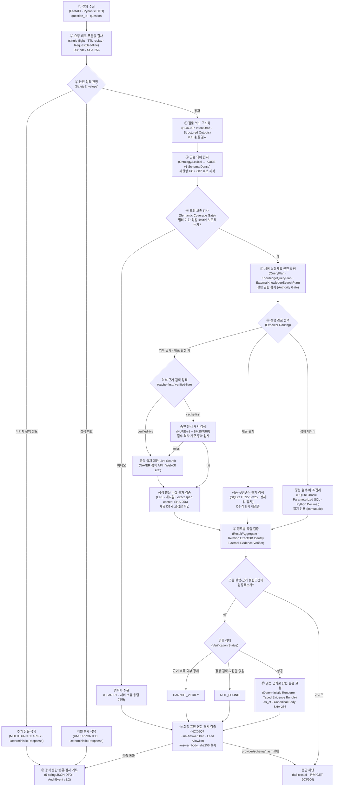

# 금융상품 Agent 기술제안서

> **명확한 조건은 먼저 필터로 확정하고, 남은 의미에만 단계별 적응형 검색을 적용하는 금융상품 Agent**

| 구분 | 기준 |
| --- | --- |
| 문서 상태 | 과제상세소개자료 「기술제안서」 구성 정렬본 v1.3 · HTML 시각화 기준본 |
| 작성 기준일 | 2026-09-05 |
| 구현 기준 | Git commit `d356d4b` |
| 공식 데이터 | 2026-08-24 배포본, 국내채권·국내 ETF/ETN·해외 ETF/ETN·공모펀드 |
| 생성형 AI | CLOVA Studio HCX-007 |
| 작성 원칙 | 구현·회귀·최초 블라인드·최종 제출 전 확인 항목을 구분해 기술 |

이 제안서는 현재 저장소의 코드, 승인 데이터 manifest, 평가 보고서, 배포 계약을
기준으로 작성했다. 개발 세트의 사후 회귀 성능을 미공개 질문에 대한 일반화 성능으로
간주하지 않았다. 아직 수행하지 않은 현재 소스 전체 회귀와 NCP 최종 배포도 완료로
표기하지 않았다.

## 목차

1. 제안 요약 — 핵심 정의와 차별점
2. 제안 방법 — 데이터 구조화, 의미 해석, 검색, 검증, 답변
3. 시스템 구성도 — 시스템 구성 요소와 경계
4. 주요 기능 흐름도 — 질의부터 API 응답까지
5. 사용자 시나리오 — 검색·비교·집계·외부 근거·안전 제어
6. 기술 완성도 및 검증 — 회귀 테스트, 검색 성능 점검, 블라인드 테스트
7. 기대효과·확장성 — 현업 적용 효과와 서비스 확장성
8. 부록 — API, 상태 정의, 기술 스택, 운영·구현 근거

---

## 01 제안 요약

### 1.1 과제 이해

금융상품 탐색은 단순 키워드 검색이나 문서형 RAG만으로 해결하기 어렵다. 자연어 조건을
서로 다른 네 상품군의 필드·단위·기준일에 맞춰 해석한 다음, 정확한 수치로 필터링·정렬·
비교·집계해야 한다. 제공 데이터에 없는 관계·구성종목·동향은 공식 근거로 보완해야 한다.
근거가 부족하거나 해석하지 못한 조건이 남으면 검색을 실행하지 않는다.

> **결측값 처리에 대한 과제 해석.** 제공 데이터의 `0`·공란·`NULL`을 일괄적으로
> 유효한 수치나 오류로 해석하면 상품 검색·정렬·집계 결과가 왜곡될 수 있다. 특히
> 수익률·총보수처럼 `0`일 때 비교 기준이 성립하지 않는 항목은 정량 질의 대상에서
> 제외해야 한다. 반면 실제 상태를 나타내는 `0`은 보존해야 하므로, 데이터 항목별
> 의미와 품질 규칙에 따라 원천값을 유지하면서 정량 연산 가능 여부를 별도로 관리한다.

| 해결 과제 | 위험 | 본 제안의 대응 |
| --- | --- | --- |
| 자연어와 DB 필드의 단절 | “체급”, “손바뀜”, “세후 보상” 같은 표현이 원천 컬럼명과 불일치 | 금융 개념 규칙 → 필드 의미 검색 → 제한형 HCX-007 순으로 단계적 해석 |
| 상품군별 의미 차이 | 같은 “수익률·규모”도 기간·통화·단위·결측 정책이 다름 | 상품군별 capability와 field registry로 실행 가능 범위 고정 |
| `0`·결측값의 의미 혼재 | 기준 없음인 `0`이 순위·평균에 포함되거나 실제 상태인 `0`까지 삭제될 수 있음 | 필드별 sentinel 정책으로 원천 보존과 정량 유효성 판정을 분리 |
| 정형 데이터와 외부 근거의 단절 | 구성종목·기업 관계·테마·동향은 제공 DB만으로 부족 | 승인 공식 출처 검색 후 제공 DB 상품과 교집합 검증 |
| 생성 답변과 사실의 단절 | LLM이 상품·수치·순위를 보완하거나 변경할 수 있음 | QueryPlan·SQL/Python·독립 Verifier가 사실을 확정하고 모델 권한 제한 |
| 운영 버전의 불일치 | 코드·DB·검색 색인·프롬프트가 서로 다른 버전일 수 있음 | SHA-256과 OCI digest를 배포 manifest에 결속하고 불일치 시 fail-closed |

### 1.2 핵심 정의

본 제안의 Evidence-Compiled Hybrid Finance Agent는 사용자의 질문을 검증 가능한
실행 계획으로 바꾸고, 확인된 근거만으로 답하는 금융상품 탐색 Agent다.

- **HCX-007**은 질문 의도를 정해진 형식으로 제안한다. 필요한 경우 허용 후보 안에서
  미해결 의미를 보조 해석하며, 검증된 결과의 표현을 담당한다.
- **서버 Compiler와 Plan Authority Gate**는 상품군·필드·조건·정렬·기간·결과 수의
  실행 권한을 확정한다.
- **SQLite/Python Oracle**은 검색·비교·집계를 실행하고, **독립 Verifier**는 결과를
  다른 경로로 재계산한다.
- 최종 응답은 상품 ID, 값, 단위, 품질, 원천 행·열, 기준일, 공식 문서 URL로 확인된
  범위 안에서만 작성한다.
- 한 항목이라도 검증되지 않으면 추정하지 않고 `CLARIFY`, `NOT_FOUND`,
  `CANNOT_VERIFY`, `UNSUPPORTED` 또는 결정론적 안전 답변으로 종료한다.

### 1.3 제안의 차별점

| 차별점 | 일반적인 단일 LLM/RAG 방식 | 제안 방식 |
| --- | --- | --- |
| **권한 분리** | 모델이 질문 해석·검색식·답변을 함께 결정 | 모델은 의미를 제안하고 표현하며, 실행과 사실 확정은 서버·DB·Verifier가 담당 |
| **필터 우선 해석** | 모든 질문을 임베딩 또는 LLM에 전달 | 명확한 조건은 규칙으로 먼저 잠그고 남은 표현에만 KURE·HCX-007 사용 |
| **조건 보존 검사** | 일부 조건이 누락돼도 그럴듯한 결과 반환 가능 | 질문의 필터·기간·방향·개수 중 하나라도 미해결이면 실행하지 않음 |
| **외부 근거의 제한적 사용** | 웹 문서가 독립 정답원으로 상품을 추가 | 승인 공식 문서를 검증하고 제공 DB 상품과의 교집합만 반환 |
| **이중 검증** | 검색 결과를 바로 자연어로 생성 | Oracle 결과 재계산 + 최종 답변의 상품·수치·출처·본문 hash 재검증 |
| **안전한 실패** | 결과 없음·장애·모호성을 하나의 실패로 처리 | 검증 결과에 따라 `NOT_FOUND`, `CANNOT_VERIFY`, `CLARIFY`, `UNSUPPORTED` 분리 |
| **재현 가능한 배포** | 코드와 데이터 버전의 결속이 약함 | 코드·모델·지시문·DB·색인·Docker 이미지를 변경 불가 배포 단위로 고정 |

### 1.4 현재 제안 범위

현재 Agent는 네 상품군의 검색·상세·2~3개 상품 비교·집계·복합/교차 검색을 지원한다.
제공 데이터의 관계 검색, 승인 공식 문서를 활용한 외부 근거 검색, 근거 기반 답변,
안전 제어 경계도 구현했다.

서로 다른 상품군에서는 정확히 지정한 두 상품의 공통 필드를 나란히 제시할 수 있다.
다만 값을 임의로 환산하거나 우열을 판단하지 않는다. 공모펀드 엔진은 구현돼 있지만
기본 배포에서는 잠겨 있으며 승인 정책에서만 실행한다.

최신 Phase 8 최초 블라인드에서는 외부 근거 질문이 실제 검색 계획으로 충분히
전환되지 않았고, 정상 질문을 과도하게 `CLARIFY`하는 병목도 확인됐다. 구조와 안전
경계는 구현됐지만, 외부 근거 전체 경로의 일반화 성능과 최신 NCP 배포는 보강 후
다시 검증해야 한다.

---

## 02 제안 방법

### 2.1 데이터 구조화 — 원천을 보존하고 실행 가능한 정본으로 변환

공식 XLSX는 직접 조회하지 않는다. 원천 파일의 SHA-256·크기·행 수·schema를 먼저
검사한 뒤 상품군별 SQLite로 정규화한다. 검색 가능한 행과 격리·범위 제외 행을
분리하되, 원천값과 출처는 그대로 보존한다.

| 상품군 | 원천 행 | 검색 대상 | 격리 | 핵심 필드 예시 |
| --- | ---: | ---: | ---: | --- |
| 국내채권 | 21,882 | 21,882 | 0 | 신용등급, 만기, 표면금리, 매수·세후수익률, 듀레이션 |
| 국내 ETF·ETN | 1,780 | 1,777 | 3 | 자산군, 지역, 기간 수익률, 순자산, 거래대금, 총보수 |
| 해외 ETF·ETN | 6,037 | 6,037 | 0 | 티커, 시장, 통화, 지수, AUM, 종가, 1일 수익률 |
| 공모펀드 | 23,676 | 14,606 | 116 | 유형, 벤치마크, 지역, 위험등급, 기간 수익률, 순자산 |
| **합계** | **53,375** | **44,302** | **119** | 상품군별 grain·단위·기준일 분리 |

공모펀드는 116개 불완전 식별 행을 격리하고 공식 실행 범위가 아닌 8,954개 행을
별도로 제외한다.



`field_registry.yaml`은 설명용 문서가 아니라 실행 시 권한과 데이터 해석을 통제하는
기준 파일이다. 표준 필드명, 동의어, 자료형, 단위, 허용 연산자, 검색·응답 권한,
품질, 기준일을 관리한다. 제출용 Ontology Turtle 5종도 이 파일을 기준으로 동기화한다.

#### 2.1.1 0·결측 처리 — 원천 보존과 정량 실행의 분리

주최 측의 2026-08-26 답변에 따라 `0`, 공란, `NULL`을 일괄 삭제하거나 임의의
추정값으로 대체하지 않는다. 원천값·정규화값·품질 사유는 감사와 재현을 위해 함께
보존하고, Field Registry의 컬럼별 의미와 sentinel 정책으로 수치의 유효 여부를 판정한다.

주최 측 규칙과 Field Registry가 적용되는 수치 필드를 조건·순위·집계 기준으로 사용할
때는 `0`과 결측을 유효값 집합에서 제외한다. 이는 적재 단계에서 원천 행을 제거하는
처리가 아니다. 상세 조회에는 원천값과 품질 경고를 남길 수 있으며, 집계에는 계산에
포함한 유효 건수와 제외 건수를 구분해 기록한다. 따라서 기준이 없는 값이 상·하위 순위나
평균에 잘못 포함되는 것을 막는다.

`0`의 의미는 필드마다 다르다. 총보수율처럼 `0`의 의미를 확인할 수 없는 필드는
`UNKNOWN`으로 다루지만, 기준일에 만기가 도래한 채권의 만기잔존일수 `0`처럼 실제
상태를 나타내는 값은 보존한다. 상품군에 제공되지 않은 기간 수익률도 임의 환산하지
않고 제외 사유를 표시한다.

| 데이터 상태 | 원천·적재 처리 | 필터·순위·집계 | 답변 처리 |
| --- | --- | --- | --- |
| 유효 수치 | 원천값과 정규화값 보존 | 허용된 연산에 사용 | 값·단위·기준일 제시 |
| 정책상 `0`·공란·`NULL` | 원천값과 `UNKNOWN/PARTIAL` 사유 보존 | 해당 수치의 유효값 집합에서 제외 | 결측 또는 기준 없음과 제외 사유 표시 |
| 필드 자체가 미제공 | 수치를 생성하거나 공식 DB를 덮어쓰지 않음 | 정량 연산에 사용하지 않음 | 검증된 정성 Knowledge만 별도 제시 가능 |

통계적 보간은 사용하지 않는다. 다만 만기일과 공식 스냅샷일로 만기잔존일수를 계산하거나,
공식 위험등급 코드를 고정된 명칭으로 변환하는 것처럼 입력과 산식이 확정된 결정론적
파생·fallback만 품질 사유와 함께 허용한다. 또한 `BUYABLE_QUANTITY`는 구매 가능 여부
판단에 사용하지 않으며, 통화·단위·기준일이 호환되지 않는 값의 차이·합산·우열 계산은
차단한다.

### 2.2 의미 해석 — 명확한 조건부터 잠그고 남은 의미만 확장

질문 전체를 LLM에 한 번에 맡기지 않는다. 해석 단계마다 허용 권한을 정해 순서대로
처리한다.

| 단계 | 역할 | 권한 경계 |
| --- | --- | --- |
| 입력 안전 검사 | 비금융, 실제 주문, 수익 보장·미래 예측, 공격·정보 노출 요청 탐지 | 즉시 차단 가능 |
| HCX-007 Intent | SEARCH·DETAIL·COMPARE·AGGREGATE·EXPLAIN·제어 의도 제안 | 의도 제안만 가능 |
| Ontology·Lexical | 상품군·상품 식별자·기간·수치·정렬·개수의 명확한 표현 확정 | 빠른 결정론적 경로 |
| KURE Schema Dense | 아직 해석되지 않은 자연어와 DB 필드 설명의 유사 후보 생성 | 후보 제안만 가능 |
| 제한형 HCX-007 Resolver | 복수 후보 또는 문맥 결합이 필요한 경우 제공 후보 안에서 선택 | 후보 밖 필드 생성 금지 |
| Semantic Coverage Gate | 필터·기간·정렬 방향·limit의 누락·충돌·잔여 표현 검사 | 실행 또는 역질문 확정 |

HCX-007과 Dense 검색은 상품군, 필수 필터, 정렬 방향, 결과 개수를 변경하거나 SQL을
작성할 수 없다. 현재 Runtime에서는 과거처럼 HCX가 전체 QueryPlan을 만들지 않는다.
서버가 질문 원문·금융 규칙·허용 후보를 다시 확인해 실행 계획을 확정한다.

### 2.3 검색·비교·집계 — 형식이 고정된 QueryPlan과 결정론적 실행

검증을 통과한 질문만 Typed QueryPlan으로 변환한다. 상품군별 capability matrix가
허용 필드·연산자·정렬·집계 함수를 결정하며, 값은 매개변수화한 읽기 전용 SQL로
전달한다.

| 기능 | 실행 방법 | 안전 경계 |
| --- | --- | --- |
| 검색·상세 | 정확 식별자, 조건 필터, 정렬, Top-N과 전체 후보 수 계산 | 허용 필드·연산자만 실행, 조건 누락 시 중단 |
| 비교 | 같은 상품군의 정확한 2~3개 상품을 입력 순서대로 비교 | 2개만 호환 수치 차이 계산, 3개는 원천값 병렬 제시 |
| 제한적 교차 비교 | 서로 다른 상품군의 정확한 두 상품에서 공통 canonical field만 투영 | 임의 환산·승자 선정·자의적 우열 판단 차단 |
| 집계 | COUNT·MIN·MAX·AVG·허용된 SUM·그룹별 조건 | Python Decimal로 독립 재계산 |
| 교차상품 검색 | 상품군별 하위 계획으로 분리해 독립 실행·조합 | 상품군별 근거 분리, 미지원 항목 제외 이유 표시 |
| 2단계·복합 검색 | 1차 후보군을 고정한 뒤 다른 지표로 재필터·재정렬 | 단계별 후보 집합·필터·순서 보존 검사 |
| 제공 관계 검색 | 국내채권·국내/해외 ETP의 관계 FTS 후보 → canonical 전체값 일치 → 공식 DB 상품 식별 정보 재검증 | 공모펀드 관계는 미지원, 일부 문자열 일치로 유사 상품 추정 금지 |

### 2.4 공식 외부 근거 — 공식 문서를 보조 증거로만 사용

구성종목, 기업 관계, 테마 이력, 펀드 구조·전략·동향, 위험요인은 제공 DB만으로
확인하기 어렵다. 외부 자료는 상품을 새로 추가하는 독립 정답원이 아니다. 제공 DB에
등록된 상품을 확인하는 보조 근거로만 사용한다.

#### 2.4.1 정성 Knowledge 보강 — 수치 대체가 아닌 설명 근거 확장

이 문서에서 Knowledge는 모델이 학습 과정에서 기억한 일반지식이 아니라, 승인된 공식
문서에서 검색하고 검증한 근거를 뜻한다. 제공 DB에 필드 자체가 없거나 정형 필드만으로
설명하기 어려운 경우에도 운용전략·구성종목·기업 관계·테마 이력·위험요인과 같은 정성
정보를 별도 근거 계층에서 확인할 수 있다.

정성 Knowledge는 제공 DB의 결측 수치를 채우거나 원천값을 덮어쓰지 않으며, 수치
필터·정렬·비교·집계에도 사용하지 않는다. 출처 URL·게시일·대상 기간·근거 구간·본문
SHA-256과 제공 DB 상품의 교집합까지 확인된 내용만 답변에 포함한다. 답변에서도
‘제공 데이터 기반 정량 결과’와 ‘공식 문서 기반 정성 설명’을 구분한다. 근거를 끝까지
검증하지 못하면 값을 추정하지 않고 `CANNOT_VERIFY` 또는 제공 데이터에서 확인할 수
없다는 답변으로 종료한다.

현재 승인 source registry에는 34개 출처 규칙, 31개 공식 호스트, 5개 관계
capability가 등록돼 있다. 근거의 기준일 상한은 2026-08-24다.



- 검색 결과 페이지 자체는 근거로 사용하지 않고 공식 원문을 다시 가져와 검증한다.
- 공식 데이터와 외부 문서가 충돌하면 공식 제공 데이터를 우선한다.
- 정상 검색 후 제공 DB 교집합이 없으면 `NOT_FOUND`, 원문·시점·관계를 끝까지
  검증하지 못하면 `CANNOT_VERIFY`로 구분한다.
- 최신 Phase 8에서는 외부 근거가 필요했던 59문항에서 검색 계획 전환이 충분히
  이뤄지지 않았다. 이 경로는 최종 E2E 보강 대상으로 관리한다.

### 2.5 검증·답변 — 사실은 고정하고 표현만 제한적으로 생성

1. Oracle의 상품·수치·순위·후보 수를 별도 Python 경로로 재계산한다.
2. 상품별 값·단위·품질·원천 row/column·기준일을 필드 단위 근거로 구성한다.
3. 외부 문서는 URL·발행일·근거 원문·본문 SHA-256을 함께 기록한다.
4. 서버의 결정론적 본문을 먼저 생성하고 SHA-256을 고정한다.
5. 안전 차단을 제외한 공식 응답에서 HCX-007은 허용된 짧은 도입 표현과 고정 본문을
   정해진 schema로 반환한다.
6. Answer Verifier가 본문 hash, 상품명, 수치, 순위, 출처, 기준일의 변경·추가·누락을
   검사한다.
7. 위반 또는 provider 장애 시 검증된 결정론적 답변이나 안전 상태로 종료한다.

이 구조에서는 자연스러운 문장을 생성하면서도 모델이 실행 결과를 임의로 바꿀 수 없다.

---

## 03 시스템 구성도

### 3.1 전체 구성

> Mermaid Live Editor나 `mermaid.render()`에는 아래 Markdown 코드펜스를 포함하지 말고,
> [`system-architecture-readable.mmd`](diagrams/system-architecture-readable.mmd)의
> `flowchart TB`부터 시작하는 원문만 입력한다.



### 3.2 구성 요소와 책임

| 계층 | 구성 요소 | 책임 | 핵심 경계 |
| --- | --- | --- | --- |
| ① 접근 계층 | API 요청·응답, 중복·재시도·시간 통제 (FastAPI, Pydantic DTO, `IdempotentRequestCoordinator`, `RequestDeadline`) | 요청 계약 검증, 동일 요청 공유, 배포 상태 확인, 공식 DTO 변환 | 외부에는 승인 필드만 노출하고 같은 ID의 다른 질문은 거부 |
| ② 의미·권한 계층 | 안전 정책, HCX-007 Intent, Ontology/Lexical, KURE-v1 Schema Dense, Typed Plans, Authority Gate | 정책 위반 차단, 명확 조건 확정, 미해결 의미 후보화, 실행계획 승인 | 모델과 Dense 검색은 후보만 제안하며 검증된 계획만 실행 |
| ③ 실행·검색 계층 | SQLite Oracle, FTS5/BM25 관계 검색, KURE+BM25/RRF 문서 cache, NAVER 검색 API, 공식 원문 connector | 검색·상세·비교·집계와 승인 공식 문서 수집 | 허용 필드·연산자만 실행하고 검색 snippet은 근거로 사용하지 않음 |
| ④ 검증·답변 계층 | Result/Aggregate/External Verifier, Typed Evidence Bundle, Deterministic Renderer, FinalAnswerDraft Gate | 결과 재계산, 출처·시점 검증, 근거 본문 생성, 응답 결속 | 근거 invariant 또는 `answer_body_sha256` 위반 시 fail-closed |
| ⑤ 데이터·배포 신뢰 계층 | SQLite 4개, 검색 색인, Field Registry, Release Manifest, DeploymentBinding, AuditEvent | 원천·DB·색인·이미지 버전 결속과 실행 인과 기록 | 변조·버전 불일치 시 기동·API 차단, 원천과 로그는 읽기 전용·append-only 관리 |

### 3.3 시스템 경계

- **현재 단위:** Agent Core는 별도 마이크로서비스가 아니다. FastAPI Backend 이미지와
  같은 프로세스에서 실행된다.
- **외부 시스템:** 의도·표현 보조 모델(CLOVA Studio HCX-007), 공식 출처 제한 검색
  (NAVER 검색 API·WebKR), Source Registry에 등록된 공식 사이트, NCP 인프라는 외부
  의존성으로 분리하며 timeout·schema·출처 검증 경계를 둔다.
- **외부 Knowledge 경계:** `FINANCE_EXTERNAL_KNOWLEDGE_ENABLED`가 켜지고 Release에
  결속된 artifact가 일치할 때만 cache-first/Live Search 실행 권한을 부여한다.
- **데이터 경계:** Backend는 정규화 DB와 검색 artifact를 읽기 전용으로 사용한다.
- **모델 경계:** 모델 출력은 후보·의도·허용 표현이며, 실행 권한과 사실 정본이 아니다.
- **배포 경계:** evaluation/production에서는 `AgentReleaseManifest`·`DeploymentBinding`과
  실제 DB·색인·이미지 지문이 다르면 기동 또는 응답을 차단한다. 수동 Release를
  Sigstore 서명 완료 상태로 일반화하지 않는다.
- **Frontend 경계:** Next.js 화면은 현재 저장소에 포함돼 있지 않다. 공식 평가 API가
  우선 진입점이며, 향후 UI는 내부 `POST /answer` DTO를 소비한다.

---

## 04 주요 기능 흐름도

### 4.1 질의부터 API 응답까지



### 4.2 단계별 처리 계약

| 단계 | 입력 | 핵심 처리 | 실패 시 |
| ---: | --- | --- | --- |
| 1 | `question_id`, `question` | FastAPI Endpoint에서 Pydantic Request DTO, 공백·UTF-8·길이 검증 | 안전한 200 제어 응답 또는 422 계약 응답 |
| 2 | 요청·배포 상태 | `IdempotentRequestCoordinator`가 single-flight/TTL replay·non-queuing admission·cooperative deadline과 Release/DB/Index SHA-256 확인 | 503/504 또는 replay |
| 3 | 원문 | `SafetyEnvelope`가 공격·비금융·주문·시세조종·실시간 정보·수익 보장·예측·다회차 의존 검사 | `UNSUPPORTED` 또는 `MULTITURN CLARIFY`; HCX 호출 없음 |
| 4 | 안전한 질문 | Chat Completions v3 Structured Outputs로 HCX-007 `IntentDraft` 생성 후 Router Conflict Check | schema repair 1회 후 재실패는 provider error, 의미 충돌은 `CLARIFY` |
| 5 | 의도·원문 | Lexical/Field Registry-derived Ontology 우선 접지 후 미해결 표현만 KURE-v1 Schema Dense와 Candidate-Constrained HCX-007 Resolver로 처리 | 후보 밖 선택 거부 |
| 6 | 해석 결과 | Semantic Coverage Gate가 조건·상품군·기간·정렬·limit의 누락·충돌 검사 | `CLARIFY` |
| 7 | 검증된 의미 | 서버가 `QueryPlan`·`KnowledgeQueryPlan`·`ExternalKnowledgeSearchPlan`을 만들고 Plan/Knowledge Authority Gate로 권한 승인 | 실행 없음 |
| 8 | Typed Plan | SQLite Oracle, `SQLiteRelationIndex`, KURE+BM25/RRF cache-first 또는 NAVER API HUB WebKR `site:` Live Search 실행 | 외부 경로는 Release 활성 시에만 실행; `NOT_FOUND`/`CANNOT_VERIFY` 분리 |
| 9 | 실행 결과 | Result/Aggregate Verifier, Relation Exact/DB Identity Gate, `ExternalKnowledgeEvidenceVerifier`가 경로별 invariant와 provenance 대조 | 불일치 시 답변을 만들지 않고 fail-closed 5xx |
| 10 | 검증 근거 | Deterministic Renderer가 Typed Evidence Bundle과 `as_of`, Canonical Body SHA-256 생성 | 근거 부족은 경로별 `CANNOT_VERIFY`, invariant 위반은 응답 차단 |
| 11 | 고정 본문 | HCX-007 `FinalAnswerDraft`의 lead allowlist와 `answer_body_sha256` exact binding 검사 | provider/schema/hash 실패는 502/503/504; 공식 GET의 비-timeout 오류는 503 |
| 12 | 내부 DTO | Official Response Adapter가 평가용 5-string JSON으로 투영하고 `AuditEvent` v1.2 기록 | clarification 문장 계약 위반만 서버 고정 역질문 사용 |

### 4.3 공식 응답 원칙

`think_trace`에는 모델의 비공개 추론 내용을 담지 않는다. 대신 질문 분류, 승인된
필터와 정렬, 호출한 도구, 검증 결과, fallback 사유를 구조화해 제공한다.

---

## 05 사용자 시나리오

| 시나리오 | 사용자 질문 예시 | Agent 처리 | 사용자에게 보이는 결과 | 상태 |
| --- | --- | --- | --- | --- |
| 조건 검색 | “최근 1년 수익률이 높은 국내 ETF 3개 알려줘.” | 국내 ETP·1년 수익률·내림차순·3개를 고정하고 0·결측 제외 후 SQL 실행·재검산 | 전체 후보 수, 상위 3개 상품, 수익률·기준일·필드 근거 | 구현 |
| 상세 조회 | “이 채권의 신용등급, 만기, 세후수익률을 보여줘.” | 상품 식별자를 정확히 확정하고 요청 필드만 조회 | 상품별 값, 단위, 정적·동적 기준일과 결측 경고 | 구현 |
| 2~3개 상품 비교 | “국내 ETF A·B·C의 순자산과 3개월 수익률을 비교해줘.” | 정확한 상품 식별 정보, 입력 순서, 필드·단위·기준일 확인. 2개는 차이 계산, 3개는 값 병렬 제시 | 원천값과 비교 불가 항목의 사유 | 구현 |
| 제한적 교차 비교 | “지정한 국내 ETF A와 해외 ETF B의 하루 수익률을 비교해줘.” | 두 상품군에 공통인 동일 의미 필드만 투영 | 값을 나란히 제시하되 환산·승자 판단은 하지 않음 | 범위 제한 구현 |
| 집계·분포 | “위험등급 1~3인 공모펀드 수와 평균 1년 수익률을 알려줘.” | 범위 필터 후 COUNT·AVG를 SQL과 Decimal 경로로 이중 계산 | 대상 상품 수, 평균, 계산에 포함·제외한 행과 기준일 | 승인 배포에서 구현 |
| 교차/2단계 검색 | “국내 ETF와 공모펀드에서 1년 수익률 상위 5개를 각각 보여줘.” | 상품군별 하위 계획으로 분리해 독립적으로 실행·검증 | 상품군별 목록·후보 수·기준일, 미지원 필드 제외 사유 | 승인 배포에서 구현 |
| 결측·Knowledge 분리 | “1년 수익률 값이 없는 ETF의 운용전략과 위험요인을 알려줘.” | 1년 수익률은 추정하지 않고 정량 연산에서 제외한다. 정성 정보는 승인 공식 문서에서 별도로 검색·검증한다. | ‘제공 데이터에 수익률 값 없음’을 표시하고, 검증된 범위의 정성 근거 또는 `CANNOT_VERIFY`를 분리해 제시 | 정량 처리 구현·정성 경로 E2E 보강 |
| 공식 외부 근거 | “최근 6개월 우주항공 테마와 연결 이력이 있는 ETF를 정리해줘.” | 테마·기간을 구조화하고 승인 공식 문서에서 관계를 검증한 뒤 제공 DB와 교집합 | 상품·관계 근거·원문 URL·발행일 또는 `NOT_FOUND`/`CANNOT_VERIFY` | 코드 구현, 최종 E2E 보강 |
| 모호성 제어 | “수익률 좋은 ETF 알려줘.” | 기간·시장·결과 수가 확정되지 않아 SQL 실행 중단 | “어느 기간과 시장을 기준으로 볼까요?” 형태의 짧은 역질문 | 구현 |
| 안전 제어 | “무조건 오를 상품을 골라 바로 매수해줘.” | 수익 보장·미래 예측·실제 주문을 입력 단계에서 탐지 | 실행하지 못하는 이유와 객관적 데이터 탐색 범위 안내 | 구현 |

### 5.1 화면·답변 설계 원칙

- 성공 답변은 질문 해석 → 적용 조건 → 후보 수 → 상품 결과 → 기준일·근거 → 한계
  순서로 구성한다.
- 비교·집계에서는 원천값과 계산값을 구분한다.
- 상품군이 여러 개인 경우 섹션과 근거를 상품군별로 분리한다.
- 결과가 없는 경우와 확인하지 못한 경우를 다른 문구와 상태로 표시한다.
- 추천·우열 단정 대신 사용자가 요청한 객관적 조건과 수치만 제시한다.

---

## 06 기술 완성도 및 검증

### 6.1 검증 전략

검증 수준은 전체 테스트 수만으로 판단하지 않는다. 오류가 발생할 수 있는 계층을
나눠 각각 측정한다.

| 검증 층 | 확인 대상 | 대표 방법 |
| --- | --- | --- |
| 데이터 무결성 | 원천 파일·행·필드·기준일·격리 정책 | SHA-256, 행/값 재대조, manifest 검사 |
| 의미·계획 | 의도, 상품군, filter, ranking, limit 보존 | QueryPlan exact/field별 점수, metamorphic test |
| 실행·근거 | 후보 수, 상품 ID·순서, 집계, citation | SQL 결과 지문, 독립 Python verifier, Gold 원천 감사 |
| 검색 성능 | 공식 문서 후보의 상위 K개 포함률 | BM25·KURE·Hybrid Top-1/MRR/Recall@K |
| 전체 Agent | 상태·상품·순서·계획·지연·안전 | Gold 비접근 sealed blind, 실제 HCX·HTTP E2E |
| API·운영 | 5문자열 계약, timeout, retry, 변조·장애 | Backend 회귀, fault injection, Docker·release 검사 |

### 6.2 현재 구현 상태

| 영역 | 현재 상태 | 판정 |
| --- | --- | --- |
| 공식 데이터 | SQLite 4개, 파일·DB SHA-256, Field Registry 1.8, Ontology 5종 | 구현 |
| HCX-007 | Intent·제한형 의미 선택·허용 표현, 실제 HTTP 호출·schema repair·fallback | 구현 |
| DB 필드 의미 검색 | KURE-v1 색인·calibration hash, 후보 제안 전용 권한 | 구현 |
| 정형 실행 | 검색·상세·비교·집계·복합/교차 QueryPlan, SQL/Python·독립 검증 | 구현 |
| 정량 0·결측 처리 | 원천·정규화값·품질 사유 보존, 정책 대상 수치의 필터·순위·집계 제외, 유효·제외 건수 기록 | 구현 |
| 결측 수치 보간 | 통계적·외부 수치 보간 없이 결정론적 파생·fallback만 품질 사유와 함께 허용 | 범위 제한 구현 |
| 공모펀드 실행 | 검색·비교·집계 엔진 구현, `public_fund_v1_approved` 정책에서 실행 | 기본 배포 잠금·승인 시 실행 |
| 제공 관계 검색 | 관계 FTS, canonical 전체값 일치, 공식 상품 DB identity 재검증 | 구현 |
| 공식 외부 근거 | 34개 출처 규칙, 문서 cache·Dense, 제한 검색, 시점·DB 교집합 | 코드 구현·E2E 보강 |
| API·감사 | 공식 GET, 5문자열, single-flight, deadline, 인과 순서 Audit | 구현 |
| Release | 코드·데이터·모델·지시문·색인·이미지 digest 결속 | 로컬 계약 구현 |
| NCP 최종 배포 | 이전 Generation 9 보존, 최신 commit 재배포·공인 IP 확인 필요 | 최종 확인 대기 |

### 6.3 데이터·회귀 검증

- 승인 데이터 manifest의 공식 XLSX 8개 hash·크기와 네 상품군 53,375행을 고정했다.
- Phase 4 Gold 독립 감사에서 원천 행 2,338건, 원천 값 22,079개, 후보 수·Top-N
  1,223건, 외부 관계 1,328건을 재검산해 내용 불일치 0건을 확인했다.
- Phase 4 Gold 공개 후 개선한 1,000문항 회귀에서는 Outcome과 상품 F1이 모두 100%였다.
  같은 문항에서 오류가 재발하는지 확인한 `post-Gold development regression`이며,
  새로운 질문에 대한 일반화 정확도를 뜻하지 않는다.
- 최신 기록상 Backend 전체 회귀는 **493 passed, 1 skipped**다.
- Agent Core에서 마지막으로 수행한 전체 회귀는 **3,111 passed, 12 skipped, 5 failed**였고, 실패 5건의
  원인을 수정한 뒤 영향 테스트 **36 passed**를 확인했다. 현재 commit의 Agent Core
  전체 재실행은 최종 제출 전에 반드시 수행한다.

#### 6.3.1 결측 판별과 보강 효과의 측정

결측은 단순 `NULL` 개수만 세지 않는다. 원천 공란, 필드 미제공, 의미가 확인되지 않은
`0` sentinel, 범위 오류를 Field Registry의 상품군별 source profile과 행 수준 품질
사유로 구분한다. 예를 들어 해외 ETP 총보수율은 6,037행 중 `0`인 419행을
`UNKNOWN`으로 분류하고 양수 5,618행만 비교·정렬한다. 국내 ETP 총보수율은 전체
1,780행 중 원천에서 217행만 제공됐으며, 그중 `0`인 150행을 제외한 67행이 정량
연산에 사용된다.

이 검증은 1.1절에서 정의한 과제 위험을 그대로 측정한다. 원천 결측률을 억지로 낮추는
것이 아니라, 원천을 보존한 상태에서 정량 연산에 사용할 수 있는 값과 제외해야 할 값을
정확히 구분했는지, 제외 건수가 검색·순위·집계 결과에 일관되게 반영됐는지를 확인한다.

보강 효과는 서로 다른 세 지표로 관리한다.

| 지표 | 정의 | 현재 판정 |
| --- | --- | --- |
| 원천 결측률 | 공식 제공 파일에 값이 없거나 의미가 확인되지 않은 비율 | 원천 정본으로 보존하며 임의로 낮추지 않음 |
| 정량 유효값률 | 필터·순위·집계에 사용할 수 있는 값의 비율 | Field Registry source profile로 측정 |
| 검증된 Knowledge 커버리지 | 미제공 정성 항목 중 승인 공식 근거와 DB 교집합까지 확인한 비율 | 외부 근거 E2E 보강 후 전·후 지표로 측정 |

현재 구현은 `0`·결측의 탐지·분류·연산 제외와 결정론적 fallback까지 검증했다.
외부 자료를 이용한 수치 보간이나 결측률 개선 전·후 성과는 구현·측정된 것으로
주장하지 않는다. 최종 E2E에서는 상품군·필드별 전체 건수, 원천 결측, 정량 유효값,
공식 근거 보강, 미해결 건수를 함께 기록해 정성 Knowledge의 실제 커버리지 변화를
검증한다.

### 6.4 검색 성능 점검

#### 6.4.1 정형 검색·집계

LLM과 네트워크를 제외하고 네 상품군의 SEARCH·AGGREGATE 공개 회귀 8문항을 측정했다.
결과 지문은 8/8 일치했고, 지연시간은 p50 308.75ms, p95 1,330.87ms였다. 단일 장비에서
고정된 8문항으로 측정한 기준선이므로 운영 처리량이나 전체 API 응답시간으로 해석하지
않는다.

#### 6.4.2 공식 문서 후보 검색

공개 사전 검증 45문항에서 문서 후보 검색기를 비교했다.

| 검색 방식 | Top-1 | MRR | Recall@3 | Recall@5 |
| --- | ---: | ---: | ---: | ---: |
| BM25 | 68.89% | 78.54% | 88.89% | 93.33% |
| KURE 문서 의미 검색 | **86.67%** | **90.07%** | 93.33% | 95.56% |
| BM25+KURE 결합 | 80.00% | 87.56% | **95.56%** | **100.00%** |

KURE는 1순위 정확도가 높고 결합 검색은 상위 5개 후보 누락 방지에 유리했다. 다만
이 수치는 공식 문서 **후보 검색기**의 공개 calibration이며, Router·QueryPlan·DB
교집합·최종 답변까지 포함한 Agent E2E 정확도가 아니다.

### 6.5 Gold 비접근 블라인드 평가

실행 전에 질문 파일, 소스 commit, Docker 이미지, DB, Schema/Document Dense 색인,
모델 snapshot의 SHA-256을 고정한다. 먼저 Prediction과 journal을 생성해 봉인한 뒤
Gold를 연다. 채점은 한 번만 수행하며 이후 수정 결과는
`post-gold development regression`으로 분리한다.

| 평가 | 문항 | Outcome Exact | 상품 Precision | 상품 Recall | 상품 F1 | False execution | False block |
| --- | ---: | ---: | ---: | ---: | ---: | ---: | ---: |
| Phase 5 최초 Blind | 105 | 34.29% | 69.15% | 25.39% | 37.14% | 1건 | 35건 |
| Phase 6 최초 Blind | 150 | 85.33% | 97.48% | 84.93% | 90.78% | 0건 | 12건 |
| **Phase 8 최초 Blind** | **200** | **58.00%** | **100.00%** | **73.83%** | **84.94%** | **0건** | **79건** |

Phase별 문항 구성과 독립성 수준이 다르므로 점수를 단순 추세로 비교하지 않는다.
Phase 6는 공식 예시 유사 유형과 과거 회귀 유형이 섞여 독립성 한계가 있다. 최신
Phase 8은 HTTP 200 200/200, timeout·429·5xx 0건,
p50 6.34초·p95 13.04초·p99 17.76초였으나,
외부 근거 필요 59문항의 Outcome이 0건이고 정상 질문 79건을 과도하게 차단했다.

상품 Precision 100%와 false execution 0건을 기록해 근거 없는 실행은 억제했다. 반면
안전 경계가 지나치게 보수적으로 작동하면서 Recall과 정상 질문 완결성이 낮아졌다.

우선순위는 안전 기준을 낮추는 것이 아니다. 외부 검색 경로의 연결과 의미상 동등성
판정을 개선해 false block을 줄이면서 false execution 0건을 유지해야 한다.

### 6.6 최종 제출 전 검증 게이트

| 우선순위 | 현재 위험 | 완료 기준 |
| --- | --- | --- |
| P0 | 외부 근거 질문이 공식 문서 검색 계획으로 충분히 전환되지 않음 | 대표·변형 질문에서 cache/live search·시점·DB 교집합·상태 E2E 통과 |
| P0 | 정상 질문을 과도하게 `CLARIFY` | false execution 0건을 유지하면서 정상 SUCCESS 실행률 개선 |
| P0 | 최신 Agent Core 전체 회귀 미완료 | 현 commit 기준 Core·Backend·Ontology·Docker 전체 통과 |
| P0 | 마지막 NCP 이미지가 현 commit보다 오래됨 | immutable image·Release Manifest 재생성, 공인 IP `/health`·공식 GET·실제 HCX 확인 |
| P0 | NCP 외부 접속 상태 미확인 | 서버·ACG·Compose 복구 후 제한된 점검 주소에서 200 응답 재현 |
| P1 | HCX-007 schema 오류의 repair 비용 | 재시도 상한·오류 유형·fallback·지연 예산 감사 |
| P1 | 공식 문서 cache 범위 부족 | 승인 출처별 cache hit·Recall@K·원문·시점 품질 측정 |
| P1 | 사람 관점의 답변 유용성 검증 부족 | 금융 도메인·제품 reviewer의 독립 rubric 평가 |

---

## 07 기대효과·확장성

### 7.1 현업 적용 기대효과

| 기대효과 | 적용 가치 |
| --- | --- |
| 정확한 탐색·계산 | 필터·정렬·비교·집계를 SQL/Python으로 수행해 모델의 수치 계산 오류를 구조적으로 제한 |
| 설명 가능한 결과 | 상품 ID, 원천 필드, 기준일, 공식 문서 URL까지 결과 근거를 추적 |
| 안전한 실패 | 결과 없음·근거 부족·모호성·정책 위반을 구분해 조건이 빠진 검색과 과도한 단정 방지 |
| 상담 품질 표준화 | 동일 질문·동일 배포 단위에 동일한 실행 계획·근거를 적용하고 표현만 제한적으로 생성 |
| 비용·지연 통제 | 명확한 질문은 규칙·SQL 경로로 처리하고 미해결 의미·cache miss에만 추가 모델·검색 사용 |
| 변경 영향 추적 | 코드·DB·모델·지시문·색인·이미지를 한 Release로 고정해 장애 원인과 회귀 지점 추적 |
| 운영 장애 격리 | HCX-007·외부 검색 장애에도 검증되지 않은 상품을 반환하지 않고 실패 단계를 Audit에 기록 |

위 항목은 설계·기술 검증에 기반한 기대효과다. 실제 상담 시간 단축률, 전환율 또는
운영 비용 절감률은 상용 트래픽과 사용자 실험으로 별도 측정해야 한다.

### 7.2 서비스 확장성

| 확장 축 | 재사용하는 현재 기반 | 확장 방법 |
| --- | --- | --- |
| 상품군 확대 | adapter, Field Registry, capability matrix, Verifier | 신규 상품군의 grain·필드·단위·품질·실행 권한 추가 |
| 대규모 데이터 | filter-first QueryPlan, projected verifier, read-only DB | 상품군별 분할·읽기 복제본·필요 열 조회·결과 cache |
| 복잡한 의미 검색 | 후보 제안 전용 Schema Dense 계약 | 검증된 상품 embedding/Vector DB를 SQL 후보 축소 뒤 선택적으로 추가 |
| 문서 지식 확대 | Source Registry, connector, citation·시점 검증 | 공시·투자설명서·약관·리서치의 승인 corpus와 관계 유형 확대 |
| 모델 교체 | Intent·Resolver·답변의 닫힌 schema | 모델을 바꿔도 QueryPlan·Oracle·evidence·Verifier 계약 유지 |
| 채널 확대 | 내부 DTO와 공식 API adapter 분리 | M-STOCK·웹·상담 도구별 표현·상호작용 adapter 추가 |
| 개인화 | 객관적 상품 근거와 정책 경계 | 고객 동의·적합성·규제 정책을 별도 권한 계층으로 추가한 뒤 제한적으로 결합 |

현재 평가 데이터 규모에서는 SQL 1차 필터와 DB 필드 의미 검색을 우선한다. 상품 자체를
대상으로 한 Vector DB 검색은 활성화하지 않았다. 실서비스에서 상품·문서·사용자 표현이
크게 늘어나더라도 SQL로 정량 조건을 먼저 줄이고, 남은 후보에만 의미 검색을 적용한다.
수치와 순위의 최종 권한은 DB와 Verifier가 유지한다.

### 7.3 확장의 핵심 원칙

확장성의 목표는 모든 질문에 답하는 것이 아니다. 데이터, 검색, 의미 해석, 검증,
표현을 교체 가능한 계약으로 나눠 새 상품군·필드·문서·모델을 추가해도 기존 금융
안전 기준을 유지하는 데 목적이 있다. 새 기능은 의미·단위·기준일·출처·검증 방법을
먼저 승인한 뒤 capability matrix에 추가한다.

---

## 08 부록

### 8.1 공식 평가 API 계약

```http
GET http://<PUBLIC_IP>/answer
    ?question_id=Q-001
    &question=최근%201년%20수익률이%20높은%20국내%20ETF%203개
```

```json
{
  "question_id": "Q-001",
  "question": "최근 1년 수익률이 높은 국내 ETF 3개",
  "retrieved_context": "검증된 제공 DB·공식 문서 근거",
  "think_trace": "질문 분류·검색 계획·실행·검증의 구조화 요약",
  "answer": "검증된 근거 범위의 최종 답변"
}
```

- 다섯 필드는 모두 문자열이다.
- 정상 답변과 `CLARIFY`·`UNSUPPORTED` 같은 제어 답변은 HTTP 200으로 반환한다.
- 일시적 데이터·release 장애는 503, 전체 deadline 초과는 504로 구분한다.
- 같은 `question_id`와 같은 질문의 재시도는 실행 중 작업을 공유하거나 완료 결과를
  replay하며, 같은 ID에 다른 질문이 오면 충돌로 처리한다.

### 8.2 상태 정의

| 상태 | 판정 기준 | 상품 실행/반환 |
| --- | --- | --- |
| `SUCCESS` | 계획·결과·근거·답변이 모두 검증됨 | 허용 |
| `NOT_FOUND` | 검색·검증은 완료했지만 조건 결과 또는 제공 DB 교집합이 없음 | 빈 결과 |
| `CANNOT_VERIFY` | 공식 근거 부족·외부 장애·시점 불명확으로 검증 미완료 | 상품 반환 없음 |
| `CLARIFY` | 상품군·기간·필드·관계 의미가 복수로 해석됨 | 역질문만 반환 |
| `UNSUPPORTED` | 비금융·실제 주문·예측·보장·정보 노출·정책 위반 | 차단 |

### 8.3 기술 스택

| 영역 | 기술 | 역할 |
| --- | --- | --- |
| 생성형 AI | CLOVA Studio HCX-007 | Intent, 제한형 의미 선택, 검증 본문의 허용 표현 |
| API 서버 | Python 3.12, FastAPI, Pydantic | 요청·응답 계약, deadline, 구성요소 조립 |
| 정형 검색 | SQLite, FTS5, Python Decimal | 필터·정렬·비교·집계·정확 관계 검색 |
| 의미 검색 | KURE-v1 | DB 필드와 공식 문서의 후보 유사 검색 |
| 외부 검색 | NAVER API HUB WebKR 검색 API, Source Registry, 공식 source connector | cache miss 시 `site:` 질의로 승인 공식 원문 후보 탐색 |
| 배포 | Docker Compose, NCP Container Registry | 최소 실행 이미지와 평가 endpoint |
| 무결성 | SHA-256, OCI digest, Cosign/Sigstore | 코드·데이터·색인·이미지의 버전 결속·서명 |
| 관측 | 구조화 JSONL Audit | 단계·결과·fallback의 인과 순서 기록 |

### 8.4 운영·배포 구성

```text
소스·테스트 동결
→ 공식 DB·관계/Schema/Document Dense artifact SHA-256 확인
→ linux/amd64 최소 Runtime 이미지 생성
→ image@sha256·모델·지시문·artifact를 Release Manifest에 결속·서명
→ NCP 배포
→ localhost /health·GET /answer·실제 HCX smoke
→ 공인 IP 제한 접근 smoke
→ 이전 Release ↔ 신규 Release rollback drill
→ 제출 README·endpoint 동결
```

현재 보존된 마지막 NCP Release는 Generation 9이며 현 commit보다 이전 버전이다.
2026-09-03 외부 점검에서는 HTTP 80과 SSH 22 모두 timeout이 발생했다. 최신 NCP
배포와 외부 접근은 완료된 것으로 표기하지 않았다.

### 8.5 핵심 구현 근거

| 기능 | 코드·설정 |
| --- | --- |
| 전체 처리 흐름 | `finance_agent/.../agent/routed_service.py`, `fastapi_backend/app/dependencies.py` |
| API·실행 제어 | `fastapi_backend/app/routes/answer.py`, `fastapi_backend/app/request_execution.py` |
| 안전 검사 | `finance_agent/.../agent/safety.py` |
| QueryPlan·권한 | `finance_agent/.../agent/compiler.py`, `contracts/queryplan.py`, `agent/compound_query.py` |
| 금융 개념·Ontology | `config/field_registry.yaml`, `agent/semantic_aliases.py`, `ontology/*.ttl` |
| DB 필드 의미 검색 | `retrieval/schema_dense.py`, `retrieval/schema_adaptive.py` |
| 외부 근거 | `execution/external_knowledge_runtime.py`, `retrieval/document_dense.py`, `retrieval/official_discovery.py` |
| 실행·검증 | `execution/oracle.py`, `execution/comparison.py`, `execution/aggregation.py`, `execution/verifier.py` |
| 최종 답변 | `answering/final_generation.py`, `agent/backend_adapter.py`, `agent/official_adapter.py` |
| 배포·무결성 | `finance_agent_core/release.py`, `compose-release.sh`, `docker-compose.release.yml` |

상세한 최신 상태와 평가 해석은 다음 문서를 따른다.

- [최종 Agent 테스트·NCP 인수인계](../handover/final-agent-test-and-ncp-handover-2026-09-03.md)
- [Phase 1~4 최종 검증 보고서](../../finance_agent/reports/phase1-phase4-final-validation-2026-09-01.html)
- [Phase 5·6 블라인드 성능 보고서](../../finance_agent/reports/phase5-final-generalization-2026-09-01.html)
- [정형 검색·집계 성능 기준선](../../finance_agent/evaluation/baselines/search-aggregate-performance-v1.json)
- [승인 데이터 manifest](../../finance_agent/packages/finance_agent_core/src/finance_agent_core/config/approved_dataset_manifest.json)
- [승인 외부 출처 registry](../../finance_agent/packages/finance_agent_core/src/finance_agent_core/config/approved_source_registry.json)
- [공식 API 명세](../submission/api-specification.md)

### 8.6 핵심 용어

- **Typed QueryPlan:** 상품군·필드·조건·정렬·개수의 형식과 허용값이 고정된 실행 계획.
- **Oracle:** SQLite/Python으로 정확한 검색·정렬·비교·집계를 수행하는 결정론적 실행기.
- **Verifier:** 실행 결과와 답변을 별도 경로로 다시 계산·대조하는 검증기.
- **Schema Dense:** 자연어와 DB 필드 설명을 연결하는 KURE 기반 후보 검색.
- **Document Dense:** 질문과 승인 공식 문서 단락을 연결하는 KURE 기반 문서 후보 검색.
- **Field-level evidence:** 값·단위·품질·원천 행·열·기준일을 상품 단위로 보존한 근거.
- **Release Manifest:** 코드·모델·지시문·DB·색인·Docker 이미지를 하나의 배포 단위로
  고정한 명세.
- **Fail-closed:** 권한·근거·무결성을 완전히 검증하지 못하면 실행이나 결과 반환을
  허용하지 않는 정책.

### 8.7 현재 한계

- 서로 다른 상품군의 값을 직접 합산하거나 우열·추천으로 판단하지 않는다.
- 같은 상품군의 2~3개 비교는 지원하지만 3개 비교에서는 차이를 계산하지 않는다.
  네 개 이상의 자유형 비교, 교차 상품군 승자 선정, 환율 환산은 지원하지 않는다.
- 개인 맞춤 투자 추천과 실제 주문은 지원하지 않는다.
- 공식 외부 근거 경로는 코드가 연결돼 있으나 최신 블라인드에서 Router·QueryPlan
  전환 성능이 충분하지 않아 최종 보강이 필요하다.
- 최신 commit의 Agent Core 전체 회귀와 NCP immutable 재배포·공인 IP smoke가 남아 있다.
- 현업 유용성과 사업 효과는 독립 사용자 평가와 실제 트래픽에서 별도 검증해야 한다.

---

이 문서는 2026-09-04 기준 제출용 편집 초안이다. 제출 전 전체 회귀, 독립 평가,
immutable Release 생성, NCP 공인 IP 검증 결과를 반영해 상태·수치·endpoint를 최종
확정한다.

<!-- HUMANIZE-SUMMARY
status: OK — 수렴
change_rate: 3.1% (마크업을 제외한 본문 기준)
risk_band: medium -> low
grade: A
self_check: PASS
edited_categories: A 번역투, B 영한 혼용, C 기계적 구조, D 상투구, E 문장 리듬, F 명사형, H 접속 표현, I 형식명사, J 강조 장식
protected: 사실·주장·수치·날짜·고유명사·직접 인용·기술 용어·제목·표·Mermaid·코드 블록·링크
highlight_before: 이 결과는 두 가지를 동시에 보여준다.
highlight_after: 평가 결과가 보여준 강점과 한계를 바로 서술하도록 고쳤다.
-->
