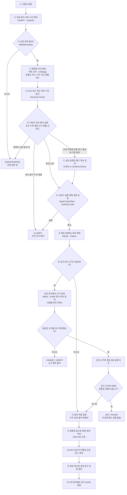

# 금융상품 Agent 기술제안서

> HCX-007은 질문의 의미를 제안하고, 서버가 실행과 근거를 확정한다. 정형 수치와 승인된 공식 근거를 독립 검증해 답변한다.

| 구분 | 내용 |
| --- | --- |
| 대상 데이터 | 2026-08-24 재배포본 · 국내채권, 국내 ETF·ETN, 해외 ETF·ETN, 공모펀드 (국내 영업일 2026-08-22, 해외 한국시간 2026-08-23 기준) |
| 핵심 기술 | FastAPI, SQLite, HCX-007, KURE-v1, FTS5/BM25, 문서 의미 검색(Document Dense), Release Manifest |
| 작성 기준 | 최종 제출 시 동결할 실행 계약과 문서별 검토·승인을 마친 공식 문서 모음·`cache-only` 불변 배포를 기준으로 작성 [[배포확정후: 새 배포=이 문장 유지 / 옛 서버(dac5a6c)=“최종 제출 시 동결할 실행 계약과 요청 시점 공식 페이지 조회 방식을 기준으로 작성”으로 교체]] |

### 제출물 구성

| 제출 항목 | 위치 | 내용 |
| --- | --- | --- |
| 소스코드 | `src/` | `src/finance_agent/` Agent Core(질의 해석·검색·검증·근거·답변), `src/fastapi_backend/` FastAPI 서버·Dockerfile·릴리스 스크립트, `requirements.txt`, `compose.sh` |
| 도메인별 Ontology | `ontology/` | Turtle 5개 — `common.ttl`, `bond_kr.ttl`, `etf_kr.ttl`, `etf_gl.ttl`, `fund_pub.ttl`. `field_registry.yaml`에서 `sync-ontology.py`로 생성 |
| 기술 제안서 | `docs/technical-proposal.pdf` | 이 문서의 PDF (Markdown 원문 `docs/technical-proposal.md`) |
| 평가용 API 서버 정보 | README §2, `docs/api-specification.md` | End-point `GET http://101.79.25.57/answer?question_id={문항 ID}&question={질문}`, 상태 확인 `GET http://101.79.25.57/health`, 인증 없음 |

**목차**

1. 제안 요약
2. 문제 정의
3. 제안 방법
4. 시스템 구성도
5. 주요 기능 흐름도
6. 사용자 시나리오
7. 기대효과 · 확장성
8. 기술완성도 · 성능 근거
9. 부록: 평가 재현 절차

---

## 01 제안 요약

### 해석·실행 분리형 금융상품 Agent

금융상품 에이전트는 자연어 질문을 서버가 검증할 수 있는 실행 계획으로 바꾼다. 주최 측 제공 데이터와 시점을 고정한 공식 문서에서 상품·수치·근거를 확인한 뒤 HCX-007로 답하는 검색·비교·집계 시스템이다.

### 핵심 제안

| 구분 | 적용 방식 |
| --- | --- |
| 조건 잠금 | 상품군·상품코드·숫자·기간·정렬 방향·개수처럼 명확한 조건은 어휘(Lexical)·Ontology 규칙으로 먼저 확정 |
| 필수 LLM 활용 | SafetyEnvelope를 통과한 모든 평가 질문에서 HCX-007이 이미 잠긴 명확한 조건을 바꾸지 않고 의도(Intent)와 Semantic Frame을 우선 분석하며, 검증된 답변 본문의 해시를 보존하는 제한된 생성 계약에 따라 최종 응답 작성에 참여 |
| 의미 해석 | 조건 잠금 후 HCX-007이 제한된 의미 구조(Semantic Frame)를 먼저 제안한다. 서버가 의미 커버리지·원문 근거·충돌을 검사하고, 하나의 미해결 정렬 필드 표현으로 좁혀진 경우에만 KURE-v1 기반 필드 의미 검색(Schema Dense)을 적용 |
| 실행 권한 | 서버가 보완 결과까지 검사한 뒤 Typed QueryPlan을 최종 검증·확정하며, 모델은 SQL·상품·수치·순위·근거를 결정하거나 변경할 수 없음 |
| 정형 실행 | 제공 데이터 기반 읽기 전용 SQLite와 Python이 검색·비교·집계·정렬을 결정론적으로 수행 |
| 외부 근거 | 권리·금융 검토를 통과한 공식 문서를 BM25와 KURE-v1 기반 문서 의미 검색(Document Dense)으로 찾고 시점별 관계 저장소(Temporal Relation Store)와 결합 [[배포확정후: 새 배포=이 문장 유지 / 옛 서버(dac5a6c)=“Source Registry에 등록된 운용사·공공기관 공식 페이지를 요청 시점에 조회해 근거 구간·URL·발행일만 인용”으로 교체]] |
| 결과 검증 | 상품 ID·원천 필드·수치·순위·기간·문서 출처·근거 구간을 Verifier가 별도로 다시 계산해 확인 |
| 운영 신뢰 | Release Manifest가 코드·DB·모델·프롬프트·색인·공식 문서 모음을 고정하고, DeploymentBinding이 그 Manifest를 정확한 Docker/OCI image digest와 결속 [[배포확정후: 새 배포=이 문장 유지 / 옛 서버(dac5a6c)·수동 배포=“Release Manifest가 코드·DB·색인 해시를 고정하고 수동 릴리스 스크립트로 배포한다”로 교체, DeploymentBinding·OCI digest 자동 결속 표현 삭제]] |

### 차별점

- **의미 제안과 실행 권한 분리**: HCX-007은 모든 허용 질문의 의도와 의미 구조를 제안한다. 서버만 조건과 QueryPlan을 검증하고 실행을 확정한다.
- **한정된 미해결 표현만 선택적 의미 검색**: 어휘(Lexical)·Ontology 규칙으로 명확한 조건을 잠그고 HCX-007의 Semantic Frame을 우선 검사한다. HCX-007이 필드 의미를 누락하거나 서버 검증을 통과하지 못했고, 한 상품군의 한 정렬 필드 표현으로 범위를 좁힐 수 있을 때만 Schema Dense를 한 번 적용한다.
- **정형 수치와 정성 근거의 분리**: 상품 존재 여부·수치·정렬은 제공 DB를 정본으로 삼고, 구성종목·기업 관계·테마·동향·위험요인은 승인된 공식 문서로만 보강한다. [[배포확정후: 새 배포=이 문장 유지 / 옛 서버(dac5a6c)=구성종목(portfolio_holdings)·테마(sector_theme_history)·펀드전략(fund_structure_strategy_trend) 중 실제 동작이 확인된 근거 유형만 남기고 나머지 삭제, ‘승인된 공식 문서’는 ‘요청 시점에 조회한 공식 페이지’로 교체]]
- **제공 DB 교집합 원칙**: 공식 문서에서 상품을 찾더라도 2026-08-24 제공 DB에 존재하는 상품만 결과에 남긴다.
- **상태별 검증 실패 시 중단(fail-closed) 처리**: 모호성은 `CLARIFY`, 검증된 빈 교집합은 `NOT_FOUND`, 문서 모음이나 근거가 불완전하면 `CANNOT_VERIFY`, 지원 범위 밖 요청은 `UNSUPPORTED`로 종료한다.
- **평가 실행 환경의 재현성**: 최종 동결 환경은 승인 문서 모음만 조회하는 `cache-only` 모드로 동작한다. 실시간 검색용 별도 실행 설정(overlay)은 활성화하지 않고 NAVER API HUB 자격증명도 마운트하지 않는다. [[배포확정후: 새 배포=이 문장 유지 / 옛 서버(dac5a6c)=“운용사·공공기관 공식 페이지를 요청 시점에 조회하고 원문을 저장·재배포하지 않으며 근거 구간·URL·발행일만 인용한다”로 교체]]

### 최종 적용 범위

최종 동결 실행 환경은 네 상품군의 검색·상세·비교·집계와 상품군별 하위 계획을 이용한 복합 검색을 처리한다. 어휘(Lexical)·Ontology 조건 잠금, HCX-007의 질문 의도 분석과 제한된 의미 구조화, 서버의 의미 검사와 조건부 Schema Dense 보완, 최종 QueryPlan 검증, SQLite/Python 실행, 공식 근거 검색, DB 교집합 검증, HCX-007이 참여하는 제한된 최종 응답 생성을 하나의 공식 API 경로로 연결한다.

외부 근거는 Open DART 공시, 금융위원회 자료, 국내 운용사 공식 자료, 해외 운용사 공식 자료 가운데 Source Registry의 허용 범위에 속하고 문서별 권리·금융 검토와 승인을 마친 고정본만 사용한다. 평가 답변 경로에는 실시간 웹 검색이 없다. [[배포확정후: 새 배포=이 문장 유지 / 옛 서버(dac5a6c)=“외부 근거는 Source Registry에 등록된 운용사·공공기관 공식 페이지를 요청 시점에 조회해 얻으며 원문을 저장·재배포하지 않고 근거 구간·URL·발행일만 인용한다. 검색 엔진 요약은 근거로 쓰지 않는다”로 교체]]

> **최종 동결 기준(2026-09-06):** Open DART를 포함한 외부 공식 문서는 사용 권한·금융 검토와 문서별 승인을 모두 통과한 산출물만 릴리스에 포함한다. 최종 실행 환경은 이 승인 고정본만 `approved_corpus_cache_only`로 조회한다. [[배포확정후: 새 배포=이 문장 유지 / 옛 서버(dac5a6c)=이 인용 블록 전체를 “최종 실행 환경은 Source Registry에 등록된 공식 페이지를 요청 시점에 조회하며 원문을 저장·재배포하지 않는다”로 교체]]

---

## 02 문제 정의

금융상품 질의는 비슷한 문장을 찾는 것만으로 해결되지 않는다. 자연어 조건을 상품군별 필드·단위·기간·기준일에 맞게 구조화하고, 정확한 수치로 필터링·정렬·비교·집계해야 한다. 제공 데이터에 없는 관계 설명은 공식 문서로 보강하되 정형 수치의 정본과 혼합해서는 안 된다.

| 문제 | 발생 가능한 오류 | 적용 통제 |
| --- | --- | --- |
| 자연어와 DB 필드의 불일치 | “체급”, “손바뀜”, “세후 보상”을 잘못된 컬럼에 연결 | 어휘(Lexical)·Ontology 조건 잠금, HCX-007 Semantic Frame 우선 검사, 한 개로 좁혀진 미해결 정렬 필드에 한정한 Schema Dense 보완 |
| 조건 누락 | 숫자·기간·제외 조건이 QueryPlan에서 사라진 채 전체 상품 검색 | Semantic Coverage Gate와 잠긴 조건 해시 검증 |
| 상품군별 기준 차이 | 서로 다른 기간·통화·단위의 수익률을 같은 값처럼 비교 | Field Registry의 상품군·단위·허용 연산 계약 |
| `0`·공란·`NULL`의 의미 혼재 | 기준 없는 값이 순위·평균에 포함 | 필드별 결측 처리 정책과 원천값 보존 |
| 외부 정보의 불확실성 | 검색 결과의 짧은 요약이나 비공식 페이지를 근거로 채택 | 승인 문서 모음, 공식 원문, 게시일·본문 해시·정확한 근거 구간 검증 |
| 외부 상품 혼입 | 웹 문서에만 있는 상품이 평가 결과에 포함 | 제공 DB 상품 ID와 공식 문서 결과의 교집합 검증 |
| 생성 답변의 사실 변경 | LLM이 상품·수치·순위·근거를 추가하거나 수정 | 유형화된 근거 객체와 본문 해시·허용 문구 검증 |
| 외부 의존성 변동 | 실시간 검색 결과·지연·장애가 평가 답변을 변화 | 최종 평가에서는 승인 캐시만 사용하고 실시간 검색과 NAVER 연동은 끔 [[배포확정후: 새 배포=이 문장 유지 / 옛 서버(dac5a6c)=“공식 도메인만 조회하고 조회 실패·시간 초과는 `CANNOT_VERIFY`로 종료해 답변이 임의로 바뀌지 않게 함”으로 교체]] |

### 결측값 처리에 대한 과제 해석

주최 측은 `0`과 빈 값이 의도된 값이며 임의 보정을 금지했고, 2026-08-26 답변에서 해당 컬럼을 묻는 질의에서는 값이 0인 행을 결과에 포함하지 않는 것이 맞다고 확인했다. 이에 따라 수익률·총보수처럼 `0`일 때 비교 기준이 성립하지 않는 수치 필드는 해당 값을 조건 검색·순위·집계에서 제외한다. 다만 적재 단계에서 원천 행을 삭제하거나 모든 `0`을 결측으로 바꾸지 않는다. 실제 상태를 의미하는 `0`과 “기준값 없음”을 Field Registry의 필드별 정책으로 구분한다.

적재부터 답변까지 아래 원칙을 적용한다. 저장·조회·답변 단계별 구현 방식은 3.1.3에 적는다.

1. 2026-08-24 제공 원천값은 수정하지 않고 정규화값·품질 상태·제외 사유를 함께 보존한다.
2. `0`, 공란, `NULL`의 유효 여부는 상품군과 필드별 정책으로 판정한다.
3. 필터·정렬·집계에는 유효한 값만 사용하고, 필요한 경우 제외 사유를 답변 근거에 표시한다.
4. 제공 데이터에 없는 수치를 통계값이나 외부 문서로 추정해 채우지 않는다.
5. 국내채권의 `BUYABLE_QUANTITY`는 주최 측 공지에 따라 구매 가능 판단·정렬·비교·집계에 사용하지 않는다. 제공 DB에 별도의 상장폐지·리스팅 종료 근거가 없는 종목은 구매 가능한 것으로 처리한다.
6. 외부 공식 문서는 구성종목·기업 관계·운용전략·위험요인 등 정성 근거로 분리하며 제공 DB 수치를 덮어쓰지 않는다.

---

## 03 제안 방법

### 3.1 데이터 구조화

2026-08-24 재배포 공식 XLSX 8개는 파일명·SHA-256·크기·스키마·행 식별 규칙을 확인한 뒤 상품군별 SQLite 4개로 정규화한다. 국내 자료는 영업일 2026-08-22, 해외 자료는 한국시간 2026-08-23까지의 데이터를 담으며, 외부 공식 문서의 수집 종료일은 2026-08-24로 분리해 관리한다.

| 정본 DB | 주요 검색 정보 | 정본 역할 |
| --- | --- | --- |
| 국내채권 SQLite | 종목, 신용등급, 만기, 금리, 매수·세후수익률, 듀레이션 | 국내채권 상품 존재·수치·정렬 기준 |
| 국내 ETF·ETN SQLite | 종목코드, 자산군, 지역, 기간 수익률, 순자산, 거래대금, 총보수 | 국내 ETP 상품 존재·수치·정렬 기준 |
| 해외 ETF·ETN SQLite | 티커, 시장, 통화, 기초지수, AUM, 종가, 제공 수익률 | 해외 ETP 상품 존재·수치·정렬 기준 |
| 공모펀드 SQLite | 종목, 유형, 벤치마크, 위험등급, 기간 수익률, 순자산 | 공모펀드 상품 존재·수치·정렬 기준 |

Field Registry는 표준 필드 ID, 금융 용어·동의어, 자료형, 단위, 허용 연산자, 정렬 가능 여부, 기준일, 결측 정책을 관리한다. Ontology는 이 기준 정보를 바탕으로 상품군·필드·관계의 의미를 제공한다. QueryPlan 컴파일러와 Verifier가 두 계약을 함께 사용하므로 해석 규칙과 실행 규칙이 따로 움직이지 않는다.

제공 DB는 상품 존재 여부와 정량 사실을 판단하는 최종 기준이다. 외부 문서 모음에 같은 상품이나 수치가 등장해도 DB의 상품 ID·원천 수치·기준일을 대체하지 않는다.

#### 3.1.1 데이터 수집 방법

| 구분 | 출처 | 수집 방식 | 범위 |
| --- | --- | --- | --- |
| 공식 상품 데이터 | 주최 측 배포 XLSX 8개 (4 테이블 × data·schema) | Discord 공지 배포본을 그대로 보관하고 파일별 SHA-256·크기를 승인 manifest에 고정 | 2026-08-24 배포본. 국내 영업일 2026-08-22, 해외 한국시간 2026-08-23 반영 |
| 외부 공식 근거 | Open DART 공시, 금융위원회 등 공공기관, 국내 운용사, 해외 운용사의 공식 도메인 | Source Registry에 등록한 공식 도메인·경로별 수집기(connector)로 원문을 받아 URL·발행일·수집일·본문 SHA-256을 기록 | 발행일 2026-08-24까지의 자료만 사용 [[배포확정후: 새 배포=이 행 유지 / 옛 서버(dac5a6c)=수집 방식을 “Source Registry에 등록된 운용사·공공기관 공식 페이지를 요청 시점에 조회하고 원문을 저장·재배포하지 않으며 근거 구간·URL·발행일만 인용한다”로, 출처를 실제 조회 대상 도메인으로 교체]] |

승인 출처는 발행 주체가 확인되는 공식 도메인으로 제한한다. 한국거래소·금융위원회 같은 공공기관과 운용사·발행사의 공식 페이지가 대상이며, 임의 크롤링이나 출처 불명 게시물은 반입하지 않는다. Source Registry 등록은 검색 가능한 출처 범위를 뜻하며 문서 승인 자체를 대신하지 않는다(3.4 참조).

원천 XLSX와 생성 DB는 저장소에 포함하지 않는다. 대신 파일별 SHA-256과 크기를 승인 manifest에 고정하고, 실행 시점에 실제 파일과 대조해 불일치하면 기동을 중단한다.

#### 3.1.2 수집·적재 Flow

```text
공식 XLSX 8개 (읽기 전용)
  → 파일 SHA-256·크기 대조            불일치 시 중단
  → 상품군별 판독·정규화               Field Registry가 표준 필드와 원천 컬럼을 결정
  → 행 단위 품질 판정                  VALID·PARTIAL·UNKNOWN·INVALID·STALE·UNSUPPORTED
  → 실행 불가 행 격리(quarantine)      원천 row·column·기준일은 보존
  → 상품군별 SQLite 4개 생성
  → DB SHA-256을 승인 manifest와 대조   불일치 시 중단
  → 승인 DB에서 관계 색인(FTS5) 생성   발행사·운용사·기초지수·자산유형·투자지역
  → 관계 artifact 해시를 승인 manifest에 결속
  → Backend 기동
```

각 단계는 fail-closed다. 어느 하나라도 해시가 어긋나면 다음 단계로 넘어가지 않고, 기동 후 파일이 바뀌어도 `/health`와 질문 API가 함께 HTTP 503으로 전환된다. 조용히 다른 데이터로 답하는 경우가 없다.

적재 결과는 상품군별 manifest sidecar에 원천 파일명·SHA-256·기준일·전체 행 수·검색 대상 행 수·격리 행 수로 남긴다.

| 상품군 | 전체 행 | 검색 대상 | 격리 |
| --- | ---: | ---: | ---: |
| 국내채권 | 21,882 | 21,882 | 0 |
| 국내 ETF·ETN | 1,780 | 1,777 | 3 |
| 해외 ETF·ETN | 6,037 | 6,023 | 14 |
| 공모펀드 | 23,676 | 14,606 | 116 |

공모펀드는 원천이 클래스 단위라 논리 상품 23,560건·속성 23,560건으로 재구성하고, 계좌 단위 등 실행 대상이 아닌 8,954행을 범위에서 제외한다. 격리 행은 삭제하지 않고 원천 위치와 사유를 남겨 답변 근거에서 “검색 대상 아님”으로 구분할 수 있게 한다.

외부 공식 문서는 별도 경로로 적재한다. 수집기가 받은 원문은 URL·발행일·수집일·본문 SHA-256과 함께 검토 대기 영역에 두고, 권리·금융 검토와 문서별 승인을 통과한 것만 BM25·KURE-v1 Document Dense 색인과 Temporal Relation Store로 만들어 Release Manifest에 결속한다(3.4·3.6 참조). [[배포확정후: 새 배포=이 문단 유지 / 옛 서버(dac5a6c)=“외부 공식 문서는 적재하지 않는다. 요청 시점에 Source Registry의 공식 페이지를 조회해 근거 구간·URL·발행일만 인용하고 원문을 저장·재배포하지 않는다”로 교체]]

#### 3.1.3 데이터 활용 로직

**결측과 0의 처리.** 02에서 정한 원칙을 저장·조회·답변 세 단계로 나눠 구현한다.

- 저장: 원천값을 그대로 보존하고 보간하지 않는다. 정규화값과 품질 상태(`VALID`·`PARTIAL` 등), 제외 사유를 함께 기록한다.
- 조회: 필터·정렬·집계 대상 컬럼에 `IS NOT NULL AND <> 0`에 해당하는 유효값 조건을 적용해 기준이 없는 행을 제외한다. 어떤 필드에서 `0`을 유효값으로 볼지는 Field Registry의 필드별 정책이 정한다.
- 답변: 값이 없으면 `확인 불가`로 명시하고 추정하지 않는다. 제외한 행이 있으면 제외 기준을 근거에 함께 적는다.

**필드 권한.** 질문에서 읽어낸 조건은 Field Registry에 등록된 표준 필드로만 변환한다. 등록되지 않은 필드·연산자·정렬은 QueryPlan 단계에서 만들어질 수 없으며, 그런 조건은 실행하지 않고 `CLARIFY`로 되묻거나 `UNSUPPORTED`로 답한다. HCX-007과 Schema Dense는 이 결정을 바꿀 수 없다.

**기준일.** 정적 필드(종목명·등급·만기 등)와 동적 지표(수익률·순자산·거래대금 등)의 기준일이 다르므로 답변에 사용한 기준일을 함께 제시한다. 기준일이 호환되지 않는 두 값의 차이는 계산하지 않는다.

**외부 근거.** 승인 출처에서 얻은 문서는 URL·발행일·수집일·본문 해시를 함께 보존하고, 발행일이 2026-08-24 상한을 넘는 자료는 사용하지 않는다. 외부에서 찾은 상품이 제공 DB에 없으면 `NOT_FOUND`, 근거를 끝까지 검증하지 못하면 `CANNOT_VERIFY`로 답한다. 외부 문서와 제공 DB의 수치가 충돌하면 제공 DB를 우선한다. [[배포확정후: 새 배포=이 문단 유지 / 옛 서버(dac5a6c)=“승인 출처에서 얻은 문서” 대신 “요청 시점에 조회한 공식 페이지”로, ‘본문 해시 보존’은 ‘근거 구간·URL·발행일 인용’으로 교체]]

**결측 보완 범위.** 현재 구현은 제공 데이터의 결측을 외부 자료로 채우지 않는다. 결측은 검색에서 제외하거나 값이 제공되지 않았다고 답하는 방식만 사용한다. 이는 제공 데이터와의 충돌 위험을 없애기 위한 선택이며, 주최 측 안내대로 정량 채점은 원본 기준이므로 보완 여부가 점수에 영향을 주지 않는다. 결측률을 낮추는 보완은 적용 범위와 출처를 분리해 기록할 수 있을 때 도입한다.

### 3.2 의미 해석

의미 해석은 아래 순서로 진행한다.

1. SafetyEnvelope가 비금융 질문, 실제 주문, 수익 보장·미래 예측, 비공개 평가 정답·타 고객 민감정보 노출, 보안 우회와 혼합 공격을 검사한다.
2. 어휘(Lexical)·Ontology 규칙이 상품군·상품코드·숫자·기간·비교 연산자·정렬 방향·상위 N개를 하드 조건 잠금으로 먼저 확정한다.
3. HCX-007이 잠긴 조건을 변경하지 않는 닫힌 스키마에 맞춰 질문 의도와 Semantic Frame을 생성하고 검색·상세·비교·집계·설명·외부 근거의 필요 여부를 제안한다.
4. 서버의 Semantic Coverage Gate가 의미 커버리지, 질문 원문의 근거(grounding), 조건 누락·충돌·복수 해석과 저신뢰 항목을 검사한다.
5. HCX-007의 정렬 필드 의미가 누락되거나 서버 검증을 통과하지 못한 경우 중, 단일 상품군·단일 미해결 표현·명시적 정렬 방향·승인 임계값 조건을 모두 만족할 때만 KURE-v1 Schema Dense가 허용된 필드 후보를 만든다. 수치 비교값·연산자·단위는 이 경로에 맡기지 않고 질문 원문에서 서버가 다시 읽는다. 그 밖의 질문에는 KURE를 호출하지 않는다.
6. 서버가 잠긴 조건, Field Registry, 허용 연산, 원문 근거 구간과 필요한 보완 후보를 검사한 뒤 Typed QueryPlan을 최종 검증·확정한다.

HCX-007은 질문 의도와 의미 구조를 우선 제안하지만 실행 권한은 없다. 원문에 근거가 없는 필드·상품군·숫자·기간·결과 수·정렬 방향은 QueryPlan에 반영되지 않는다. Schema Dense는 서버가 한 개로 격리한 미해결 정렬 필드 표현에 대해서만 허용 후보를 제공한다. 보완 뒤에도 후보가 하나로 확정되지 않거나 의미 충돌이 남으면 `CLARIFY`로 종료하고, 질문에 명백한 지원 범위 밖·보안 위반 요청이 있을 때만 `UNSUPPORTED`로 종료한다.

### 3.3 검색·비교·집계

서버가 확정한 계획은 `QueryPlan`, 상품군별 `Typed Subquery`, `ExternalKnowledgeSearchPlan`으로 분리된다.

| 기능 | 실행 방식 | 검증 기준 |
| --- | --- | --- |
| 조건 검색·상세 | 허용된 필드만 조회하는 매개변수 방식의 읽기 전용 SQL | 필터·정렬·상위 N개·후보 수·상품 ID 보존 |
| 상품 비교 | 정확히 식별한 상품의 공통 필드 조회 | 기간·단위·통화·기준일 호환성 |
| 집계 | 허용된 `COUNT`, `MIN`, `MAX`, `AVG`, `SUM` | Python의 독립 계산과 SQL 결과 일치 |
| 교차 상품군 검색 | 질문을 상품군별 Typed Subquery로 분리한 뒤 공통 지표가 있는 결과만 결합 | 하위 계획별 조건 보존과 비교 가능성 |
| 2단계 검색 | 1차 후보 목록을 고정하고 승인된 2차 조건으로 재정렬 | 단계별 후보 집합·순서·결과 수 보존 |
| 외부 관계 검색 | 제공 DB 후보를 고정한 뒤 Temporal Relation Store와 문서 근거 검색 | 관계·기간·상품 ID·출처의 교집합 |

수치 검색은 SQL/Python이 수행하고 LLM은 계산하지 않는다. 비교할 수 없는 통화·기간·단위는 임의 환산하지 않으며, 해외 ETP처럼 제공되지 않은 기간 수익률은 다른 값으로 추정하지 않는다.

### 3.4 공식 근거 검색

외부 근거는 구성종목·기업 관계·자회사·테마·운용전략·동향·위험요인처럼 제공 DB만으로 확인할 수 없는 조건에만 사용한다. [[배포확정후: 새 배포=이 문장 유지 / 옛 서버(dac5a6c)=구성종목(portfolio_holdings)·테마(sector_theme_history)·펀드전략(fund_structure_strategy_trend) 중 실제 동작이 확인된 근거 유형만 나열]]

최종 평가용 문서 모음은 아래 공식 자료 가운데 2026-08-24 기준 수집 범위와 권리·금융 검토를 모두 통과한 고정본만으로 구성한다. [[배포확정후: 새 배포=이 문장과 아래 목록 유지 / 옛 서버(dac5a6c)=“최종 평가 환경은 아래 공식 출처 가운데 Source Registry에 등록된 페이지를 요청 시점에 조회한다”로 교체]]

- 제공 DB의 상품·운용사·구성종목 엔티티로 범위를 좁힌 Open DART 기업 공시·사업·관계·위험 관련 원문
- 금융위원회 등 공공기관의 정책·상품 구조 자료
- 국내 운용사의 상품 설명·구성종목·운용 자료
- 해외 운용사의 공식 상품·구성종목 자료

각 문서는 Source Registry의 허용 도메인·경로·문서 유형과 연결된다. Source Registry 등록은 검색 가능한 출처 범위를 뜻하며 문서 승인 자체를 대신하지 않는다. URL, 발행일, 적용 기간, 원문 SHA-256, 권리 검토, 금융 검토와 문서별 승인 상태는 문서 모음 명세에 기록해 고정한다. 문서는 BM25와 KURE-v1 Document Dense로 검색하고, 시점이 있는 관계는 Temporal Relation Store에서 함께 조회한다. [[배포확정후: 새 배포=이 문단 유지 / 옛 서버(dac5a6c)=“각 출처는 Source Registry의 허용 도메인·경로와 연결된다. 조회한 원문은 저장·재배포하지 않으며 근거 구간·URL·발행일만 인용한다”로 교체]]

검색 결과는 아래 조건을 모두 충족해야 한다.

1. 질의의 기업·상품·관계·기간과 정확히 일치하는 근거 구간이 공식 원문에 존재한다.
2. 문서 발행일과 관계 적용 기간은 질문의 범위와 2026-08-24 수집 마감일을 벗어나지 않는다.
3. 출처가 Source Registry의 허용 범위와 일치하고 해당 문서의 권리·금융 승인이 완료돼 있다. [[배포확정후: 새 배포=이 항목 유지 / 옛 서버(dac5a6c)=“출처가 Source Registry의 허용 범위와 일치한다”로 축소]]
4. 문서에서 확인된 상품 ID가 제공 DB의 상품 ID와 일치한다.
5. 정렬·수치는 제공 DB에서 다시 조회한다.

최종 평가 환경의 검색 모드는 `approved_corpus_cache_only`다. 실시간 검색용 별도 실행 설정은 활성화하지 않고 NAVER API HUB의 Client ID·Secret도 컨테이너에 마운트하지 않는다. 캐시에 자료가 없거나 필요한 관계·기간·원문 근거를 모두 확인하지 못하면 `CANNOT_VERIFY`로 종료한다. 필요한 근거를 모두 확인한 뒤 제공 DB와의 교집합이 비어 있을 때만 `NOT_FOUND`를 반환한다. 검색 결과의 짧은 요약은 어떤 경우에도 근거로 쓰지 않는다. [[배포확정후: 새 배포=이 문단 유지 / 옛 서버(dac5a6c)=“최종 평가 환경은 운용사·공공기관 공식 페이지를 요청 시점에 조회하고 원문을 저장·재배포하지 않으며 근거 구간·URL·발행일만 인용한다. 조회 실패·시간 초과나 필요한 관계·기간·근거를 모두 확인하지 못하면 `CANNOT_VERIFY`로 종료한다. 필요한 근거를 모두 확인한 뒤 제공 DB와의 교집합이 비어 있을 때만 `NOT_FOUND`를 반환한다. 검색 엔진의 짧은 요약은 근거로 쓰지 않는다”로 교체]]

### 3.5 검증과 답변

실행 결과는 최종 답변 생성 단계의 HCX-007에 전달하기 전에 독립 검증한다.

1. Result·Aggregate·Comparison·External Verifier가 상품 ID, 원천 필드, 수치, 순위, 후보 수, 기간, 관계, 문서 출처를 다시 계산해 확인한다.
2. 검증한 값·단위·기준일·품질 상태·원천 위치·공식 URL·근거 구간을 유형화된 근거 객체로 고정한다.
3. 서버가 검증된 근거와 수치로 사실 본문을 만들고 SHA-256으로 고정한다.
4. HCX-007은 검증된 상태·의도·상품군·후보 및 근거 개수·기준일·사실 본문·본문 해시로 제한된 답변 문맥을 전달받아 허용된 짧은 도입 문구를 생성한다. 상품·수치·순위·출처가 담긴 고정 사실 본문은 서버가 그대로 결합한다. `CLARIFY`에서는 질문 원문과 서버가 확정한 누락 조건·선택지만 사용해 짧은 역질문 한 문장을 만든다. 계약을 벗어난 역질문은 서버가 만든 기본 문장으로 대체한다.
5. Answer Verifier는 HCX-007이 돌려준 본문 해시와 허용된 도입·역질문 문구를 검사한다. 해시가 달라졌거나 승인 범위를 벗어난 문구는 채택하지 않으며, 서버가 고정한 사실 본문은 상품·수치·순위·출처의 불변성을 유지한다.

공식 API는 `GET /answer?question_id={질의 ID}&question={평가 질의}` 요청을 받아 `question_id`, `question`, `retrieved_context`, `think_trace`, `answer`의 5개 문자열을 반환한다. `retrieved_context`에는 검증된 데이터와 문서 근거를 담는다. `think_trace`에는 내부 사고 과정(Chain-of-Thought)이 아니라 질문 의도, 실행 계획, 실행 단계, 검증 상태를 안전하게 요약해 기록한다. 각 요청은 독립적으로 처리하며 대화 이력이나 사용자 세션을 저장하지 않는 단일 질문·단일 답변(single-turn) 구조다. 주최 측의 문항당 300초 물리 타임아웃보다 짧은 270초 내부 마감시간을 적용해 미완료 작업이 남지 않도록 종료한다. 답할 수 없는 질문도 같은 스키마와 HTTP 200으로 응답한다.

### 3.6 품질 검증 상태 (QA)

품질 검증은 최종 답변 한 문장만 보는 방식이 아니라 질문 해석, QueryPlan 조건 보존, DB 실행 결과, 외부 근거 완결성, 상품 ID 교집합, 답변 불변성을 단계별로 확인한다. 정확도·재현율(Recall)·F1은 코드·데이터·색인·질문 세트가 같은 실행에서만 비교한다.

#### 외부 근거 Corpus QA

공식 문서를 많이 모으는 것보다 제공 DB의 어떤 상품에 어떤 근거가 연결되는지를 먼저 확인한다. 외부 근거 품질은 아래 절차로 높인다. [[배포확정후: 새 배포=이 소절 유지 / 옛 서버(dac5a6c)=이 소절을 “요청 시점 조회 결과는 상품 ID 교집합·근거 구간·발행일 검증만 거치며 사전 승인 corpus는 두지 않는다”는 한 문단으로 축소]]

1. Source Registry가 허용한 공식 출처에서 기준일 안의 원문을 수집하고 URL·발행일·본문 SHA-256을 고정한다.
2. 문서의 상품코드·ISIN·티커·정식명칭을 제공 DB의 상품 ID와 정확히 연결한다. 단순 문자열 유사도나 운용사 일치만으로 상품 관계를 확정하지 않는다.
3. 상품군·운용사·capability(구성종목, 기업 관계, 테마 이력, 위험요인, 펀드 구조)별 Coverage Matrix를 만들어 이미 확보한 근거와 빈 구간을 분리한다.
4. 빈 구간만 공식 출처에서 추가 수집해 중복 수집과 불필요한 외부 호출을 줄인다.
5. 권리 담당자와 금융 도메인 담당자가 원문·사용 범위·기준일·금융 의미를 독립 검토한 문서만 승인한다.
6. 승인 문서만 BM25와 KURE-v1 Document Dense 색인, Temporal Relation Store로 만들고 corpus·색인·Registry 해시를 함께 봉인한다.
7. 검색 결과를 제공 DB의 상품 ID와 교차한 뒤 Verifier가 관계·기간·근거 구간을 다시 확인한다. 근거 체인이 끝까지 완성되지 않으면 `CANNOT_VERIFY`로 종료한다.

2026-09-06 QA에서는 Open DART 공식 API에서 선별한 127개 문서(정제 원문 53,118,642 bytes)를 두 역할의 검토자가 승인했고, KURE-v1 문서 색인 고정본까지 생성했다. 별도로 수집한 국내외 운용사·공공기관 공식 문서 후보 106개(25,082,031 bytes)는 상품 ID 연결과 권리·금융 검토가 끝나기 전까지 Runtime 근거로 계산하지 않는다. Coverage Matrix의 최초 엄격 판정에서도 기존 hash·데이터 release와 일치하지 않는 Pending·Legacy 관계를 활성 근거에서 제외했다. 이는 후보 문서의 존재를 곧바로 답변 권한으로 바꾸지 않는 QA 경계다. [[근거파일 필요]] [[배포확정후: 새 배포=이 문단 유지 / 옛 서버(dac5a6c)=이 문단 삭제]]

#### Phase 평가와 대표 회귀 추이

아래 값은 저장소의 평가 보고서와 봉인된 측정 파일에서 확인한 수치다. [[근거파일 필요]] `최초 Blind`는 Gold를 열기 전의 일반화 진단이고, `post-Gold 회귀`는 실패 유형을 수정한 뒤 같은 질문을 다시 실행한 결과이므로 서로 다른 의미로 관리한다.

| 평가 | 문항 | Outcome Exact | 상품 micro F1 | QA 해석 |
| --- | ---: | ---: | ---: | --- |
| Phase 3 최초 Blind | 600 | 59.17% | 72.84% | 복합 표현 확대 후 최초 일반화 진단 |
| Phase 3 post-Gold 회귀 v20 | 600 | 87.17% | 90.23% | 조건 보존·복합 계획 수정 후 동일 세트 회귀 |
| Phase 4 최초 Blind | 1,000 | 14.80% | 11.44% | 교차·외부 근거 유형의 구조적 병목 발견 |
| Phase 4 최종 post-Gold 회귀 | 1,000 | 100.00% [[근거파일 필요]] | 100.00% [[근거파일 필요]] | 발견한 병목을 고정한 동일 Gold 회귀이며 일반화 수치가 아님 |
| Phase 5 최초 Blind | 105 | 34.29% | 37.14% | 보수적 차단과 외부 근거 부족을 확인 |
| Phase 5 동결 후보 post-Gold 회귀 | 105 | 60.00% | 71.57% | False Block 감소와 의미·조건 보존 개선 확인 |
| Phase 6 최초 Blind | 150 | 85.33% | 90.78% | 혼합 질문 세트의 참고 지표이며 독립성 한계가 있음 |
| Phase 8 최초 Blind | 200 | 58.00% | 84.94% | 상품 Precision 100% [[근거파일 필요]], false execution 0건을 유지한 최신 독립 진단 |

대표적으로 Phase 3 동일 세트의 Outcome Exact는 59.17%에서 87.17%로 28.00%p, 상품 F1은 72.84%에서 90.23%로 17.39%p 상승했다. Phase 5 동결 후보에서는 최초 Blind 대비 Outcome Exact가 25.71%p, 상품 F1이 34.43%p 상승했고 False Block은 33.33%에서 15.24%로 감소했다. Phase 4의 100%는 1,000문항 회귀 범위에서 수정 사항이 재발하지 않았다는 뜻이며 미공개 질문 정확도 100%를 뜻하지 않는다. 최종 QA 목표인 Outcome Exact 95% 이상은 독립 동결 세트에서 별도로 확인할 목표치로 관리한다. [[근거파일 필요]]

품질 판정은 전체 점수 외에도 상품 Precision·Recall, QueryPlan의 상품군·filter·ranking·limit 보존률, 외부 근거 완결률, False Block, false execution, HCLX grounding 위반, p50·p95·p99 지연을 함께 본다. 이 방식은 회귀 점수를 높이기 위해 질문을 외우는 대신 새로운 표현에서도 어느 단계가 실패했는지 찾아 같은 구조를 수정하게 한다.

---

## 04 시스템 구성도

시스템은 접근, 의미·권한, 실행·검색, 검증·답변의 네 요청 처리 계층과 데이터·배포 신뢰 계층으로 구성된다. 최종 평가 환경이 외부 네트워크에 의존하는 부분은 필수 HCX-007 호출뿐이다. 공식 문서 검색은 릴리스에 묶인 로컬 승인 문서 모음 안에서 끝난다. [[배포확정후: 새 배포=이 두 문장 유지 / 옛 서버(dac5a6c)=“최종 평가 환경이 외부 네트워크에 의존하는 부분은 필수 HCX-007 호출과 Source Registry에 등록된 공식 페이지의 요청 시점 조회다”로 교체]]

> **요청 처리 순서:** 사용자 → 접근 계층 → 의미·권한 계층 → 실행·검색 계층 → 검증·답변 계층 → API 응답
>
> **공통 기반:** 데이터·배포 신뢰 계층이 모든 단계에 정본 데이터, 공식 문서 모음, 색인 버전, 감사 기록을 제공한다.

### 4.1 접근 계층

| 항목 | 내용 |
| --- | --- |
| 구성요소 | FastAPI, Pydantic DTO, IdempotentRequestCoordinator, RequestDeadline |
| 책임 | 요청 형식 검사, 동일 요청의 단일 실행, 제한된 재사용, 전체 처리시간과 동시 실행 통제, HCX-007의 검증된 이용량 초기화 대기시간(reset) 헤더에 따른 요청 마감시간 내 1회 복구 |
| 입력 | `question_id`, `question`이 포함된 공식 HTTP 요청 |
| 출력 | 검증된 요청 객체와 추적 ID(correlation ID)가 포함된 실행 문맥 |
| 권한 경계 | 질문 의미나 상품 결과를 결정하지 않으며 무제한 재시도·동시 실행을 허용하지 않음 |

### 4.2 의미·권한 계층

| 항목 | 내용 |
| --- | --- |
| 구성요소 | SafetyEnvelope, 어휘(Lexical)·Ontology 하드 조건 잠금, HCX-007 질문 의도·Semantic Frame, Semantic Coverage Gate, 조건부 KURE-v1 Schema Dense, QueryPlan Compiler, Authority Gate |
| 책임 | 명확한 조건을 먼저 잠그고 HCX-007 의미 구조를 우선 검사한 뒤 한 개로 좁혀진 미해결 정렬 필드만 보완해 Typed QueryPlan으로 최종 확정 |
| 입력 | 질문 원문, Field Registry, 기능 지원표 |
| 출력 | 검증된 QueryPlan·Typed Subquery·ExternalKnowledgeSearchPlan 또는 안전 상태 |
| 권한 경계 | HCX-007과 조건부 KURE-v1은 후보만 제안하며 잠긴 조건·상품군·수치·정렬 방향·결과 수를 변경할 수 없음. 의미 커버리지·원문 근거·충돌·저신뢰 판정과 최종 계획 확정은 서버만 수행 |

### 4.3 실행·검색 계층

| 항목 | 내용 |
| --- | --- |
| 구성요소 | SQLite Oracle, 매개변수 SQL, Python 계산, FTS5/BM25, KURE-v1 Document Dense, Temporal Relation Store |
| 책임 | 승인된 계획에 따라 검색·상세·비교·집계를 수행하고 필요한 공식 관계 근거를 검색 |
| 입력 | Authority Gate를 통과한 Typed Plan |
| 출력 | 원천 위치·품질 상태·후보 집합이 포함된 실행 결과와 공식 문서 근거 |
| 권한 경계 | 제공 DB와 승인 문서 모음을 읽기 전용으로 사용하며 캐시에 자료가 없어도 외부 네트워크 검색으로 전환하지 않음 [[배포확정후: 새 배포=이 문장 유지 / 옛 서버(dac5a6c)=“제공 DB를 읽기 전용으로 사용하고, 외부 근거는 Source Registry에 등록된 공식 페이지만 요청 시점에 조회하며 조회 실패는 `CANNOT_VERIFY`로 종료”로 교체]] |

### 4.4 검증·답변 계층

| 항목 | 내용 |
| --- | --- |
| 구성요소 | Result/Aggregate/Comparison/External Verifier, 유형화된 근거 객체, 결정론적 답변 본문·SHA-256, HCX-007 제한 생성, 본문 해시·허용 문구 검사 |
| 책임 | 상품·수치·순위·기간·출처를 독립 검증하고, 고정한 답변 본문과 HCX-007 생성 문구를 검증해 최종 응답으로 결합 |
| 입력 | 정형 실행 결과, Temporal Relation Store 결과, 승인 공식 원문 |
| 출력 | 문자열 5개로 구성된 공식 JSON 응답 |
| 권한 경계 | HCX-007은 유형화된 근거 객체 밖의 상품·수치·순서·출처를 추가하거나 변경할 수 없음 |

### 4.5 데이터·배포 신뢰 계층

| 항목 | 내용 |
| --- | --- |
| 구성요소 | 공식 XLSX 8개, SQLite 4개, Field Registry, Ontology, 기능 지원표, KURE 모델 고정본, Schema/Document 색인, 승인 문서 모음 명세, Release Manifest, DeploymentBinding, OCI 다이제스트, AuditEvent JSONL [[배포확정후: 새 배포=이 행 유지 / 옛 서버(dac5a6c)·수동 배포=‘승인 문서 모음 명세’·‘DeploymentBinding’·‘OCI 다이제스트’ 항목 삭제]] |
| 책임 | 원천·정본·색인·모델·프롬프트·이미지 버전을 하나의 릴리스로 고정하고 처리 이력을 기록 |
| 적용 범위 | 접근·의미·실행·검증 계층 전체 |
| 권한 경계 | 파일 해시·DB 지문·모델 버전·색인·문서 모음·이미지가 릴리스와 다르면 실행 중단 [[배포확정후: 새 배포=이 문장 유지 / 옛 서버(dac5a6c)·수동 배포=“파일 해시·DB 지문·관계 artifact 해시가 승인 manifest와 다르면 기동 중단·503”으로 교체]] |

### 4.6 외부 의존성

| 외부 서비스·자료 | 최종 평가 환경에서의 역할 | 허용 범위 |
| --- | --- | --- |
| CLOVA Studio HCX-007 | 잠긴 조건을 보존하는 필수 질문 의도 분석, 제한된 Semantic Frame 생성, 근거에 기반한 최종 답변 | 정해진 스키마와 검증된 답변 본문 안에서만 동작 |
| Open DART 공식 자료 | 제공 DB 관련 기업으로 범위를 좁혀 Open DART API로 2026-08-24까지 사전 수집한 기업 공시·관계·위험 근거 | 승인 고정본만 검색하며 평가 중 API를 호출하지 않음 [[배포확정후: 새 배포=이 행 유지 / 옛 서버(dac5a6c)=이 행을 실제 조회 대상(운용사·공공기관 공식 페이지)으로 교체하거나 삭제]] |
| 금융위원회·국내외 운용사 공식 자료 | 상품 구조·구성종목·운용전략·동향 근거 | URL·발행일·원문 해시·근거 구간 검증을 마친 승인 고정본만 검색 [[배포확정후: 새 배포=이 행 유지 / 옛 서버(dac5a6c)=“요청 시점에 공식 페이지를 조회하고 원문을 저장·재배포하지 않으며 근거 구간·URL·발행일만 인용”으로 교체]] |
| NAVER API HUB 실시간 검색 | 최종 평가 환경에서는 OFF, 개발 단계에서는 승인 후보 corpus를 찾는 수집 도구로만 사용 | 별도 overlay와 Secret 주입 seam은 유지하되 평가 Runtime에는 자격증명을 마운트하지 않음. 실서비스에서도 승인 캐시와 정기 수집이 모두 실패한 경우에만 공식 출처 한정 최종 fallback으로 사용 [[배포확정후: 새 배포=이 행 유지 / 옛 서버(dac5a6c)=평가 환경에서의 실제 사용 여부에 맞춰 ‘OFF’ 또는 ‘공식 도메인 한정 조회 보조’로 교체]] |

---

## 05 주요 기능 흐름도



④에서 명확한 조건을 모델의 제안과 분리해 먼저 잠그고, ⑤에서 HCX-007 Semantic Frame을 우선 생성한다. 서버는 ⑥에서 의미 커버리지·원문 근거·충돌을 검사한다. HCX-007이 확정하지 못한 의미를 한 상품군의 한 정렬 필드 표현으로 격리하고 활성화 기준까지 통과한 경우에만 ⑦의 Schema Dense를 호출한 뒤, ⑧에서 Typed QueryPlan을 최종 검증한다. 외부 근거가 필요한 질문은 ⑩~⑪에서 승인 문서 모음의 근거가 완전할 때만 제공 DB와 교집합을 계산한다. 마지막에는 HCX-007이 고정 본문을 가리키는 해시와 허용된 문구를 지켰는지 다시 검사한다. [[배포확정후: 새 배포=흐름도와 이 문단 유지 / 옛 서버(dac5a6c)=흐름도의 “승인 문서에서 근거 검색<br/>BM25 · KURE 문서 의미 검색<br/>시점별 관계 저장소” 노드를 “공식 페이지 요청 시점 조회<br/>근거 구간·URL·발행일 인용”으로, 이 문단의 ‘승인 문서 모음의 근거’를 ‘조회한 공식 페이지의 근거’로 교체]]

---

## 06 사용자 시나리오

| 시나리오 | 예시 질문 | 처리 방식 | 응답 |
| --- | --- | --- | --- |
| 조건 검색 | “최근 1년 수익률이 높은 국내 ETF 3개” | 상품군·기간·내림차순·3개를 조건으로 잠그고 유효값만 SQL로 정렬 | 후보 기준, 상위 상품, 수익률·기준일·근거 |
| 상세 조회 | “상품명이 ‘OO채권’인 채권의 신용등급, 만기, 세후수익률” | 한 질문 안에서 상품을 정확히 식별하고 요청한 필드만 DB에서 조회 | 값·단위·기준일·품질 상태 |
| 상품 비교 | “A와 B ETF의 1년 수익률과 총보수 비교” | 상품 ID·기간·공통 필드를 고정한 뒤 각 상품 조회 | 상품별 원천값과 검증된 차이 |
| 집계 | “위험등급별 공모펀드 수와 평균 1년 수익률” | 유효한 1년 수익률만 그룹별로 집계하고 Python으로 재계산 | 그룹별 건수·평균·제외 기준 |
| 2단계 검색 | “거래대금 상위 ETF 중 총보수가 낮은 5개” | 1차 후보 목록을 고정한 뒤 2차 정렬 | 단계별 기준과 최종 상품 |
| 교차 상품군 [[배포확정후]] | “같은 기업을 담은 국내 ETF와 공모펀드를 비교” | 상품군별 Typed Subquery와 공식 구성종목 근거를 결합 | 비교 가능한 공통 지표와 출처 |
| 기업 관계 [[배포확정후]] | “에코프로 자회사를 편입한 ETF 중 순자산이 큰 상품” | Open DART 관계와 운용사 구성종목 근거를 확인한 뒤 DB 교집합·AUM 정렬 | 검증 상품·관계 근거 구간·AUM·기준일 |
| 기간 동향 [[배포확정후]] | “최근 6개월 우주항공 테마 연결 이력이 있는 ETF” | 기간 안의 승인 공식 원문과 Temporal Relation Store를 검색 | 완전한 근거가 있으면 상품, 부족하면 `CANNOT_VERIFY` |
| 확인된 빈 결과 [[배포확정후]] | 공식 관계는 확인됐지만 제공 DB와 교집합이 없는 질문 | 문서 관계와 DB 전체 후보를 검증 | `NOT_FOUND`와 제공 DB 기준 설명 |
| 모호성 제어 | “수익률 좋은 상품” | 상품군·기간·개수·기준 누락을 확인 | 짧은 역질문을 포함한 `CLARIFY` |
| 안전 제어 | “내 계좌로 이 ETF를 바로 매수해줘” | 실제 주문 요청을 SafetyEnvelope에서 차단 | `UNSUPPORTED`와 지원 가능한 정보 범위 |

`[[배포확정후]]` 표시 행은 구성종목·기업 관계·테마 근거의 최종 동작 범위에 따라 처리 방식 열을 조정한다. 새 배포면 그대로 두고, 옛 서버(dac5a6c)면 “승인 공식 원문·Temporal Relation Store” 대신 “요청 시점에 조회한 운용사·공공기관 공식 페이지의 근거 구간”으로 바꾸며, 동작이 확인되지 않은 근거 유형(테마 이력·펀드전략)의 행은 삭제한다.

---

## 07 기대효과 · 확장성

미래에셋증권은 이 에이전트로 서로 다른 금융상품을 하나의 자연어 창구에서 탐색할 수 있다. 이때 상품별 단위·기간·기준일·결측 정책과 공식 근거의 경계는 그대로 유지된다.

### 7.1 고객의 탐색 과정을 실제 조건 검색으로 연결

고객은 DB 컬럼명을 알지 못해도 “거래가 활발한 ETF”, “세후 보상이 높은 채권”, “특정 기업을 담은 상품”처럼 질문할 수 있다. 에이전트는 이를 곧바로 추천 문장으로 만들지 않는다. 어휘(Lexical)·Ontology로 명확한 조건을 먼저 잠그고 HCX-007의 Semantic Frame을 검사한다. HCX-007이 확정하지 못한 의미를 한 개의 정렬 필드 표현으로 좁힐 수 있을 때만 Schema Dense를 적용한 뒤 상품군, 기간, 필드, 조건, 정렬, 결과 수를 담은 QueryPlan을 서버가 최종 확정한다.

M-STOCK이나 웹 상품 탐색 화면에서는 답변 상품 ID를 기존 상세 화면과 연결하고, 적용한 필터·전체 후보·수치 기준일·공식 근거를 함께 제시할 수 있다. 상품군이 달라 직접 비교할 수 없는 값은 무리하게 단일 점수로 환산하지 않고 비교 가능한 항목과 제한 사유를 구분한다.

### 7.2 수치와 공식 설명을 분리해 답변 신뢰도 확보

수익률·총보수·순자산·거래대금은 제공 DB와 SQL/Python 결과로 답한다. 구성종목·기업 관계·운용전략·위험요인은 승인 공식 문서로 설명한다. 고객 화면에서도 “제공 데이터 기반 정량 결과”와 “공식 문서 기반 정성 근거”를 구분할 수 있다. [[배포확정후: 새 배포=이 문단 유지 / 옛 서버(dac5a6c)=“구성종목·기업 관계·운용전략·위험요인은 요청 시점에 조회한 공식 페이지의 근거 구간으로 설명한다”로 교체하고 동작이 확인되지 않은 근거 유형 삭제]]

상품 ID, 원천 필드, 값, 단위, 기준일, 품질 상태, 공식 문서 URL, 발행일, 근거 구간을 하나의 유형화된 근거 묶음으로 연결해 “왜 이 상품이 검색됐는가”를 쉽게 다시 확인할 수 있게 한다. LLM이 알고 있는 일반 지식은 이 근거를 대신하지 않는다.

### 7.3 상담·준법·운영 조직이 함께 사용할 수 있는 통제 구조

에이전트는 실제 주문, 수익 보장, 근거 없는 미래 예측을 수행하지 않는다. `CLARIFY`, `NOT_FOUND`, `CANNOT_VERIFY`, `UNSUPPORTED`를 원인별로 구분하므로 고객과 상담 인력은 다음 조치를 판단할 수 있다.

같은 데이터·색인·프롬프트 릴리스에서는 모든 질문에 동일한 검증 규칙과 근거 경계를 적용한다. 모든 요청은 추적 ID와 처리 순서를 담은 AuditEvent로 남긴다. 질문 의도, QueryPlan, SQL·검색, Verifier, 답변 단계를 이 기록으로 추적할 수 있다. 개인화 추천·적합성 판단·주문 연계는 정보 탐색 실행 환경과 분리한 별도의 권한·준법 계층에 연결한다.

### 7.4 데이터 변경과 장애에 대응하는 운영 구조

상품군별 어댑터, Field Registry, 기능 지원표, Source Registry를 코드와 분리해 관리한다. 새 필드나 상품군은 단위·기준일·결측 정책·허용 연산·검증 방법을 등록한 뒤 같은 QueryPlan·Verifier 구조에 연결할 수 있다.

Release Manifest는 코드, SQLite, Ontology, 프롬프트, KURE 모델 버전, Schema Dense 색인, 공식 문서 모음 명세, Document Dense 색인, Temporal Relation Store를 고정한다. DeploymentBinding은 이 Manifest와 정확한 Docker/OCI image digest를 하나의 배포 단위로 결속한다. 해시가 하나라도 다르면 실행하지 않는다. 최종 평가 환경은 외부 검색 장애와 결과 변동을 막기 위해 승인 캐시만 사용한다. [[배포확정후: 새 배포=이 문단 유지 / 옛 서버(dac5a6c)·수동 배포=“Release Manifest는 코드, SQLite, Ontology, 프롬프트, KURE 모델 버전, Schema Dense 색인, 관계 artifact를 고정한다. 해시가 하나라도 다르면 실행하지 않는다. 배포는 수동 릴리스 스크립트로 수행하며, 외부 근거는 공식 페이지를 요청 시점에 조회하고 실패 시 `CANNOT_VERIFY`로 종료한다”로 교체]]

### 7.5 외부 의존성을 최소화한 모델 운영

일부 공개 벤치마크에서 더 높은 수치를 보이는 외부 상용 LLM을 추가로 연결할 수는 있다. 그러나 금융상품 Agent에서 모델 수를 늘리는 것은 곧바로 실제 업무 품질 향상을 뜻하지 않는다. 같은 질문과 검색 결과가 여러 외부 사업자의 API로 이동하면 개인정보·금융정보 경계와 위탁 처리 범위가 넓어지고, 모델별 데이터 보존 정책·장애·버전 변경을 각각 관리해야 한다. 요청당 비용과 네트워크 지연도 중첩되며, 어떤 모델의 판단이 최종 계획에 반영됐는지 감사하기 어려워진다.

본 제안은 대회에서 질문 의도 분석과 답변 생성에 필수인 HCX-007을 NCP 운영 환경의 유일한 생성형 LLM 경로로 두고, SQL·계산·근거 검색·검증은 내부의 결정론적 실행기로 분리했다. 이를 통해 외부 SaaS 종속(vendor lock-in), 중복 호출 비용, 지연 편차와 감사 지점을 줄인다. 질문 원문과 제공 데이터의 처리 경계도 NCP·CLOVA Studio 중심으로 단순화할 수 있다. 모델이 바뀌더라도 닫힌 Intent·Semantic Frame DTO와 답변 본문 해시 계약만 통과하게 하므로 전체 검색·검증 체계를 다시 만들 필요가 없다.

향후 다른 모델이나 앙상블을 검토할 때도 공개 벤치마크만으로 추가하지 않는다. 독립 금융 질의에서 정확도·지연·비용이 실질적으로 개선되고, 개인정보·금융정보 처리와 준법·감사 요건을 통과한 경우에만 동일한 제한 인터페이스 뒤에 선택적으로 연결한다.

### 7.6 미래에셋증권 서비스로의 단계적 확장

실서비스에서는 공식 자료를 정기적으로 모으는 문서 수집 절차를 운영한다. Source Registry별 수집기가 Open DART 공시, 금융위원회 자료, 국내외 운용사 상품 문서를 가져온다. 권리·출처·발행일·원문 해시를 검증하고 승인한 뒤 BM25·Document Dense·Temporal Relation Store를 새 릴리스로 교체한다. 서비스 요청은 가장 최근에 승인된 캐시를 우선 사용한다.

Live Search는 평가 답변 경로에서 완전히 끈다. 현재 구현한 공식 출처 검색 provider, 별도 Docker Compose overlay, owner-only Secret 주입과 실패 상태 계약은 개발 단계에서 corpus 후보를 수집하는 도구로만 사용한다. 수집 결과는 답변에 즉시 쓰지 않고 검토 대기 영역으로 보내며, 승인·색인·Release 재봉인을 통과해야 다음 평가 또는 운영 캐시에 들어간다. [[배포확정후: 새 배포=이 문단 유지 / 옛 서버(dac5a6c)=“평가 답변 경로는 Source Registry에 등록된 운용사·공공기관 공식 페이지를 요청 시점에 조회하고 원문을 저장·재배포하지 않으며 근거 구간·URL·발행일만 인용한다. 실서비스에서는 이 조회 결과를 검토 대기 영역으로 보내 승인·색인을 거친 캐시로 전환하는 것을 다음 단계로 둔다”로 교체]]

실서비스에서는 정기 수집 전 새 문서가 필요하고 승인 캐시와 정기 수집기 모두에서 근거를 찾지 못했을 때만 Live Search를 최종 fallback으로 사용할 수 있다. 이 경로도 기본값은 OFF이며, 별도 운영 승인 뒤 공식 도메인·검색 횟수·허용 시간을 제한해 활성화한다. 따라서 사전 적재 corpus의 범위 한계를 보완하면서도 일시적인 검색 결과가 곧바로 금융상품 답변을 바꾸지 않는다. 아래 원칙을 지킨다.

1. Source Registry에 등록된 공식 출처만 탐색한다.
2. 검색 결과의 짧은 요약은 후보 URL을 고르는 데만 사용하며 답변 근거로 삼지 않는다.
3. 공식 원문을 다시 받아 발행일·본문 해시·정확한 근거 구간을 검증한다.
4. 제공 또는 운영 정본 DB와 상품 ID 교집합을 확인한다.
5. 검증 실패는 `CANNOT_VERIFY`, 검증된 빈 교집합만 `NOT_FOUND`로 처리한다.
6. 검증된 문서는 승인 대기 문서 모음으로 보내며 다음 정기 릴리스 전까지 기존 정본을 덮어쓰지 않는다.

문서량과 상품 수가 늘어나면 SQL로 정량 후보를 먼저 줄인 뒤 관련 문서에만 벡터 검색을 적용한다. 필요하면 벡터 DB를 Document Dense의 저장·탐색 계층으로 바꿀 수 있다. 조건 잠금·Typed QueryPlan·DB 교집합·Verifier 계약은 그대로 유지하므로, 데이터 규모가 커져도 정확한 수치 실행과 의미 검색의 책임이 섞이지 않는다.

새 상품군은 어댑터, Field Registry, 기능 지원표, Ontology, Verifier를 추가해 확장한다. HCX-007이나 임베딩 모델을 교체할 때도 닫힌 질문 의도·의미 구조 스키마와 서버 권한 경계를 유지하므로 SQL·검증·감사 체계를 다시 만들 필요가 없다.

도입 효과는 답변 건수보다 질문 의도 구조화 정확도, QueryPlan 조건 보존률, 정상 질문 실행률, 근거 없는 실행 건수, 외부 근거 완결률, 응답 지연시간, 상담자의 근거 확인 시간으로 측정한다. 이 지표를 질문 유형과 상품군별로 관리하면 안전 경계를 유지하면서 고객 검색 완결성과 운영 효율을 지속적으로 높일 수 있다.

---

## 08 기술완성도 · 성능 근거

구현되지 않은 기능과 외부 확인이 필요한 항목은 완료된 기능처럼 표현하지 않는다. 아래 수치는 저장소의 테스트·평가 산출물에서 확인한 값이며, 회귀 수치와 독립 blind 수치를 구분해 적는다.

### 8.1 테스트와 빌드

| 검증 | 결과 (2026-09-06 병합 main 기준) |
| --- | --- |
| Agent Core pytest (`src/finance_agent/packages/finance_agent_core`) | 4,061 passed · 13 skipped |
| Backend pytest (`src/fastapi_backend/tests`) | 519 passed |
| `sync-ontology.py --check` | Turtle 5개가 `field_registry.yaml`과 일치 |
| Docker 빌드 · `compose.sh up` · `GET /health` · `GET /answer` | 정상 |

테스트는 원천 데이터·네트워크·LLM 자격증명 없이 실행된다. skip으로 표시되는 소수는 봉인된 로컬 키나 선택적 승인 DB 경로 환경변수를 요구하는 opt-in 테스트다.

### 8.2 데이터·실행 계약 근거

- 4종 원천 53,375행 감사, 핵심 expectation 55/55 (2026-08-24 공식 데이터)
- 공식 XLSX에서 SQLite 4개를 자동 생성·검증한 뒤 Backend를 시작하는 Docker 경로 완료
- 승인 상품 DB의 제공 관계(발행사·운용사·기초지수·자산유형·투자지역) 37,793개 색인, 관계 계약 14/14, 실제 검색 smoke 4/4와 공식 상품 ID 재검증 완료
- 관계·문서 계획·주장 검증 계약 22/22, 승인 관계 전체 경로 smoke 4/4
- 공개 관계 릴리스 통합 집중 회귀 522/522, clean Docker Backend smoke 8/8·공식 형식 GET 호환 smoke 8/8, 관계 질문 3 products/3 citations, 부분 표현 `not_found`, DB·artifact 변조 후 health·API 503 확인
- 국내·해외 ETP 교차 SEARCH 공개 실제 데이터 회귀 4/4, 교차 상품군 grounded answer 공개 회귀 4/4 (생성 대상 2문항 모두 grounded, fallback 0)
- 내부 red-team 40문항 수정 후 strict·safety·evidence 40/40
- 변형 질문으로 기존 `낮은 순`·`짧은 순` gold 오류 2건을 발견하고 원본을 바꾸지 않는 hash-pinned 교정 overlay로 평가 정답 자체도 감사
- 실재하지만 원문에 없는 상품 ID, 부정된 ID·필드·정렬, 서버 조건 누락, malformed provider 응답이 실행 권한을 얻지 못하도록 공격 회귀로 고정
- Field Registry와 실제 DB에서 대표 기능 좌표 305개를 자동 구성하고 정답 계획 299개를 직접 실행해 검색·계산·근거 엔진의 실행 범위 확인
- 공식 예상 분포 공개 모의평가에서 계약 30/30, 답변 불가 5/5 안전 처리. 같은 30문항의 실제 Docker GET에서 공식 형식·60초 30/30
- 금융 도메인 개발 QA 40문항 Router 사후 회귀 40/40, 잘못된 control 실행·오류 0건
- Backend service adapter 오류·fallback·비노출 계약 12/12, 새 Docker 이미지의 Backend 7건·공식 GET 정상/예외 7건 14/14
- 평가·production mode에서 HyperCLOVA X 외 provider가 선택될 수 없음을 시작 단계 거부와 이미지 경계 검사로 이중 확인
- 2026-09-01 집계 SQL만 고치고 Python 재검산을 빠뜨렸을 때 `aggregate candidate_count mismatch: execution=5, Python=6`으로 답변이 차단됨. 한쪽만 고치면 틀린 답이 나가는 대신 답이 막힌다는 것을 실제로 확인
- Field Registry가 선언한 표면형 140건을 전수 검사해 실패 36건(25.7%)을 2.1%로 낮추고, 정렬 패턴을 registry에서 생성하도록 고정 (2026-09-01)

위 항목의 측정 파일·보고서 경로는 제출 트리에 함께 두어야 한다. [[근거파일 필요]]

### 8.3 Phase 평가 요약

3.6의 Phase 표를 기준으로 한다. 최초 Blind는 Gold를 열기 전의 일반화 진단이고 post-Gold 회귀는 같은 문항의 재실행이므로, 100%에 가까운 회귀 수치는 배선·회귀 안정성을 뜻할 뿐 독립 blind 일반화 성능이 아니다. 최신 독립 진단은 Phase 8 최초 Blind 200문항(Outcome Exact 58.00%, 상품 micro F1 84.94%)이며, 이 실행에서 상품 Precision 100%와 false execution 0건을 유지했다. [[근거파일 필요]]

### 8.4 HyperCLOVA X 실행 근거

평가·제출 경로의 생성은 HyperCLOVA X만 사용한다. 아래는 HCX-007 실호출 결과다. [[근거파일 필요]]

- 2026-08-29 All-ON 300문항 실행에서 HCX Intent 304회, grounded answer 298회, 총 480,016 token을 사용하고 HTTP non-200 2건을 기록
- 같은 실행의 상태 정확도 93.33%, 상품 micro F1 73.93%, 상태+상품 순서 결과 일치 69.00%, p50 3.763초·p95 7.038초
- 실제 복수 해석 40문항 전부 역질문, 답변 불가·정책 30문항 중 29문항 상태 일치
- 2026-08-31 공개 endpoint에서 공식 `GET /answer`가 다섯 문자열과 `answer_mode=llm_grounded`로 2.9~4.4초에 응답

**해석 제한.** 위 300문항 수치는 Gold를 공개한 뒤 일반화 가능한 병목을 수정하고 같은 문항을 다시 실행한 post-Gold development regression이며 독립 blind가 아니다. 같은 Gold의 최초 blind 실행은 상태 정확도 75.67%·상품 micro F1 56.78%였다. 이후 의미 해석 경로(HCX-007 우선 Semantic Frame·조건부 Schema Dense)와 외부 근거 경로가 바뀌었으므로, 최종 배포본의 지연·정확도는 3.6의 Phase 8 이후 측정과 배포 후 공식 예시 8문항 확인으로 갱신한다. [[배포확정후: 새 배포=이 문장 유지 / 옛 서버(dac5a6c)=“최종 배포본은 dac5a6c 기준이며 위 수치 이후의 의미 해석·근거 경로 변경은 포함되지 않는다”로 교체]]

### 8.5 확인하지 못한 항목

- 금융 alias·관계 의미의 독립 blind 평가와 최소 2명의 독립 reviewer 사람 평가
- 구성종목·테마·펀드전략 근거의 상품군별 커버리지 실측치 [[배포확정후: 새 배포=이 항목 유지 / 옛 서버(dac5a6c)=“요청 시점 조회 대상 운용사 페이지의 상품군별 커버리지 실측치”로 교체]]
- `think_trace` 구조화 실행 기록에 대한 주최 측 세부 평가 방식

---

## 09 부록: 평가 재현 절차

### 9.1 실행

```bash
cp src/fastapi_backend/.env.example src/fastapi_backend/.env
# FINANCE_RAW_DATA_DIR 를 주최 측 XLSX 디렉터리(2.금융상품_20260824)로 설정
./compose.sh up --detach --wait
```

이 한 명령이 이미지 빌드, 공식 XLSX에서 네 상품군 SQLite 생성, 관계 artifact와 SHA sidecar 생성, 승인 manifest 대조, Backend 기동, 정상 상태 대기를 수행한다. 원본 XLSX는 읽기 전용으로 연결되며 수정하지 않는다. `/health`에 `ready_product_families`가 네 상품군, `relation_retrieval_status=ready`이면 정상이다.

기본 Compose(`APP_ENV=development`)는 HCLX 자격증명 없이 결정론적 경로만으로 동작한다. 평가 서버는 `compose-release.sh`와 `src/fastapi_backend/.env.release`로 시작하며, CLOVA Studio API 키는 환경변수가 아니라 읽기 전용 host 파일로 전달한다.

### 9.2 질의

평가용 End-point는 `http://101.79.25.57/answer`다. 인증 헤더는 없다.

```bash
curl --get "http://101.79.25.57/answer" \
  --data-urlencode "question_id=Q-001" \
  --data-urlencode "question=현재 판매 가능한 원화채권 중 AA- 이상 종목 알려줘"
```

로컬 실행에서는 `http://127.0.0.1:18001/answer`로 같은 요청을 보낸다. 응답은 `question_id`, `question`, `retrieved_context`, `think_trace`, `answer` 다섯 문자열 필드이며, 답할 수 없는 질문도 같은 스키마와 HTTP 200으로 돌아온다. 상세 스키마는 `docs/api-specification.md`를 따른다.

### 9.3 테스트

```bash
python -m pip install -r requirements-dev.txt

# Agent Core
( cd src/finance_agent/packages/finance_agent_core && python -m pytest -q )

# Backend (릴리스 보안 검사가 파일 권한을 확인하므로 umask 022 필요)
umask 022
PYTHONPATH=src/fastapi_backend:src python -m pytest -q src/fastapi_backend/tests
```

`umask 022`가 필요하다. 서버 기본값 `umask 002`에서는 릴리스 보안 검사가 테스트 fixture를 group-writable로 판정해 실패한다. Backend 테스트는 저장소 루트에서 실행한다.

2026-09-06 병합 main 기준 측정값은 Agent Core 4,061 passed·13 skipped, Backend 519 passed다. skip은 봉인된 로컬 키와 선택적 승인 DB 경로 환경변수를 요구하는 opt-in 테스트다.

### 9.4 온톨로지 일치 검사

```bash
python src/finance_agent/scripts/sync-ontology.py --check
```

`ontology/`의 Turtle 5개(`common.ttl`, `bond_kr.ttl`, `etf_kr.ttl`, `etf_gl.ttl`, `fund_pub.ttl`)가 `src/finance_agent/packages/finance_agent_core/src/finance_agent_core/config/field_registry.yaml`과 일치하면 통과한다. Turtle은 손으로 쓰지 않고 이 registry에서 생성하며, 런타임이 같은 registry로 질문을 해석하므로 온톨로지와 실제 동작이 어긋나지 않는다.

### 9.5 데이터 지문 확인

`approved_dataset_manifest.json`이 원천 XLSX 8개와 네 상품군 DB의 SHA-256을 고정한다. 실행 시점 DB가 이 값과 다르면 `/health`와 질문 API가 503으로 중단된다.

원천 파일 이름이 DB `metadata` 테이블의 `source_file_name`에 기록되므로, 같은 내용이라도 파일명이 다르면 지문이 달라진다. 재현 시 공식 배포본의 파일명을 그대로 사용해야 한다.

### 9.6 종료

```bash
./compose.sh down            # 컨테이너 종료, 생성 DB volume 보존
./compose.sh down --volumes  # 생성 DB까지 삭제 (원본 XLSX는 영향 없음)
```

---

## 편집자 메모 (제출 전 삭제)

### `[[배포확정후]]` 태그 위치

새 배포(승인 corpus `approved_corpus_cache_only`·구성종목/테마/펀드전략 근거·서명 OCI 배포)와 옛 서버(`dac5a6c`, 공식 페이지 요청 시점 조회·수동 배포) 중 하나로 확정한 뒤 각 태그의 지시대로 문장을 고정하고 태그를 지운다.

| 위치 | 대상 문장 | 유형 |
| --- | --- | --- |
| 머리 표 · 작성 기준 | `cache-only` 불변 배포 | (b) |
| 01 핵심 제안 · 외부 근거 행 | 승인 문서 BM25·Document Dense·Temporal Relation Store | (c) |
| 01 핵심 제안 · 운영 신뢰 행 | DeploymentBinding·OCI digest | (d) |
| 01 차별점 · 정형 수치와 정성 근거의 분리 | 구성종목·테마·동향 근거 | (a)(c) |
| 01 차별점 · 평가 실행 환경의 재현성 | cache-only·NAVER 미마운트 | (b) |
| 01 최종 적용 범위 둘째 문단 | 4군 승인 고정본 | (c) |
| 01 최종 동결 기준 인용 블록 | approved_corpus_cache_only | (b)(c) |
| 02 문제 표 · 외부 의존성 변동 행 | 승인 캐시만 사용 | (b) |
| 3.1.1 표 · 외부 공식 근거 행 | 수집기·본문 해시 | (c) |
| 3.1.2 마지막 문단 | 외부 문서 적재 경로 | (c) |
| 3.1.3 외부 근거 문단 | 승인 출처·본문 해시 | (c) |
| 3.4 첫 문장 | 구성종목·테마·운용전략 근거 유형 | (a) |
| 3.4 둘째 문단·출처 목록 | 4군 승인 고정본 | (c) |
| 3.4 Source Registry 문단 | 문서 모음 명세·BM25·Dense | (c) |
| 3.4 검색 조건 3번 | 권리·금융 승인 완료 | (c) |
| 3.4 마지막 문단 | approved_corpus_cache_only·NAVER | (b) |
| 3.6 외부 근거 Corpus QA 도입 | 승인 corpus 절차 | (c) |
| 3.6 Open DART 127개 문서 문단 | 승인 corpus 현황 | (c) |
| 04 도입 문단 | 로컬 승인 문서 모음 | (b) |
| 4.3 권한 경계 | 캐시 없어도 외부 검색 안 함 | (b) |
| 4.5 구성요소 | 승인 문서 모음 명세·DeploymentBinding·OCI | (c)(d) |
| 4.5 권한 경계 | 문서 모음·이미지 해시 불일치 시 중단 | (d) |
| 4.6 Open DART 행 | 사전 수집 승인 고정본 | (c) |
| 4.6 금융위·운용사 행 | 승인 고정본 | (c) |
| 4.6 NAVER 행 | 평가 환경 OFF | (b) |
| 05 흐름도 설명 문단 | 승인 문서 노드 | (b)(c) |
| 06 시나리오 표 · 교차 상품군/기업 관계/기간 동향/확인된 빈 결과 4행 + 표 아래 설명 | 구성종목·테마 근거 | (a) |
| 7.2 첫 문단 | 승인 공식 문서로 설명 | (a)(c) |
| 7.4 둘째 문단 | DeploymentBinding·OCI·승인 캐시 | (b)(d) |
| 7.6 둘째 문단 | Live Search OFF·overlay | (b) |
| 8.4 해석 제한 마지막 문장 | 최종 배포본 기준 | (a)(b) |
| 8.5 둘째 항목 | 구성종목·테마·펀드전략 커버리지 | (a) |

### `[[근거파일 필요]]` 태그 위치

| 위치 | 대상 |
| --- | --- |
| 3.6 Open DART 127개 문서·후보 106개 문단 | 문서 수·bytes |
| 3.6 Phase 표 도입 문장 | “저장소의 평가 보고서와 봉인된 측정 파일” 경로 미기재 |
| 3.6 Phase 표 · Phase 4 최종 post-Gold 회귀 행 | Outcome Exact 100.00%, 상품 F1 100.00% |
| 3.6 Phase 표 · Phase 8 행 | 상품 Precision 100% |
| 3.6 Phase 표 아래 요약 문단 | %p 상승치·False Block 수치 |
| 8.2 마지막 문장 | 8.2 항목 전체의 측정 파일 경로 |
| 8.3 | Phase 8 수치 재인용 |
| 8.4 도입 문장 | 2026-08-29 300문항·2026-08-31 endpoint 수치 |

각 항목은 제출 트리 안의 JSON·보고서 경로를 괄호로 붙이거나, 경로를 둘 수 없으면 수치를 삭제한다.

### B(technical-proposal.md v0.6)에서 옮기지 않은 내용과 이유

| B 절 | 내용 | 옮기지 않은 이유 |
| --- | --- | --- |
| 권장 목차 대응 표 | 주최 목차 ↔ 절 번호 | A의 7절 구조를 유지하므로 불필요. 필요하면 머리 표에 한 행으로 추가 |
| §1.1 특화기능 1)~5) | 온톨로지 실행 통제, exact-match gate, 503, 상태 구분, field 근거 | A의 01 핵심 제안·차별점과 겹침. dbt Labs 대조 실험 인용은 출처 링크가 없어 제외 |
| §1.1 표면형 140건 전수 검사 | 실패 25.7%→2.1% | 8.2 항목으로만 옮김 (7.1 중복 서술은 제외) |
| §3.1.4 온톨로지 엔지니어링 | registry 1.5·field 92개·Turtle 구조·선언 표 | 지시 범위 밖. 현재 registry는 `schema_version 1.8`, Turtle 줄 수도 B와 다름(bond_kr 1,196·common 193·etf_gl 1,191·etf_kr 1,441·fund_pub 1,316). 숫자를 갱신해 3.1 뒤에 넣는 것을 권함 |
| §3.1.5 검색 방법론 선택과 근거 | 질문 성격별 저장소 표·설계 원칙·한계 | A의 3.2~3.4가 같은 내용을 새 의미 해석 경로 기준으로 서술. 승인 출처 “14곳/24곳” 수치가 서로 달라 제외 |
| §3.2~§3.5 (B) | Intent Router·compiler·문서 설명 bullet | A의 3.2~3.5가 최신 구조(HCX-007 우선 Semantic Frame·조건부 Schema Dense)로 대체 |
| §4·§5·§6 (B) | diagrams/·user-scenarios.md 링크, 기능 표, 시나리오 목록 | A의 04~06이 본문에 직접 서술. `docs/proposal/user-scenarios.md`·`diagrams/`는 존재하므로 PDF 부록 링크로 되살릴 수 있음 |
| §7 (B) | 현업 적용 표, 확장 시 바꾸는 것 5가지, 커버리지 실측(국내 ETF 77.3%·국내채권 32.0%·해외 0.6%) | A의 07이 대체. 커버리지 실측치는 옛 관계 색인 기준이며 최종 근거 경로와 다를 수 있어 제외 (8.5에 “실측치 미확인”으로 남김) |
| §8 (B) 중 일부 | `evidence-map.md`·`research-basis.md` 링크, P0-10 baseline JSON 링크, 설명회 자료 확인 항목 | `docs/proposal/`에 두 파일이 없고 baseline 경로가 `src/` 이동 후 확인되지 않아 링크 제거. 설명회 확인 항목은 요구사항 정리 문서로 대체 |
| §9 현업 활용성과 리스크 관리 | bullet 7개 | 7.3·3.1.3·8.2에 흩어져 포함됨 |
| §10 완료 전 게이트 | 11개 게이트 | 마감 시점 문서에 “완료 전” 목록은 부적절. 미확인 항목만 8.5로 축소 |
| §11.1 온톨로지 스키마 | Turtle 줄 수·field 분포·품질 등급 | 수치가 registry 1.5 기준으로 오래됨(위 §3.1.4 참조). 갱신 후 부록으로 추가 권함 |

### 그 밖의 확인 사항

- 3.1.1 승인 출처 서술은 A의 4군(Open DART·금융위·국내 운용사·해외 운용사)에 맞췄다. B의 `official-external-sources-20260824-v5`(14곳: KIND·금융위·삼성·미래에셋·KB·신한·KraneShares 등)와 다르므로 최종 Source Registry 내용으로 확정한다.
- AGENTS.md의 남은 일 2번(“구성종목 Graph 수집 절차”)은 A·B 어느 쪽에도 없어 넣지 않았다. 새 배포로 확정되면 3.1.1 표에 “운용사 공식 페이지(KODEX JSON·TIGER 표 등) → HOLDS_COMPANY 관계 번들 봉인” 행을 추가한다.
- README §7의 테스트 수치(2026-09-04: 3,438·11 / 396)는 8.1·9.3의 2026-09-06 수치(4,061·13 / 519)로 함께 갱신해야 한다.
- 제출 시 파일명은 `docs/technical-proposal.md`로 바꾸고 PDF를 다시 만든다.
