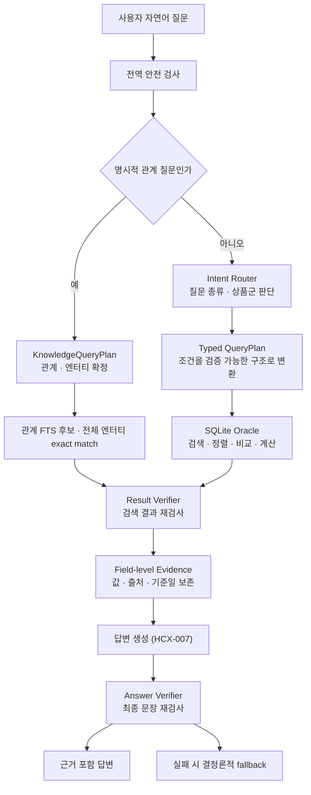

# finance_agent

금융상품 Agent의 질의 해석·검색·계산·검증·근거 생성 코드를 담는 Agent Core 작업공간.
전체 시스템 실행은 [루트 README](../../README.md), FastAPI 연동은
[Backend README](../fastapi_backend/README.md)를 따른다.

## 1. 역할

- 공식 금융상품 XLSX 감사와 정규화 (네 상품군 SQLite 생성)
- 국내채권·국내 ETF·ETN·해외 ETF·ETN·공모펀드 검색
- 상품 비교와 개수·평균·최솟값·최댓값·순위 계산
- 자연어 질문을 검증 가능한 Typed `QueryPlan`으로 변환
- 필드별 근거와 기준일 생성, 결과·최종 답변의 상품명·수치·순위·출처 검증
- 발행사·운용사·기초지수·자산유형·투자지역 관계 색인과 외부 근거 결합
- field registry에서 제출용 Ontology Turtle 5개 생성·검사

웹 화면, FastAPI route, Docker 운영은 이 디렉터리에 두지 않는다.

## 2. 처리 흐름



LLM은 수치 계산·필터·정렬·상품 순위·출처를 직접 만들지 않는다. LLM 없이도
검색·계산·검증·안전 답변 경로가 실행되도록 설계했다.

## 3. 지원 범위

| 영역 | 지원 내용 |
| --- | --- |
| 국내채권 | 검색·상세·비교·집계·날짜·신용등급·근거 검증 |
| 국내 ETF·ETN | 검색·상세·비교·집계·근거 검증 |
| 해외 ETF·ETN | 검색·상세·비교·집계·교차 상품군 검색·근거 검증 |
| 공모펀드 | 검색·비교·집계·근거 검증 |
| 관계 검색 | 발행사·운용사·기초지수·자산유형·투자지역 관계 색인, 전체 엔터티 exact match |
| 외부 근거 | 승인된 공식 출처만 HTTPS로 가져와 DB 후보를 **줄이는 방향으로만** 결합 |
| Backend 연동 | 요청·응답 DTO, 오류 adapter, JSON Schema |

## 4. 디렉터리 구조

```text
src/finance_agent/
├── packages/finance_agent_core/  # 설치 가능한 Agent Core Python 패키지 + 테스트
├── requirements/                 # base · dev · constraints (고정 버전)
├── scripts/sync-ontology.py      # field registry → ontology/*.ttl 생성 · 검사
└── artifacts/runtime/            # KURE 필드 의미 색인 v9 (런타임 입력)
```

## 5. 설치와 검증

저장소 루트에서:

```bash
python -m pip install -r requirements-dev.txt
( cd src/finance_agent/packages/finance_agent_core && python -m pytest -q )
python src/finance_agent/scripts/sync-ontology.py --check
```


## 6. 공식 데이터로 Agent Core만 실행

Docker 없이 한 상품군을 정규화하고 결정론적 Agent 경로를 확인하는 예시.

```bash
export FINANCE_DATA_DIR="/path/to/2.금융상품_20260824"
cd src/finance_agent

python -m finance_agent_core.storage --dataset bond --data-dir "$FINANCE_DATA_DIR"
python -m finance_agent_core.agent \
  --database artifacts/normalized/bond.sqlite3 \
  --provider mock \
  --output artifacts/e2e/bond-mock-response.json
```

`--dataset`은 `bond` · `domestic_etp` · `overseas_etp` · `fund`. 네 상품군을 한 번에 준비하고
FastAPI까지 띄우려면 [루트 README](../../README.md)의 Docker 실행을 사용한다.

## 7. Backend 연결 경계

Backend는 Agent 내부 SQL·검색·검증을 다시 구현하지 않고 다음 공개 계약만 사용한다.

- 요청 `BackendAgentRequest` · 응답 `BackendAgentResponse` — `finance_agent_core/contracts/backend.py`
- 실행 `RoutedFinanceAgent` · HTTP 변환 `execute_answer_request()` — `finance_agent_core/agent/`

evaluation/production에서는 코드·Prompt·Model·index·공식 데이터·Docker image가 같은
release인지 `AgentReleaseManifest`로 검증한다 (`finance_agent_core/release.py`).

## 8. LLM 사용 경계

- 평가·운영 LLM은 공식 규칙에 따라 HyperCLOVA X `HCX-007`로 제한한다
- `agent/providers/`의 mock·로컬 provider는 단위 테스트 전용이며, `evaluation`·`production`
  모드에서는 설정 단계에서 거부된다
- 검색·계산·검증은 provider와 분리되어 있어 모델과 무관하게 같은 결과를 재검사할 수 있다
