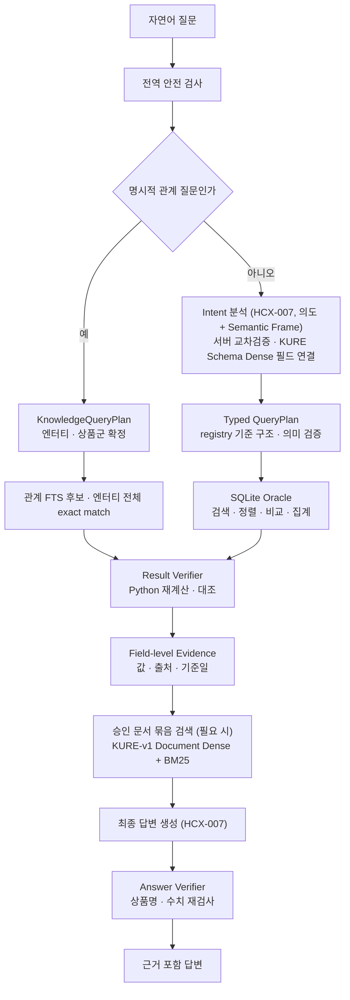

# finance_agent

금융상품 Agent의 질의 해석·검색·계산·검증·근거 생성 코드(Agent Core)를 담는 디렉터리.
전체 실행은 [루트 README](../../README.md), HTTP 제공은 [Backend README](../fastapi_backend/README.md),
패키지 내부 구조는 [finance_agent_core README](packages/finance_agent_core/README.md)를 따른다.

## 1. 역할

- 공식 금융상품 XLSX 감사·정규화와 네 상품군 SQLite 생성
- 국내채권·국내 ETF·ETN·해외 ETF·ETN·공모펀드 검색, 비교, 개수·평균·최솟값·최댓값·순위 계산
- 자연어 질문을 서버가 검증하는 Typed `QueryPlan`으로 변환
- 필드별 근거와 기준일 생성, 결과·최종 답변의 상품명·수치·순위·출처 검증
- 발행사·운용사·기초지수·자산유형·투자지역 관계 색인과 승인 문서 묶음 검색
- field registry에서 제출용 Ontology Turtle 5개 생성·검사

FastAPI route, Docker, 배포 스크립트는 `src/fastapi_backend/`에 있다.

## 2. 처리 흐름



LLM은 field·filter·정렬·개수·순위·출처를 만들지 않는다. Oracle 결과를 Verifier가 같은 규칙으로
재계산해 대조하고, 어긋나면 답하지 않는다.

## 3. 지원 범위

| 영역 | 지원 내용 |
| --- | --- |
| 국내채권 | 검색·상세·비교·집계·날짜·신용등급·근거 검증 |
| 국내 ETF·ETN | 검색·상세·비교·집계·근거 검증 |
| 해외 ETF·ETN | 검색·상세·비교·집계·교차 상품군 검색·근거 검증 |
| 공모펀드 | 검색·비교·집계·근거 검증 |
| 관계 검색 | 발행사·운용사·기초지수·자산유형·투자지역 관계 색인, 엔터티 전체 exact match |
| 외부 근거 | 승인·봉인된 공식 문서 258건(`approved_corpus_cache_only`)을 KURE-v1 Document Dense + BM25로 검색. DB 후보를 줄이는 방향으로만 결합하며 실시간 웹 검색은 사용하지 않는다 |
| Backend 연동 | 요청·응답 DTO, 오류 adapter, JSON Schema |

## 4. 디렉터리 구조

```text
src/finance_agent/
├── packages/finance_agent_core/  # 설치 가능한 Agent Core Python 패키지 + 테스트
├── requirements/                 # base · dev · constraints (고정 버전)
├── scripts/sync-ontology.py      # field registry → ontology/*.ttl 생성 · 검사
└── artifacts/runtime/schema-dense/  # KURE-v1 Schema Dense 색인 v9 (registry 1.8, 런타임 입력)
```

## 5. 설치와 검증

저장소 루트에서 실행한다. 테스트는 원천 데이터·네트워크·LLM 자격증명 없이 동작한다.

```bash
python -m pip install -r requirements-dev.txt
```

```bash
cd src/finance_agent/packages/finance_agent_core && python -m pytest -q
```

```bash
python src/finance_agent/scripts/sync-ontology.py --check
```

## 6. Docker 없이 데이터 준비

주최 측 XLSX 디렉터리에서 네 상품군 SQLite, 관계 색인, 관계 artifact를 한 번에 만든다.
원본 XLSX는 수정하지 않는다.

```bash
python -m finance_agent_core.storage.prepare \
  --data-dir /path/to/2.금융상품_20260824 \
  --output-dir src/finance_agent/artifacts/normalized
```

한 상품군만 만들 때는 `python -m finance_agent_core.storage --dataset bond --data-dir ...`
(`bond` · `domestic_etp` · `overseas_etp` · `fund`). 생성한 경로를 Backend의
`FINANCE_DB_*`·`FINANCE_RELATION_*` 환경변수로 지정한다.

## 7. Backend 연결 계약

Backend는 Agent 내부 SQL·검색·검증을 다시 구현하지 않고 다음 공개 계약만 사용한다.

| 계약 | 위치 |
| --- | --- |
| 요청 `BackendAgentRequest` · 응답 `BackendAgentResponse` | `finance_agent_core/contracts/backend.py` |
| 실행 `RoutedFinanceAgent` | `finance_agent_core/agent/routed_service.py` |
| HTTP 변환 `execute_answer_request()` | `finance_agent_core/agent/backend_adapter.py` |
| 릴리스 봉인 `AgentReleaseManifest` | `finance_agent_core/release.py` |

`evaluation`·`production`에서는 코드·Prompt·Model·색인·공식 데이터·Docker image가 같은 릴리스인지
`AgentReleaseManifest`의 SHA-256으로 검증하고, 하나라도 다르면 시작하지 않는다.

## 8. LLM과 외부 근거 경계

- 평가·운영 LLM은 HyperCLOVA X `HCX-007` 하나다. Intent 분석(의도 + Semantic Frame)과 최종
  답변 생성에만 쓰이며, `evaluation`·`production`에서 다른 provider는 설정 단계에서 거부된다
- 필드 의미 연결은 KURE-v1 Schema Dense 색인 v9, 문서 검색은 KURE-v1 Document Dense + BM25를
  CPU에서 실행한다. 색인은 릴리스에 해시로 결속된다
- 외부 근거는 승인·봉인된 문서 묶음만 조회한다. 공식 데이터와 외부 데이터가 충돌하면 공식 데이터를 우선한다
- 검색·계산·검증은 provider와 분리되어 있어 모델과 무관하게 같은 결과를 재검사할 수 있다
